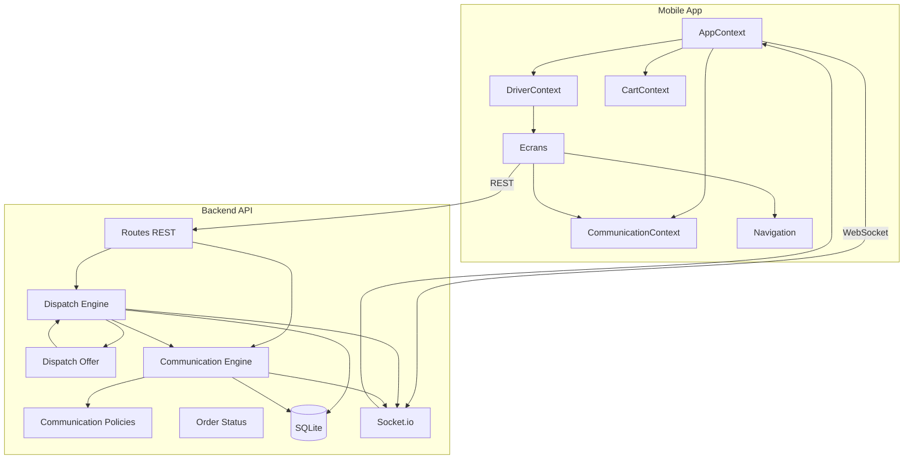
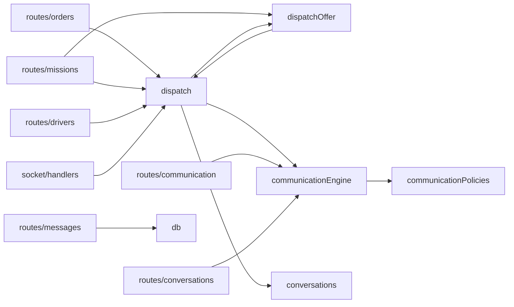
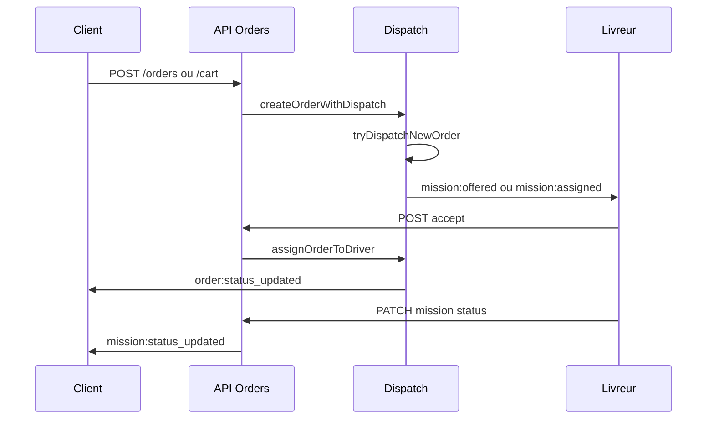

# Audit d'architecture Ma Zone — Préparation des prochains moteurs

**Date :** 13 juillet 2026  
**Périmètre :** Audit read-only — aucune modification de code  
**Rôle :** Évaluation architecturale avant Wallet Engine, QR Identity, Marketing Engine, Event Engine  
**Version projet auditée :** commit `mvp-pre-mac-restart-2026-07-12` + correctifs postérieurs

---

## Résumé exécutif

Ma Zone dispose d'une architecture **modulaire par organes** (Dispatch, Communication, Navigation) suffisamment mature pour un MVP stabilisé. Les récents raffinements métier (séparation livreur occupé / offre pending, `navigateToFreshHome`, annulation client) montrent une capacité d'évolution sans casser les moteurs centraux.

**Verdict : B — Quelques ajustements mineurs recommandés avant Wallet Engine.**

Deux points **Critiques** (autorisations API/socket, persistance des offres dispatch) doivent être traités avant tout moteur financier. Le Wallet Engine peut être ajouté comme **nouvel organe** sans modifier le cœur Dispatch ni Communication.

---

## 1. Vue d'ensemble de l'architecture

### 1.1 Stack technique

| Couche | Technologie | Rôle |
|--------|-------------|------|
| Mobile | Expo 56, React Native, React Navigation 7 | UI client / livreur / commerçant |
| Backend | Node.js, Express 4 | API REST |
| Temps réel | Socket.io 4 | Événements commandes, missions, chat |
| Données | SQLite (better-sqlite3), WAL | Persistance locale MVP |
| Auth | JWT (Bearer + socket handshake) | 3 rôles : client, driver, merchant |

### 1.2 Inventaire des organes

| Organe | Emplacement | Rôle | Maturité | Stabilité | Dette | Risques |
|--------|-------------|------|----------|-----------|-------|---------|
| **Dispatch Engine** | `backend/src/lib/dispatch.js`, `dispatchOffer.js`, `config/dispatch.js` | Attribution livreur, offres 20s, annulation, création commande+mission | Mature | Bonne (post-raffinement métier) | Circulaire dispatch↔offer ; timeouts mémoire | Restart serveur ; scaling horizontal |
| **Communication Engine** | `communicationEngine.js`, `communicationPolicies.js`, `unread.js` | Threads durable/éphémère, messages, unread, archival | Mature | Bonne | Triple pile API messages legacy | Duplication routes |
| **Order/Mission Engine** | `orderStatus.js`, `orders.js`, routes orders/missions | Cycle de vie commande et mission | Fonctionnel | Moyenne | Double vocabulaire statuts | Désync order/mission |
| **Socket Layer** | `socket/handlers.js` + émissions dans lib/ | Rooms, driver online, typing, propagation | Fonctionnel | Moyenne | Join rooms sans ACL | Fuite rooms, broadcast global |
| **SQLite / DB** | `db/index.js` | Schéma, migrations boot, seed | Fonctionnel | Moyenne | Migrations rejouées ; pas de version table | Croissance données |
| **API REST** | `routes/*.js` (14 modules) | ~70 endpoints par rôle | Mature | Bonne | PATCH order permissif | Auth ressource |
| **AppContext** | `mobile/context/AppContext.js` | Auth, socket lifecycle | Stable | Bonne | driver:offline pour tous rôles | — |
| **DriverContext** | `mobile/context/DriverContext.js` | Online, mission, offre pending | Stable | Bonne | notifications non consommées | Legacy screens |
| **CommunicationContext** | `mobile/context/CommunicationContext.js` | Threads, unread | Stable | Bonne | Map threads non bornée | — |
| **CartContext** | `mobile/context/CartContext.js` | Panier serveur | Stable | Bonne | Pas invalidation socket | — |
| **Navigation** | `navigation/index.js`, `navigateToFreshHome.js` | Arbres client/merchant/driver | Mature | Bonne | ChatScreen 10× ; cross-nav fragile | — |
| **Chat UI** | `ChatScreen`, `openCommunication.js`, `ChatPresentation.js` | Messagerie unifiée | Mature | Bonne | Support hors engine | — |
| **Promotions** | `lib/promotions.js`, routes | Flash promos, pricing | Fonctionnel | Moyenne | — | — |
| **Geo** | `lib/geo.js` | Distance, ETA | Présent | Non utilisé dispatch | Dispatch sans géo | — |

### 1.3 Schéma global — communication entre organes

---

## 2. Audit de chaque moteur

### 2.1 Dispatch Engine

**Responsabilités :** Sélection livreur, proposition offre (mode OFFER_MODE), assignation transactionnelle, annulation client, re-dispatch, création commande+mission.

**Forces :**
- Séparation explicite `driverHasAcceptedMission` / `driverHasPendingOffer` / `driverIsBusyForNewOffer`
- Transaction SQLite atomique dans `assignOrderToDriver`
- Mode offre configurable via `DISPATCH_OFFER_MODE`
- Re-dispatch après cancel, refuse, expire, delivery

**Faiblesses :**
- `findAvailableDriver` n'exclut pas offres pending (asymétrie avec `driverIsBusyForNewOffer`)
- Timeouts offre en `Map` mémoire — perdus au restart
- Dépendance circulaire `dispatch.js` ↔ `dispatchOffer.js` (require lazy)
- Pas de dispatch géographique malgré `geo.js`

**Découplage :** Moyen — `io` passé en paramètre partout ; couplé à DB, conversations, communication archival.

**Dette :** `driverHasActiveMission` déprécié ; statuts legacy dans requêtes SQL.

**Recommandations :** Important — persister `offer_expires_at` + job expiry ; Confort — aligner `findAvailableDriver` sur busy rules.

---

### 2.2 Communication Engine

**Responsabilités :** Résolution threads (durable client↔commerce, éphémère mission), envoi messages, unread, archival éphémère à la fin de commande.

**Forces :**
- Couche policies séparée (`communicationPolicies.js`)
- Modèle durable vs éphémère clair
- `openCommunication` côté mobile = point d'entrée unique
- `ChatPresentation` distingue visuellement les modes

**Faiblesses :**
- Trois chemins API : `/api/messages` (legacy), `/api/conversations`, `/api/communication`
- Support driver/merchant hors engine (`support_threads`)
- `sendMessage` requiert parfois contexte order même pour durable

**Découplage :** Bon au sein de l'engine ; faible envers routes dupliquées.

**Recommandations :** Important — déprécier `/api/messages` ; Confort — unifier support dans engine.

---

### 2.3 Navigation (mobile)

**Responsabilités :** Arbres par rôle (client Drawer+Tabs, merchant Tabs, driver Tabs), routing écrans.

**Forces :**
- Séparation claire client / merchant / driver
- `navigateToFreshHome` documenté, SRP navigation pure
- Drawer client enrichi (profil, FAQ, paramètres placeholders)

**Faiblesses :**
- `OrderTracking` dans HomeStack ET CartStack
- `ChatScreen` enregistré dans 10 stacks
- Navigation cross-drawer fragile (`OrderHistory` → `OrderTracking`)
- ~10 écrans legacy orphelins

**Recommandations :** Confort — retirer écrans orphelins ; Important — contrat navigation cross-stack documenté.

---

### 2.4 CommunicationContext

**Responsabilités :** Index threads, compteurs unread, sync socket `conversation:updated` / `message:new`.

**Forces :** Badge onglet Messagerie centralisé ; skip unread si conversation active.

**Faiblesses :** Map threads croît sans prune ; lookup O(n).

**Recommandations :** Confort — index par clé composite.

---

### 2.5 DriverContext

**Responsabilités :** État online, `activeMission`, `pendingOffer`, bridge `onMissionAssigned`.

**Forces :** Distinction offre vs mission acceptée ; ref anti-stale offer.

**Faiblesses :** `notifications` chargées mais inbox refetch ; APIs `acceptMissionOffer` inutilisées.

**Recommandations :** Confort — consolider notifications.

---

### 2.6 Chat

**Responsabilités :** UI messagerie unifiée (`ChatScreen`), résolution thread (`openCommunication`), présentation (`ChatPresentation`).

**Forces :** Un seul écran chat pour rôles principaux ; join room `conv_*`.

**Faiblesses :** Support chats séparés ; legacy `resolveConversation` dans écrans orphelins.

---

### 2.7 Gestion des commandes

**Backend :** `routes/orders.js`, `createOrderWithDispatch`, checkout cart, cancel.

**Forces :** Cancel transactionnel + restock + archival + re-dispatch.

**Faiblesses :** `PATCH /:id/status` sans contrôle ownership/rôle ; `GET /:id` sans ownership.

**Risque : Critique** — autorisation.

---

### 2.8 Gestion des missions

**Backend :** `routes/missions.js` — accept, refuse, status progression livreur.

**Forces :** Offer mode intégré ; chain dispatch après delivery.

**Faiblesses :** Sync manuelle statut order ↔ mission dans PATCH status.

---

### 2.9 Socket temps réel

**Événements clés :** `order:status_updated`, `mission:offered`, `mission:assigned`, `mission:cancelled`, `conversation:updated`, `message:new`.

**Forces :** Rooms nommées cohérentes ; JWT à la connexion.

**Faiblesses :** `join:order` / `join:conversation` sans vérification ACL ; `io.emit` global pour stock/catalogue.

**Risque : Critique** — rooms ouvertes à tout utilisateur authentifié.

---

### 2.10 Gestion des états (mobile)

**Pattern :** Contextes React + état local par écran + sockets.

**Forces :** Pas de sur-engineering Redux ; contextes par domaine.

**Faiblesses :** Pas de contexte « commande active client » ; listeners socket dupliqués par écran.

---

### 2.11 Base SQLite

**Tables :** 18+ (users, stores, products, orders, missions, conversations, messages, cart, favorites, promotions, notifications, support…).

**Forces :** WAL, FK, migrations incrémentales, merge conversations doublons.

**Faiblesses :** Migrations data rejouées chaque boot ; pas de `schema_version`.

**Recommandations :** Important avant scale — table version ; Confort — geo index.

---

### 2.12 API backend

**14 modules routes, ~70 endpoints.**

**Forces :** `requireRole` sur endpoints sensibles ; structure modulaire.

**Faiblesses :** Incohérence ownership checks ; secret JWT fallback dev.

---

## 3. Cartographie des dépendances

### 3.1 Composants critiques (impact maximal si modifiés)

| Composant | Utilisé par | Utilise | Si modifié |
|-----------|-------------|---------|------------|
| `dispatch.js` | orders, missions, drivers, socket | db, orderStatus, conversations, communicationEngine, dispatchOffer | Tout le flux commande/livreur |
| `communicationEngine.js` | communication, conversations, dispatch | policies, unread, db | Toute la messagerie |
| `db/index.js` | Tout le backend | — | Tout |
| `AppContext` | Tous contextes mobile | socket, storage | Toute l'app |
| `orderStatus.js` | dispatch, orders, mobile config | — | Règles annulation, affichage |

### 3.2 Diagramme de dépendances simplifié

### 3.3 Mobile — qui utilise quoi

| Consommateur | Dispatch (via API) | Communication | Navigation reset |
|--------------|-------------------|---------------|------------------|
| OrderTrackingScreen | cancel, track | openCommunication | navigateToFreshHome |
| DriverHomeScreen | accept/refuse offer | openCommunication | — |
| CartScreen | checkout | — | — |
| ClientMessagingHome | — | CommunicationContext | — |

---

## 4. Audit qualité — notes sur 10

| Critère | Note | Justification |
|---------|------|---------------|
| **Modularité** | 7/10 | Organes nommés et fichiers dédiés ; mais routes dupliquées et legacy coexistants |
| **Découplage** | 6/10 | dispatch↔offer circulaire ; io passé partout ; écrans couplés aux sockets |
| **Lisibilité** | 8/10 | Fonctions métier explicites (driverHasAcceptedMission…) ; commentaires ciblés |
| **Maintenabilité** | 7/10 | MVP documenté ; dette legacy screens ; migrations boot |
| **Évolutivité** | 7/10 | Ajout organe Wallet faisable ; SQLite et socket global limitent scale |
| **Robustesse** | 6/10 | Transactions OK ; auth gaps ; offer timeouts volatiles |
| **Simplicité** | 8/10 | Pas de sur-abstraction ; stack lisible pour MVP |
| **Cohérence** | 6/10 | Double statuts ; triple messaging ; deux thèmes mobile |

**Moyenne pondérée : 6,9/10** — solide pour MVP, perfectible avant scale.

---

## 5. Audit des responsabilités

### 5.1 Composants exemplaires (un organe = une responsabilité)

| Composant | Pourquoi |
|-----------|----------|
| `navigateToFreshHome.js` | Navigation pure, documenté, sans logique métier |
| `orderStatus.js` | Règles statut et annulation centralisées |
| `communicationPolicies.js` | ACL et lifecycle séparés du transport |
| `NewCourseOfferModal.js` | Présentation pure ; logique dans DriverHomeScreen + backend |
| `openCommunication.js` | Point d'entrée unique vers Chat |

### 5.2 Composants qui font trop

| Composant | Problème |
|-----------|----------|
| `dispatch.js` | Dispatch + cancel + create order + emit socket + archive comm |
| `routes/orders.js` | Création, cart, cancel, patch status, notifications merchant |
| `db/index.js` | DDL + migrations + seed + merge data |
| `DriverHomeScreen.js` | Online, offer timer, mission drawer, chat, map |

### 5.3 À séparer (futur, pas urgent MVP)

- Extraire `OrderCancellationService` de dispatch (Confort)
- Extraire `SocketEmitter` order/mission (Confort)
- Retirer legacy `messages.js` route (Important)

---

## 6. Single Source of Truth

| Domaine | SSOT | Statut | Amélioration possible |
|---------|------|--------|----------------------|
| Statuts commande (règles) | `backend/orderStatus.js` | Correct | Mobile `CANCELLABLE_ORDER_STATUSES` doit rester aligné |
| Labels statuts UI | `mobile/config.js` | Partiel | Alias masquent hétérogénéité backend |
| Mission active livreur | `DriverContext.activeMission` | Correct | Legacy ActiveMissionScreen en parallèle |
| Offre pending livreur | `DriverContext.pendingOffer` | Correct | — |
| Threads / unread | `CommunicationContext` | Correct | Support hors context |
| Reset accueil client | `navigateToFreshHome` + `HomeScreen.reset` | Correct | — |
| Panier | `CartContext` + API `/cart` | Correct | — |
| Auth / socket | `AppContext` | Correct | — |
| Dispatch busy rules | `dispatch.js` (3 fonctions) | Correct | `findAvailableDriver` à aligner |
| Conversations | `communicationEngine` | Correct | Legacy `/messages` concurrent |

---

## 7. Audit des flux utilisateurs

### 7.1 Client — commande → livraison

**Cohérence :** Bonne post-correctifs. **Risques :** navigation CartStack vs HomeStack ; pas de bannière commande active globale.

### 7.2 Client — annulation → nouvelle commande

**Flux :** confirmAction → POST cancel → `navigateToFreshHome` → accueil reset.

**Stabilité :** Bonne (T10 validé backend). **Risque :** threads durable conservés (attendu).

### 7.3 Client — messagerie

Durable via MesCommerces ; éphémère via OrderTracking/Driver selon phase livraison.

**Risque :** Confort — support placeholder.

### 7.4 Livreur — proposition → livraison

Offer 20s → accept/refuse → MissionDrawer steps → PATCH statuses → delivery → assignPendingOrdersToDriver.

**Stabilité :** Bonne. **Risque :** timeout mémoire si restart pendant offre.

### 7.5 Commerçant — commande & messagerie

`MerchantOrdersScreen` + sockets `order:*` ; inbox merchant.

**Stabilité :** Fonctionnelle. **Risque :** Confort — pas de lien direct dispatch côté merchant UI.

---

## 8. Scénarios de non-régression

### 8.1 Couverts (documentés / testés)

| ID | Scénario |
|----|----------|
| T1 | Nouvelle commande après livraison → accueil reset |
| T2 | Nouvelle commande depuis CartStack |
| T3–T4 | Annulation web / native |
| T5 | Bouton annuler disparaît à picked_up |
| T6 | Cancel avec offre offered → livreur libéré |
| T7 | Cancel livreur accepted → re-dispatch |
| T8 | Dispatch post-cancel |
| T9 | Archival éphémère post-cancel |
| T10 | Cycle complet annulation → nouvelle → livraison → nouvelle |
| — | Accept offre après raffinement driverHasAcceptedMission |
| — | Refuse / timeout offre 20s |

### 8.2 Manquants

| Scénario | Priorité |
|----------|----------|
| Restart backend pendant offre active | Important |
| Client tente join room order d'un autre | Critique |
| PATCH order status par utilisateur non autorisé | Critique |
| Multi-commandes simultanées même client | Important |
| Driver offline/online race HTTP vs socket | Important |
| Conversation durable pendant commande annulée | Confort |
| Performance 100+ commandes pending | Confort |

---

## 9. Préparation aux futurs moteurs

### 9.1 Wallet Engine

| Question | Réponse |
|----------|---------|
| Architecture prête ? | **Partiellement** — pas de tables wallet/payment |
| Modifier moteur existant ? | **Minime** — orders.total_price, missions earnings ; hooks post-delivery |
| Nouvel organe seul ? | **Oui** — `walletEngine.js` + routes `/wallet` + `WalletContext` mobile |
| Bloqueur | Auth/ownership (Critique) avant argent réel |

### 9.2 QR Identity

| Question | Réponse |
|----------|---------|
| Prêt ? | **Oui structurellement** — organe additif |
| Modifier existant ? | Missions (scan preuve livraison) — extension PATCH status |
| Nouvel organe | `qrIdentity.js` + génération/validation tokens |

### 9.3 Marketing Engine

| Question | Réponse |
|----------|---------|
| Prêt ? | **Partiellement** — `promotions.js` existe |
| Modifier existant ? | Enrichir promotions ; Event Engine pour campagnes |
| Nouvel organe | `marketingEngine.js` pour règles, ciblage, A/B |

### 9.4 Event Engine

| Question | Réponse |
|----------|---------|
| Prêt ? | **Non** — pas de bus d'événements interne |
| Modifier existant ? | Remplacer appels socket directs par publish (long terme) |
| Nouvel organe | `eventBus.js` — écoute dispatch, orders, communication |

### 9.5 Stock Engine (futur)

| Question | Réponse |
|----------|---------|
| Prêt ? | **Partiellement** — stock dans products + restock cancel |
| Modifier existant ? | Extraire de products/orders vers engine dédié |
| Nouvel organe | Recommandé pour réservations, seuils, multi-store |

---

## 10. Audit des risques

### Critique

1. **Autorisation API** — `PATCH /orders/:id/status`, `GET /orders/:id` sans ownership
2. **Socket room join** — tout JWT peut rejoindre `order_*` / `conv_*`
3. **JWT secret fallback** — `mazone-secret-dev-2024` si env absent

### Important

4. Offer timeouts en mémoire uniquement
5. Triple pile messaging (`/messages`, `/conversations`, `/communication`)
6. `findAvailableDriver` vs `driverIsBusyForNewOffer` incohérence
7. Migrations SQLite à chaque boot
8. Pas de Redis adapter socket — scaling horizontal bloqué
9. Désync potentielle statuts order/mission

### Confort

10. Écrans mobile legacy orphelins
11. Double thème COLORS / THEME
12. ChatScreen multi-stack
13. `geo.js` non utilisé par dispatch
14. Notifications driver dupliquées context/inbox
15. Global `io.emit` catalogue/stock

---

## 11. Audit philosophie produit

| Principe | Respect | Dérive |
|----------|---------|--------|
| Un moteur = une responsabilité | **Oui** globalement | dispatch.js et routes/orders un peu larges |
| Organes spécialisés | **Oui** | Legacy messages non retiré |
| Séparation UI / métier | **Oui** | Quelques règles statut dupliquées mobile |
| Évolutivité | **Oui** | SQLite limite |
| Simplicité | **Oui** | Pas de micro-services prématurés |
| Réutilisation | **Oui** | openCommunication, navigateToFreshHome |
| Pas de duplication logique | **Partiel** | Statuts, messaging, notifications |

**Conclusion philosophie :** Le projet reste aligné sur ses principes fondateurs. Les dérives sont principalement des **artefacts de migration MVP** (legacy) plutôt qu'une dérive architecturale fondamentale.

---

## 12. Verdict final

### Choix : **B — Quelques ajustements mineurs sont recommandés avant Wallet Engine**

### Justification

**Pour commencer Wallet (arguments A) :**
- Organes Dispatch et Communication stables et récemment renforcés
- Wallet peut être un **nouvel organe** sans toucher le cœur transactionnel
- Documentation et patterns (SSOT, navigateToFreshHome) matures
- Tests T1–T10 couvrent les flux critiques commande

**Pour attendre refonte (arguments C) :**
- Failles auth sur orders et socket rooms — **inacceptables pour argent réel**
- Pas de persistance offre au restart — risque incident ops

**Synthèse B :**
- **Autoriser la conception et le développement du Wallet Engine** en parallèle, comme organe isolé (`wallet/`, tables dédiées, routes dédiées)
- **Bloquer la mise en production paiements réels** jusqu'à correction des 3 points Critiques (auth API, auth socket rooms, secret JWT)
- **Avant intégration Wallet ↔ Orders :** traiter Important #4 (offer persistence) si cancel/refund touche dispatch

### Feuille de route recommandée

| Phase | Action | Classification |
|-------|--------|----------------|
| 0 | Corriger auth orders + socket rooms + JWT env | Critique |
| 1 | Démarrer Wallet Engine (schéma, API, UI placeholder) | — |
| 2 | Persister offer timeouts / expiry job | Important |
| 3 | Déprécier `/api/messages` | Important |
| 4 | QR Identity organe | — |
| 5 | Marketing / Event engines | — |

---

## Annexes

### A. Fichiers clés backend

- `backend/src/lib/dispatch.js` — Dispatch Engine
- `backend/src/lib/dispatchOffer.js` — Offer mode
- `backend/src/lib/communicationEngine.js` — Communication Engine
- `backend/src/lib/communicationPolicies.js` — Policies
- `backend/src/lib/orderStatus.js` — SSOT statuts
- `backend/src/db/index.js` — SQLite
- `backend/src/socket/handlers.js` — Socket
- `backend/src/routes/*.js` — API

### B. Fichiers clés mobile

- `mobile/src/context/*.js` — État global
- `mobile/src/navigation/index.js` — Navigation
- `mobile/src/navigation/navigateToFreshHome.js` — Reset accueil
- `mobile/src/communication/openCommunication.js` — Entrée chat
- `mobile/src/screens/client/OrderTrackingScreen.js` — Flux commande client
- `mobile/src/screens/driver/DriverHomeScreen.js` — Flux livreur

### C. Documents projet connexes

- `CURRENT_ARCHITECTURE.md`
- `ORGANE_COMMUNICATION.md`
- `PLAN_STABILISATION_MVP_PHASE_1.md`
- `RAPPORT_CORRECTION_NOUVELLE_COMMANDE_ANNULATION.md`

---

*Audit généré le 13 juillet 2026 — lecture seule, aucune modification de code.*
