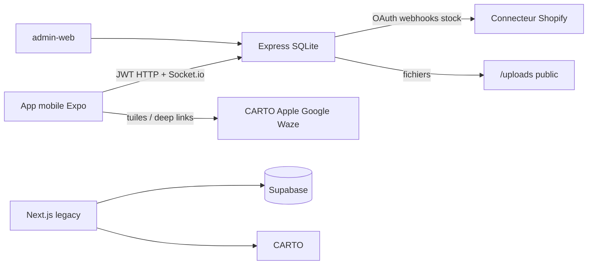

# DOSSIER COMPLET — Conformité réglementaire et sécurité applicative Ma Zone

| | |
|---|---|
| **Nature** | Document de travail regroupé — **PAS une FD** |
| **Date** | 2026-07-26 |
| **Usage** | **Document unique à envoyer / lire** (Adam → Reda). Les fragments d'origine sont archivés dans `archive-fragments/`. |
| **Fiche Cursor** | [FD-003](../../FICHE_DISCUSSION/FD-003-conformite-reglementaire-securite-applicative.md) — liste maîtresse « inattaquable » + séquencement pour les agents |
| **Hors dossier** | Gabarits juridiques : `docs/legal/` · CSV ASVS : `references/OWASP_ASVS_5.0.0_fr.csv` · Méthode portable : `docs/METHODE-AUDIT-CONFORMITE-APP.md` + `docs/PROMPT-AUDIT-CONFORMITE-COMPLET.md` |

> Ce n'est **pas** un avis juridique ni une certification ASVS.
> Les textes légaux doivent être validés par un avocat avant publication.

## Composition du dossier

0. **PARTIE 0 — Synthèse exécutive**
1. **PARTIE 1 — Plan de mise en sécurité et conformité**
2. **PARTIE 2 — Décisions à trancher**
3. **PARTIE 3 — Surfaces exposables (point de vue attaquant)**
4. **PARTIE 4 — Inventaire exhaustif des entrées**
5. **PARTIE 5 — Audit sécurité (ANSSI + OWASP)**
6. **PARTIE 6 — OWASP ASVS 5.0 (niveau L2)**
7. **PARTIE 7 — Matrice d'écarts CNIL (18 fiches)**
8. **PARTIE 8 — Registre des traitements (art. 30)**
9. **PARTIE 9 — Cartographie des données**
10. **PARTIE 10 — Obligations légales (LCEN, conso, DSA)**

## Comment lire (Reda)

1. **Partie 0** — verdict et top écarts (5 min)
2. **Partie 1** — ce qu'il faut faire, dans quel ordre
3. **Partie 2** — décisions à trancher ensemble
4. **Parties 3–4** — ce qu'un attaquant voit (labToken, inventaire champ par champ)
5. **Parties 5–10** — détail technique et juridique si besoin

---


# PARTIE 0 — Synthèse exécutive

---

## Synthèse exécutive — Audit de conformité réglementaire et sécurité applicative Ma Zone

| | |
|---|---|
| **Date** | 2026-07-26 (complété avec OWASP ASVS 5.0.0, puis avec la revue des surfaces exposables) |
| **Périmètre** | Dépôt complet (`mobile/`, `backend/`, `src/`, `supabase/`, `admin-web/`) |
| **Produit vivant** | `mobile/` + `backend/` Node/SQLite (FD-000) |
| **Statut déploiement** | Prototype local — **pas en production** |
| **Montage** | Place de marché d'intermédiation (hypothèse actée) |
| **Entité juridique** | Pas encore immatriculée → gabarits `docs/legal/` |
| **Méthode** | [`docs/METHODE-AUDIT-CONFORMITE-APP.md`](../../docs/METHODE-AUDIT-CONFORMITE-APP.md) |
| **Fiche de discussion** | [FD-003](../../FICHE_DISCUSSION/FD-003-conformite-reglementaire-securite-applicative.md) |

> Ce document n'est **pas** un avis juridique et ne vaut pas certification de sécurité. Les textes légaux doivent être validés par un professionnel du droit ; une attestation ASVS exige une vérification par un tiers indépendant.

---

## Verdict en une phrase

Ma Zone a **durci son socle technique** avec le chantier E0–E8 (secrets, CORS, contrôle d'accès sur les commandes, helmet, limitation de débit, coffre chiffré, intégration continue), mais reste **non conforme sur quatre fronts simultanés** : le corpus juridique est inexistant, les droits des personnes ne sont pas implémentés, le cycle de vie des comptes présente des écarts bloquants au regard de l'OWASP ASVS niveau 2, et — écart découvert en dernier — **des outils de laboratoire et des modes de démonstration restent actifs dans du code livrable**, au point qu'un simple lien suffit à ouvrir une session.

### La chose à retenir avant toute autre

`mobile/src/context/AppContext.js` accepte un jeton de session passé dans une URL (`mazone://lab?labToken=…`), sans aucune garde de production. C'est l'écart le plus grave de l'audit, et il n'était visible sous aucun des angles précédents : ce n'est pas un bug, c'est un outil interne qui n'a jamais été retiré du build. Voir Partie 3 (ce dossier) § S-01.

---

## Référentiels croisés

| Référentiel | Couverture | Document |
|-------------|-----------|----------|
| Guide RGPD du développeur (CNIL) — 18 fiches | Intégrale | Partie 7 |
| **OWASP ASVS 5.0.0 — 345 exigences, 17 chapitres** | **Niveau L2 visé** | Partie 6 |
| OWASP Cheat Sheet Series | Ciblée | Partie 5 |
| ANSSI — standards de sécurité côté navigateur (R1–R63) | Applicable web | Partie 5 |
| LCEN, Code de la consommation, DSA | Intégrale | Partie 10 |
| RGPD — registre article 30 | Intégrale | Partie 8 |
| Revue orientée attaquant (bundles, deep links, entrées, modes cachés) | Intégrale | Partie 3 |

---

## Score par domaine et par métier

| Domaine | Note | Métier concerné | Commentaire |
|---------|------|-----------------|-------------|
| Architecture et qualité de code | **A−** | Développeur | 349 tests, lois vérifiées en CI, OpenAPI, séparation en couches |
| Sécurité — socle et secrets | **B+** | Cybersécurité | Fort progrès E0 ; coffre AES-GCM exemplaire |
| Sécurité — comptes et sessions | **D** | Cybersécurité | Ni politique de mot de passe, ni changement, ni révocation |
| Sécurité — fichiers et messagerie | **D−** | Cybersécurité | Téléversements non filtrés, messagerie sans contrôle d'accès |
| Sécurité — surfaces exposables | **D−** | Cyber / Dev | Laboratoire actif en build livrable, démonstration web sans authentification, identifiants d'administration dans le bundle |
| Validation des entrées | **D** | Développeur | Un seul champ sur vingt impose une limite de longueur |
| Journalisation et détection | **D** | DevOps / Cybersécurité | Événements de sécurité non tracés |
| Exploitation et déploiement | **C** | DevOps | Runbook sérieux, mais rien de déployé ni TLS ni sauvegarde testée |
| Droits des personnes (RGPD) | **D** | Juriste / DPO | Effacement, portabilité et consentement absents |
| Information des utilisateurs | **F** | Juriste / DPO | Aucune mention légale ni politique dans l'interface |
| Obligations e-commerce et DSA | **F** | Juriste / DPO | Bloquant avant ouverture publique |
| Gouvernance et documentation | **C+** | Transverse | Registre créé par cet audit ; AIPD à trancher |

---

## Ce qui s'est amélioré depuis le pré-audit du 25/07

| Avant | Maintenant, vérifié dans le code |
|-------|----------------------------------|
| JWT avec repli `mazone-secret-dev-2024` | Arrêt au démarrage en production, secrets historiques refusés (`config/env.js`) |
| CORS ouvert à toutes les origines | Liste blanche obligatoire en production, `*` refusé |
| Commandes et salons temps réel sans contrôle | `lib/access.js` plus tests dédiés `test/security/access.test.js` |
| Ni helmet ni limitation de débit | Présents, avec 10 requêtes par minute sur l'authentification |
| Aucun test, aucune intégration continue | 349 tests et un workflow qui vérifie les lois d'architecture |
| Secrets d'intégration en clair | Coffre AES-256-GCM avec effacement au débranchement |
| Bac à sable activable partout | Refusé au démarrage si `NODE_ENV=production` |

Ce progrès est réel et mérite d'être dit : le projet a réglé en une semaine la majorité des écarts d'infrastructure que le pré-audit avait identifiés.

---

## Les dix-huit écarts bloquants

Classés par gravité décroissante. Le détail « pourquoi c'était vulnérable / ce que fera la nouvelle version » figure dans Partie 5, Partie 6 et Partie 3.

Les six premiers sont les **portes ouvertes par conception**, découvertes par la revue orientée attaquant. Ils passent devant le reste pour une raison simple : leur correction demande une journée, et ils ferment trois scénarios d'attaque complets qui ne nécessitent même pas de compte.

| # | Écart | Métier | Référentiel | Priorité |
|---|-------|--------|-------------|----------|
| 1 | Session ouverte par simple lien (`labToken` actif en build livrable) | Cyber | ASVS V7.2, V13.4.1 | P0 |
| 2 | Authentification web contournée par défaut sans configuration Supabase | Cyber | ASVS V13.4.1 | P0 |
| 3 | Identifiants d'administration préremplis et affichés dans le bundle | Cyber | ASVS V6.3.2 | P0 |
| 4 | Connexion administrateur sans limitation de débit dédiée | Cyber | ASVS V6.3.1 | P0 |
| 5 | Rôle non vérifié malgré la session, données non filtrées par propriétaire (web) | Cyber | ASVS V8.2.1–2 | P0 |
| 6 | Injection HTML dans les marqueurs de carte (XSS stockée) | Cyber | ASVS V1.2.1 | P0 |
| 7 | Messagerie de commande lisible et inscriptible par n'importe quel compte | Cyber | ASVS V8.2.2 | P0 |
| 8 | Aucun document légal accessible dans l'application | Juriste | LCEN, RGPD art. 12–14 | P0 |
| 9 | Ni suppression de compte ni export de données | Juriste / Dev | RGPD art. 17 et 20 | P0 |
| 10 | Téléversements sans filtrage, servis sans authentification | Cyber | ASVS V5.2.2, V5.3.1 | P0 |
| 11 | Aucune politique de mot de passe côté serveur | Cyber | ASVS V6.2.1 | P0 |
| 12 | Changement de mot de passe impossible | Cyber / Dev | ASVS V6.2.2 | P0 |
| 13 | Aucune récupération de compte (mot de passe oublié) | Dev / Produit | ASVS V6.4.1 | P0 |
| 14 | Déconnexion sans révocation serveur, jeton valable 30 jours | Cyber | ASVS V7.4.1 | P0 |
| 15 | Inscription sans information ni acceptation | Juriste | RGPD art. 13, CNIL 12 et 15 | P0 |
| 16 | TLS et WSS non déployés | DevOps | ASVS V12.1.1, V4.4.1, ANSSI R1 | P0 en production |
| 17 | Événements de sécurité non journalisés | DevOps / Cyber | ASVS V16.3.1 et V16.3.2 | P1 |
| 18 | Durées de conservation non définies, aucune purge | Juriste / Dev | RGPD art. 5-1-e, CNIL 14 | P1 |

---

## Le paradoxe à retenir

Le projet protège **très bien** les secrets des commerçants — coffre chiffré, HMAC à temps constant, purge au débranchement, vérification en intégration continue — et **très mal** les comptes des habitants : mot de passe d'un caractère accepté, impossible à changer, session irrévocable pendant trente jours, et conversation privée lisible par n'importe quel inscrit.

L'explication est structurelle, pas fautive : le chantier E0–E8 portait sur l'orchestration et l'interopérabilité, et il a traité rigoureusement les risques de **son** périmètre. Le cycle de vie des comptes citoyens n'était simplement dans le périmètre d'aucun chantier depuis le début du projet.

Le second paradoxe est du même ordre. Le projet a mis en place un garde-fou remarquable — le backend **refuse de démarrer** en production si le bac à sable est activé — puis a laissé le mécanisme d'imitation vivre côté mobile, sans aucune garde équivalente. La protection existe, elle a été pensée, et elle s'arrête à la frontière du backend. C'est exactement le genre d'écart qu'une revue de code ne voit pas, parce que chaque fichier pris isolément est correct.

---

## Documents de cet audit

| Fichier | Contenu |
|---------|---------|
| Partie 1 (ce dossier) | Feuille de route complète P0 / P1 / P2 (ex-PLAN-TRAVAIL) |
| Partie 4 (ce dossier) | Inventaire champ-par-champ UI + API + stockage (passe hacker) |
| Partie 8 (ce dossier) | Registre article 30 — neuf traitements |
| Partie 9 (ce dossier) | Tables, flux, sous-traitants |
| Partie 7 (ce dossier) | Les 18 fiches CNIL confrontées au code |
| Partie 5 (ce dossier) | ANSSI et OWASP, format pourquoi / nouvelle version |
| Partie 10 (ce dossier) | LCEN, consommation, DSA, médiateur |
| Partie 6 (ce dossier) | Les 17 chapitres ASVS, niveau L2 |
| Partie 3 (ce dossier) | **Revue orientée attaquant** — bundles, deep links, entrées utilisateur, modes cachés (S-01 à S-21) |
| Partie 2 (ce dossier) | Décisions bloquantes |
| [`docs/legal/`](../../docs/legal/) | Sept gabarits juridiques à champs variables |
| [FD-003](../../FICHE_DISCUSSION/FD-003-conformite-reglementaire-securite-applicative.md) | Fiche de discussion — **liste maîtresse de 97 items** (§16) |
| [references/OWASP_ASVS_5.0.0_fr.csv](./references/OWASP_ASVS_5.0.0_fr.csv) | Référentiel ASVS 5.0.0 FR (345 exigences) |

---

## Liste maîtresse — ce qui manque pour être défendable

**97 items** inventoriés dans [FD-003 §16](../../FICHE_DISCUSSION/FD-003-conformite-reglementaire-securite-applicative.md) :

| Métier | Items | Focus |
|--------|------:|-------|
| Développeur | 20 | Compte, validation, tests, SecureStore, consents |
| Cybersécurité | 18 | Messagerie, téléversements, sessions, test d'intrusion, journaux |
| DevOps | 18 | TLS, sauvegardes restaurées, audit en CI, supervision, sous-traitance infra |
| Juriste / DPO | 24 | Corpus légal, AIPD, sous-traitants, DSA, médiateur |
| Surfaces exposables | 17 nouveaux | Laboratoire, mode démonstration, entrées, journaux clients |

Dont ~**41 P0**. Définition d'« inattaquable » = tous les P0 cochés + 18 critères FD-003 §12 + test d'intrusion + corpus validé par un avocat + AIPD tranchée.

Détail ASVS : Partie 6 (ce dossier). Détail attaquant : Partie 3 (ce dossier).

---

## Prochaine action recommandée

1. **Exécuter la vague 0** de [FD-003 §11](../../FICHE_DISCUSSION/FD-003-conformite-reglementaire-securite-applicative.md) — cinq actions de quelques lignes chacune : retirer `labToken` du build de production, vider les identifiants de la console d'administration, appliquer le limiteur strict à la connexion administrateur, faire échouer le site web sans configuration d'authentification, ramener les serveurs de développement sur `127.0.0.1`. **Une journée de travail, trois scénarios d'attaque fermés.**
2. Lire [FD-003](../../FICHE_DISCUSSION/FD-003-conformite-reglementaire-securite-applicative.md) — §16 liste maîtresse et §10 scénarios d'attaque.
3. Trancher les décisions de Partie 2 (ce dossier), dont le **sort du site Next.js legacy** qui porte à lui seul trois écarts P0.
4. Exécuter le Partie 1 (ce dossier) — vague C.1 puis validation des entrées (08 / P1-9…).

> **En attendant la vague 0 :** ne pas faire de démonstration de l'application sur un réseau partagé, et ne pas déployer le site Next.js, même temporairement.


# PARTIE 1 — Plan de mise en sécurité et conformité

---

## Plan de mise en sécurité et conformité — Ma Zone

| | |
|---|---|
| **Date** | 2026-07-26 |
| **Remplace** | `PLAN-TRAVAIL.md` (renommé et densifié) |
| **Sources** | [00-synthèse](./00-SYNTHESE-EXECUTIVE.md) · Partie 5 · [06-ASVS](./06-ASVS-5.0.md) · [07-surfaces](./07-SURFACES-EXPOSABLES.md) · [08-inventaire entrées](./08-INVENTAIRE-ENTREES.md) · [FD-003](../../FICHE_DISCUSSION/FD-003-conformite-reglementaire-securite-applicative.md) |

> **Honnêteté de couverture.** L’audit initial n’était **pas** exhaustif champ par champ. La passe du 26/07 soir a produit l’[inventaire 08](./08-INVENTAIRE-ENTREES.md) (~63 TextInput mobile, admin, Next, ~100 routes API, sockets, uploads, stockage local). Ce plan intègre ces trouvailles. Ce qui reste hors revue de code : pentest runtime, RLS Supabase cloud, formulaires connecteurs futurs.

Chaque correctif technique : **pourquoi** → **nouvelle version** (détail dans 04 / 06 / 07 / 08).

---

## Phase 0 — Fermer les portes ouvertes par conception

Effort faible. À faire **avant** toute démo sur réseau partagé et avant tout déploiement Next.js.

| ID | Correctif | Effort | Fichiers | Réf. |
|----|-----------|--------|----------|------|
| P0-0a | Retirer `labToken` des builds de production | S | `AppContext.js`, `labToken.js` | S-01 |
| P0-0b | Vider identifiants admin préremplis + retirer le texte affiché | S | `admin-web/.../LoginPage.jsx` | S-04 |
| P0-0c | Limiteur strict sur `POST /api/admin/auth/login` | S | `backend/src/app.js` | S-14 |
| P0-0d | Fail-fast Next sans auth **ou** retirer `src/` (décision D9) | S/M | `src/lib/supabase/*` | S-02 |
| P0-0e | Dev servers sur `127.0.0.1` par défaut | S | `vite.config.js`, `package.json` | S-05 |
| P0-0f | Échapper labels Leaflet | S | `LiveMap.tsx` | S-15 |
| P0-0g | Contrôle de rôle + filtrage propriétaire (web) | M | `middleware.ts`, `data.ts` | S-03 |

**P0-0d/f/g disparaissent si retrait de `src/`.**

---

## Phase A — Gouvernance

| # | Action | Owner | Statut |
|---|--------|-------|--------|
| A1 | Valider Partie 2 (ce dossier) | Adam + Reda | À faire |
| A2 | Trancher AIPD oui/non | Adam + conseil | À faire |
| A3 | Identité éditeur (placeholders légaux) | Adam | À faire |
| A4 | Médiateur de la consommation | Adam | À faire |
| A5 | Prestataire email (bloque P0-8) | Adam + Reda | À faire |
| A6 | Hébergeur (bloque P0-13, registre, DPA) | Adam + Reda | À faire |
| A7 | Sort du Next.js legacy (D9) | Adam + Reda | À faire |
| A8 | Sort de `labToken` (D10) | Adam + Reda | À faire |
| A9 | Valider FD-003 + ce plan | Adam | À faire |

---

## Phase B — Corpus juridique (bloquant stores)

| Document | Fichier | Statut |
|----------|---------|--------|
| Mentions légales | `docs/legal/mentions-legales.md` | Gabarit |
| Politique de confidentialité | `docs/legal/politique-confidentialite.md` | Gabarit |
| CGU | `docs/legal/cgu.md` | Gabarit |
| CGV intermédiation | `docs/legal/cgv-intermediation.md` | Gabarit |
| Politique cookies | `docs/legal/politique-cookies.md` | Gabarit |
| Procédure violation | `docs/legal/procedure-violation-donnees.md` | Gabarit |
| Procédure droits | `docs/legal/procedure-droits-personnes.md` | Gabarit |

Puis : liens dans l’app + acceptation tracée (P0-11, P0-12).

---

## Phase C — Correctifs P0 (bloquant exposition)

### C.1 — Fermer les portes exploitables

| ID | Correctif | Effort | Cibles | Réf. |
|----|-----------|--------|--------|------|
| P0-1 | ACL `canViewOrder` sur `/api/messages` (404 si refus) | S | `messages.js` | ASVS V8.2.2 |
| P0-2 | Uploads : MIME réel + UUID + fin du static public `/uploads` | M | users/stores/products, `app.js` | ASVS V5.2–5.3 |
| P0-3 | Politique MDP serveur (≥ 8, cible 12–15, sans composition) | S | `auth.js` | ASVS V6.2.1 |
| P0-4 | `jwt.verify(..., { algorithms: ['HS256'] })` × 3 | S | auth, adminAuth, socket | ASVS V9.1.2 |
| P0-5 | Inscription publique `client` only | S | `auth.js` | ASVS V8 |
| P0-5a | **Limites de longueur serveur sur TOUS les champs texte** (inventaire 08 §2) | M | schémas + routes écriture | 08 · S-06 |
| P0-5b | Filtrer statut sur `GET /api/events/:id` et `/journal` | S | `events.js` | S-11 |
| P0-5c | Refuser MDP / admin par défaut si `NODE_ENV=production` | S | `create-admin` / boot | S-04 · C-15 |

### C.2 — Comptes vivables

| ID | Correctif | Effort | Cibles | Réf. |
|----|-----------|--------|--------|------|
| P0-6 | Changement de mot de passe | M | `users.js` | ASVS V6.2.2 |
| P0-7 | Révocation de session (logout, change pwd, delete) | L | sessions / denylist | ASVS V7.4 |
| P0-8 | Reset MDP + verify email (**dépend A5**) | L | auth + email | ASVS V6.4.1 |
| P0-9 | `DELETE /api/users/me` + anonymisation journaux | L | users + organes | RGPD art. 17 |
| P0-10 | `GET /api/users/me/export` | M | `users.js` | RGPD art. 20 |

### C.3 — Information et déploiement

| ID | Correctif | Effort | Cibles | Réf. |
|----|-----------|--------|--------|------|
| P0-11 | Info + acceptation tracée à l’inscription | M | Register, `consents` | RGPD 13 / 7 |
| P0-12 | Liens légaux accessibles | S | mobile (+ web si gardé) | LCEN |
| P0-13 | TLS 1.2/1.3 + WSS | M | infra / runbook | ASVS V12 / V4.4 |

---

## Phase D — Correctifs P1

### D.1 — Observabilité et données

| ID | Correctif | Effort | Réf. |
|----|-----------|--------|------|
| P1-1 | Journaliser auth succès/échec | S | ASVS V16.3.1 |
| P1-2 | Journaliser refus d’autorisation | S | ASVS V16.3.2 |
| P1-3 | Redact PII dans logs + retirer console socket/lab | S | ASVS V16.2.5 |
| P1-4 | Expédition logs (`ERROR_TRACKING_DSN`) | M | ASVS V16.4.3 |
| P1-5 | JWT + profil → `expo-secure-store` | M | ASVS V14.3.3 · 08 §4 |
| P1-6 | Durées de conservation + purges | L | RGPD 5-1-e |
| P1-7 | Écran Paramètres / Confidentialité | M | RGPD 12 |
| P1-8 | Info RGPD avant OAuth connecteur | M | RGPD 13 |

### D.2 — Validation des entrées (issu de l’inventaire 08)

| ID | Correctif | Effort | Réf. |
|----|-----------|--------|------|
| P1-9 | Schémas déclaratifs (Zod ou équiv.) sur **toutes** les routes d’écriture listées en 08 §6–§7 | L | ASVS V2.2.1 |
| P1-17 | Types / bornes / formats : prix, qty, lat/lng ∈ [-90,90]/[-180,180], dates ISO strictes | M | 08 · S-07 |
| P1-18 | Allowlist domaines `imageUrl()` | S | S-08 |
| P1-19 | Allowlist schémas `Linking.openURL` | S | S-09 |
| P1-20 | Plus de `e.message` brut au client en prod (~12 routes) | M | S-12 |
| P1-21 | Sandbox allowlist env + `requireSandbox` sur World Factory | S | S-13 |
| P1-22 | Valider `next` sur `/auth/callback` | S | S-16 |
| P1-23 | Auth+rôle sur chaque Server Action Next | M | S-17 |
| P1-24 | Strip `console.*` au build prod | S | S-20 |
| P1-25 | Anti-énumération register (ou compromis documenté) | S | S-10 |
| P1-26 | `PUT /api/users/me` : longueurs + formats (aujourd’hui merge aveugle) | S | 08 §6.4 |
| P1-27 | `PATCH /promotions/:id` : revalider `%` 1–99 | S | 08 §6.6 |
| P1-28 | Plafond `quantity` panier / stock + type number strict | S | 08 §6.10 |
| P1-29 | Bornes serveur sur `POST /admin/world/run` params | S | 08 §6.7 |
| P1-30 | Schéma serveur sur params lab actions | M | 08 §6.8 |
| P1-31 | ACL boutique sur `conflicts/:id/acknowledge` | S | 08 §6.9 |
| P1-32 | Idempotency-Key obligatoire aussi sur intents **legacy** (aligner v1) | S | 08 §6.11 |
| P1-33 | `maxLength` UI aligné sur plafonds serveur (support chats, story, CSV UX) | S | 08 §2 |
| P1-34 | Re-scan inventaire 08 à chaque nouveau connecteur / intent / action lab | S | 08 §8 |

### D.3 — Hardening divers

| ID | Correctif | Effort | Réf. |
|----|-----------|--------|------|
| P1-10 | CSP + HSTS (+ Permissions-Policy) si Next exposé | S | ANSSI · ASVS V3 |
| P1-11 | `npm audit` CI + délai de correction écrit | S | ASVS V15 |
| P1-12 | `NSPhotoLibraryUsageDescription` (+ Android) | S | Stores |
| P1-13 | MFA comptes admin | M | ASVS V6.5 |
| P1-14 | (couvert par P0-5c) | — | — |
| P1-15 | Allowlist destinations HTTP moteur intégration | M | SSRF |
| P1-16 | Sauvegarde **restaurée** au moins une fois (preuve datée) | S | Runbook |

---

## Phase E — Durabilité P2

| ID | Action | Réf. |
|----|--------|------|
| P2-1 | Tests auto sur chaque correctif P0/P1 sécu | — |
| P2-2 | Revue annuelle registre + sous-traitants | RGPD 30 |
| P2-3 | AIPD si décision positive | RGPD 35 |
| P2-4 | DSA traçabilité pros + obligations fiscales (conseil) | DSA |
| P2-5 | Rotation secrets / clé coffre | ASVS V13.3.4 |
| P2-6 | `security.txt` | — |
| P2-7 | SBOM + pin SHA Actions CI | OWASP CI/CD |
| P2-8 | **Pentest externe** (couvre ce que la revue de code ne voit pas) | Preuve |
| P2-9 | CSRF tokens + `noopener` | S-19 |
| P2-10 | Blocage capture d’écran écrans sensibles (QR identité) | S-21 |
| P2-11 | Harnais tests mobile (auth + compte) | FD-002 |
| P2-12 | Modèle `order_items` (facturation / conservation) | Dette |

---

## Hors périmètre immédiat (signalé, pas oublié)

- Accessibilité (European Accessibility Act)
- Statut social des livreurs
- Paiement PSP → CGV + PCI-DSS
- Certification ASVS par un tiers

---

## Ordre d’exécution recommandé

```text
Phase 0 (1 jour) → A7/A8 décisions → Vague C.1 → C.2 (email A5) → B corpus
→ C.3 déploiement → Phase D (validation 08 en priorité P1-9 / P1-17 / P1-26…)
→ Phase E dont pentest
```

**Critère « prototype non exposable » :** tout P0 ouvert (phases 0 + C).  
**Critère « défendable » :** tous les P0 + pentest traité + corpus validé avocat + AIPD tranchée (FD-003 §16.7).

---

## Checklist de complétude du plan

- [x] Portes ouvertes (labToken, démo auth, admin defaults, LAN)
- [x] IDOR messages, uploads, MDP, sessions, droits RGPD
- [x] Inventaire champ-par-champ UI mobile (08)
- [x] admin-web + Next + Server Actions
- [x] Body/query API + sockets + webhooks + multer
- [x] Stockage local / tokens
- [x] Lacunes validation serveur croisées UI↔API
- [x] Corpus juridique + gouvernance
- [x] DevOps TLS / backup / CI / logs
- [ ] Runtime pentest (P2-8) — **seule preuve hors revue de code**
- [ ] Re-scan connecteurs futurs (P1-34)


# PARTIE 2 — Décisions à trancher

---

## Décisions à trancher — Conformité Ma Zone

Avant correctifs P1 de rétention et avant publication des textes légaux.  
À valider par Adam (et Reda si architecture).

---

## D1 — Socle de données en production

| Option | Conséquence |
|--------|-------------|
| A. SQLite auto-hébergé (continuité actuelle) | Maîtrise ; responsabilité hébergement + backups |
| B. Postgres managé UE (Supabase/autre) | Sous-traitant + DPA ; RLS à porter |
| C. Hybride | Complexité registre / transferts |

**Décision :** ☐ A  ☐ B  ☐ C  
**Date / qui :** ________

---

## D2 — Bases légales Mode Réception / opportunités par distance

| Option | Conséquence |
|--------|-------------|
| A. Consentement opt-in | Case + preuve `consents` ; retrait facile |
| B. Intérêt légitime | Analyse LIA documentée ; droit d’opposition |

**Décision :** ☐ A  ☐ B  
**Date / qui :** ________

---

## D3 — Âge minimum d’inscription

France : 15 ans pour consentement numérique (art. 8 RGPD).  
**Proposition :** 18 ans (livraison + place de marché) sauf décision contraire.

**Décision :** ☐ 18 ans  ☐ 15 ans  ☐ Autre : ___  
**Date / qui :** ________

---

## D4 — AIPD (analyse d’impact)

Facteurs : messagerie + adresses/géoloc + ciblage distance + (futur) suivi livreurs.

**Décision :** ☐ AIPD formelle avant prod  ☐ Pas d’AIPD (motivée)  ☐ AIPD après bêta fermée  
**Date / qui :** ________

---

## D5 — Durées de conservation (propositions)

| Catégorie | Proposition | Décision |
|-----------|-------------|----------|
| Compte inactif | 24 mois puis anonymisation | ☐ OK ☐ Autre |
| Commandes | 13 mois puis anonymisation (litiges) | ☐ OK ☐ Autre |
| Messages commande | 12 mois après archivage | ☐ OK ☐ Autre |
| Logs techniques | 6–12 mois | ☐ OK ☐ Autre |
| Journaux append-only | Anonymisation subject_id à l’effacement | ☐ OK ☐ Autre |
| Jetons intégration | Jusqu’au disconnect | ☐ OK (déjà) |

---

## D6 — Inscription commerçant / livreur

| Option | |
|--------|--|
| A. Self-register ouvert (état actuel) | Risque abus |
| B. Client only + validation (recommandé audit) | |

**Décision :** ☐ A  ☐ B  
**Date / qui :** ________

---

## D7 — Identité éditeur (bloquant mentions légales)

Fournir : raison sociale, forme, SIREN, RCS, siège, capital, email, directeur publication, hébergeur, médiateur.

**Statut :** ☐ Pas encore immatriculé (placeholders)  ☐ Fiche identité jointe

---

## D8 — Prestataire d'envoi d'email (bloquant P0-8)

Aucun service d'envoi n'est branché aujourd'hui. Sans lui, il n'y a ni réinitialisation de mot de passe, ni vérification d'adresse, ni notification d'exercice des droits. Le prestataire retenu devient un **sous-traitant** à inscrire au registre et à couvrir par un contrat article 28 ; s'il héberge hors Union européenne, un encadrement des transferts est requis.

| Option | Point d'attention |
|--------|-------------------|
| A. Prestataire européen | Transferts simplifiés |
| B. Prestataire hors UE | Clauses contractuelles types à documenter |
| C. Serveur d'envoi auto-hébergé | Charge d'exploitation et délivrabilité |

**Décision :** ☐ A  ☐ B  ☐ C — prestataire : ________  
**Date / qui :** ________

---

## D9 — Sort du site Next.js legacy (bloquant trois écarts P0)

FD-000 indique que `src/` n'est pas le produit et ne doit pas être développé. Le code reste pourtant dans le dépôt, déployable, avec `vercel.json` prêt. La revue des surfaces exposables (Partie 3) y a trouvé **trois écarts P0** : authentification entièrement contournée sans configuration Supabase (S-02), rôle non vérifié malgré la session (S-03), injection HTML dans les marqueurs de carte (S-15) — plus trois P1.

Le point à comprendre : déclarer ce code « hors périmètre » ne réduit pas le risque d'un iota. Un déploiement accidentel ouvre les espaces commerçant et livreur à n'importe quel visiteur. Seules la suppression ou la correction protègent.

| Option | Conséquence |
|--------|-------------|
| A. Retirer `src/`, `supabase/` et `vercel.json` du dépôt | Trois P0 et trois P1 disparaissent ; plus rien à entretenir ; l'historique Git conserve le code si besoin |
| B. Le corriger au même niveau que le reste | Coût réel : middleware de rôle, échec au démarrage sans configuration, échappement, en-têtes, actions serveur protégées |
| C. Le garder tel quel en le déclarant hors périmètre | **Non défendable** — le risque reste entier et l'audit le signale |

**Décision :** ☐ A  ☐ B  ☐ C  
**Date / qui :** ________

---

## D10 — Sort du mécanisme `labToken`

`mobile/src/context/AppContext.js` ouvre une session complète à partir d'un jeton reçu dans une URL, sans garde de production. C'est l'écart le plus grave de tout l'audit (S-01). Le mécanisme a été écrit pour le confort du Bac à Sable et il fonctionne bien pour cela ; le problème est qu'il est compilé dans le build livré.

| Option | Conséquence |
|--------|-------------|
| A. Supprimer purement le mécanisme | Le laboratoire perd l'ouverture en un clic ; il faut se connecter normalement |
| B. Le conserver derrière `__DEV__` ou une variable de build | Le confort reste en développement, le risque disparaît en production — **à condition de vérifier que le code est bien éliminé du bundle, pas seulement inatteignable** |
| C. Jeton d'imitation marqué côté serveur (`imp: true`, courte durée, usage unique) refusé par un build de production | Plus robuste, plus coûteux ; utile si le laboratoire doit un jour fonctionner sur un environnement de recette |

**Décision :** ☐ A  ☐ B  ☐ C  
**Date / qui :** ________


# PARTIE 3 — Surfaces exposables (point de vue attaquant)

---

## 07 — Surfaces exposables : ce qu'un attaquant peut voir, atteindre et manipuler

| | |
|---|---|
| **Date** | 2026-07-26 |
| **Angle** | Point de vue de l'attaquant, pas du développeur |
| **Périmètre** | `mobile/` (bundle, deep links, entrées) · `admin-web/` · `src/` Next.js legacy · `backend/` (découverte externe) |
| **Méthode** | Revue de code orientée surface d'attaque — **pas** un test d'intrusion |
| **Complète** | Partie 5 (ce dossier) et Partie 6 (ce dossier) |

> Les documents 04 et 06 répondaient à « le code est-il correct ? ».  
> Celui-ci répond à « **que peut faire quelqu'un qui regarde et qui essaie ?** »

Format de chaque écart : **constat → pourquoi c'est vulnérable → ce que fera la nouvelle version → référentiel → gravité**.

---

## 1. Les trois trous critiques découverts par cet angle

Ces trois écarts n'apparaissaient dans aucun audit précédent parce qu'ils ne sont pas des défauts de code : ce sont des **portes ouvertes par conception**.

### S-01 — Injection de session par deep link (`labToken`)

- **Constat :** `mobile/src/context/AppContext.js` L10-18, L119-127, L172-196 et `mobile/src/utils/labToken.js` L10-29. L'application accepte un jeton passé dans une URL : `mazone://lab?labToken=<JWT>` sur mobile, ou `#labToken=<JWT>` dans le fragment d'URL en mode web. Le jeton est validé par un simple appel à `GET /api/users/me` : **tout JWT accepté par cette route ouvre une session complète**. Aucune garde `__DEV__`, aucune vérification que le jeton provient du Laboratoire.
- **Pourquoi c'est vulnérable :** trois scénarios. Un attaquant qui obtient un jeton par n'importe quel moyen (hameçonnage, journal, sauvegarde, capture réseau en HTTP) le transforme en session en un clic. Un lien piégé envoyé à une victime peut la faire basculer dans une session contrôlée par l'attaquant, qui observe ensuite ce qu'elle saisit. Et en mode web, le fragment `#labToken=` reste dans l'historique du navigateur. Le mécanisme est un outil de laboratoire compilé dans le build de production.
- **Ce que fera la nouvelle version :** mécanisme entièrement supprimé du build de production, soit par `__DEV__`, soit par une variable d'environnement de build explicitement absente en production. Si le laboratoire doit continuer à fonctionner, le jeton d'imitation doit être marqué côté serveur (revendication `imp: true`, durée très courte, usage unique) et refusé par un build de production.
- **Référentiel :** ASVS V7.2, V13.4 · OWASP Session Management · CNIL fiche 3
- **Gravité :** **P0 — le plus grave de cet audit**

### S-02 — Mode démonstration : authentification entièrement contournée

- **Constat :** `src/lib/supabase/config.ts` L1-9, `src/lib/supabase/middleware.ts` L11-12, `src/app/(auth)/connexion/page.tsx` L36-39 et L112-120. Si `NEXT_PUBLIC_SUPABASE_URL` ou `NEXT_PUBLIC_SUPABASE_ANON_KEY` sont absentes, `updateSession` retourne immédiatement sans vérifier quoi que ce soit, les champs du formulaire ne sont plus obligatoires, et un clic redirige vers l'espace choisi. Le rôle se sélectionne par trois boutons.
- **Pourquoi c'est vulnérable :** ce n'est pas un contournement à trouver, c'est le comportement par défaut. Un déploiement Vercel sans variables d'environnement — ce qui est précisément ce qui arrive quand on déploie « pour voir » — ouvre les espaces commerçant et livreur à n'importe qui, sans mot de passe. Le fichier `vercel.json` est déjà présent et prêt. S'ajoutent des données synthétiques réalistes : noms de clients, adresses parisiennes, revenus livreur (`src/lib/data.ts` L352-456).
- **Ce que fera la nouvelle version :** refus de démarrer en production si la configuration d'authentification est absente, sur le modèle du `fail-fast` déjà en place côté backend dans `config/env.js`. Le mode démonstration doit être une décision explicite (`DEMO_MODE=1`), jamais une conséquence d'une variable oubliée. À défaut, retirer le site legacy du dépôt puisque FD-000 indique qu'il n'est pas le produit.
- **Référentiel :** ASVS V13.4.1, V6.3 · OWASP Security Misconfiguration
- **Gravité :** **P0**

### S-03 — Contrôle de rôle absent malgré l'authentification (Next.js)

- **Constat :** `src/lib/supabase/middleware.ts` L5 et L37-44. Même avec Supabase configuré, le middleware ne vérifie que la **présence** d'une session sur `/commercant` et `/livreur`, jamais le rôle. Le commentaire de la ligne 8 affirme le contraire. La redirection après connexion utilise le rôle choisi dans l'interface (`connexion/page.tsx` L56-57), pas celui du jeton. `getMerchantOrders` (`src/lib/data.ts` L386-391) ne filtre pas par commerçant.
- **Pourquoi c'est vulnérable :** n'importe quel compte client authentifié atteint le tableau de bord commerçant en tapant l'URL, et y voit des commandes qui ne sont pas les siennes.
- **Ce que fera la nouvelle version :** vérification du rôle issu du jeton dans le middleware, et filtrage par propriétaire dans chaque requête de données.
- **Référentiel :** ASVS V8.2.1, V8.2.2
- **Gravité :** P0 si le site est exposé

---

## 2. Ce qui est visible dans le code livré au client

Tout ce qui part dans un bundle est **public par construction**. La question n'est pas « est-ce caché ? » mais « est-ce grave que ce soit lu ? ».

| Élément | Où | Verdict |
|---------|-----|---------|
| `EXPO_PUBLIC_API_URL` | `mobile/src/config.js` L31-32 | Acceptable — révèle l'adresse du backend, ce qui est inévitable |
| `EXPO_PUBLIC_V1_STOCK` | `config.js` L58-68 | Sans risque — drapeau de fonctionnalité |
| `NEXT_PUBLIC_SUPABASE_ANON_KEY` | `src/lib/supabase/config.ts` | Acceptable **si** RLS est correcte — c'est le modèle Supabase |
| `VITE_API_URL`, `VITE_MOBILE_WEB_URL` | `admin-web/src/config.js` | Acceptable |
| Aucune clé serveur, Stripe, Firebase, Maps | — | **Bon point confirmé** |
| `SUPABASE_SERVICE_ROLE_KEY` | Jamais importée côté client | **Bon point confirmé** |
| Source maps en production | Non activées (Next et Vite au défaut) | **Bon point** |
| `public/` | `icon.svg` seulement | Rien à signaler |

### S-04 — Identifiants d'administration écrits dans le bundle

- **Constat :** `admin-web/src/pages/LoginPage.jsx` L5-6 (valeurs par défaut des champs) et L46-48 (texte « Dev local : admin@mazone.local / admin1234 »). Les mêmes valeurs sont les défauts de `backend/scripts/create-admin.js` L7-8 et sont réinitialisées par `start-lab.sh`.
- **Pourquoi c'est vulnérable :** ces identifiants partent dans le JavaScript livré au navigateur. Si la console est servie quelque part — même temporairement, même sur un port oublié — un visiteur lit le mot de passe sans même ouvrir les DevTools, puisqu'il est affiché à l'écran. Et comme le script de création les réutilise, la probabilité qu'un compte réel les porte est élevée.
- **Ce que fera la nouvelle version :** champs vides par défaut, mention retirée, et refus côté serveur d'un mot de passe administrateur par défaut lorsque `NODE_ENV=production`.
- **Référentiel :** ASVS V6.3.2, V13.4 · CNIL fiche 3
- **Gravité :** P0

### S-05 — Serveurs de développement à l'écoute du réseau

- **Constat :** `admin-web/vite.config.js` L6 — `server: { port: 5174, host: true }`. `package.json` L6 — `"dev": "next dev -H 0.0.0.0"`. Le backend écoute `0.0.0.0:4000` hors production.
- **Pourquoi c'est vulnérable :** sur un réseau partagé (café, coworking, salon professionnel, réseau d'entreprise), toute machine du réseau atteint la console d'administration, le site et l'API sans authentification réseau. Combiné à S-04, cela suffit.
- **Ce que fera la nouvelle version :** écoute sur `127.0.0.1` par défaut, exposition réseau uniquement sur variable explicite le temps d'une démonstration.
- **Référentiel :** ASVS V13.4 · CNIL fiche 3
- **Gravité :** P1

---

## 3. Entrées utilisateur — inventaire et défauts

> **Inventaire exhaustif champ par champ :** voir Partie 4 (ce dossier).  
> Ci-dessous : synthèse des écarts (la première version de ce § n’était qu’un résumé).

Environ soixante champs TextInput fixes. **Un seul** impose une limite de longueur : `ChatScreen.js` L180 avec `maxLength={500}`.

### S-06 — Aucune limite de longueur sur les champs de saisie

- **Constat :** tous les champs sauf le chat. Les plus exposés : description et histoire de boutique (`CreateStoreScreen.js` L68-95, multiligne), catalogue CSV collé (`MesIntegrationsScreen.js` L263-272), message d'aide (`HelpCenterScreen.js` L52-58), messages de support (`MerchantSupportChatScreen.js`, `DriverSupportChatScreen.js`).
- **Pourquoi c'est vulnérable :** rien n'empêche d'envoyer un mégaoctet de texte dans un nom de boutique. Le serveur accepte jusqu'à 1 Mo par requête (`app.js` L113-116) et n'impose aucune longueur en base. Répété, cela remplit la base SQLite, dégrade toutes les lectures, et casse l'affichage des autres utilisateurs. C'est un déni de service à coût nul pour l'attaquant.
- **Ce que fera la nouvelle version :** limites côté client pour le confort, et surtout **limites côté serveur** dans les schémas de validation — la seule barrière qui compte, puisque l'attaquant n'utilise pas l'interface.
- **Référentiel :** ASVS V2.2.1, V5.2.1 · OWASP Input Validation
- **Gravité :** P1

### S-07 — Champs numériques et dates en texte libre non validés

- **Constat :** prix et quantités (`AddProductScreen.js` L65-79), pourcentages de remise (`CreatePromotionScreen.js` L87-111), latitude et longitude (`CreateStoreScreen.js` L89-96), et surtout les dates au format `YYYY-MM-DD HH:MM` saisies librement dans `CreatePromotionScreen.js` L111, `PromotionDetailScreen.js` L61, `CreateEventScreen.js` L182 — aucune validation de format côté client ni côté serveur.
- **Pourquoi c'est vulnérable :** un `parseFloat` sur une saisie libre produit `NaN`, qui traverse l'API et se retrouve en base. Une date malformée casse les comparaisons d'expiration : une promotion dont la date de fin est invalide peut ne jamais expirer. Une latitude hors bornes fausse les calculs de distance qui pilotent la diffusion des opportunités.
- **Ce que fera la nouvelle version :** validation de type, de bornes et de format dans les schémas serveur, refus explicite avec message clair, et sélecteurs de date dans l'interface plutôt que de la saisie libre.
- **Référentiel :** ASVS V2.2.1, V2.3 · CNIL fiche 18
- **Gravité :** P1

### S-08 — Chargement d'images depuis n'importe quelle adresse

- **Constat :** `mobile/src/utils/format.js` L25-29 — `imageUrl()` retourne telle quelle toute valeur commençant par `http`. Utilisée dans une quinzaine d'écrans (`HomeScreen`, `StoreDetailScreen`, `Avatar`, `CartScreen`, etc.).
- **Pourquoi c'est vulnérable :** un commerçant, ou quiconque parvient à écrire une URL d'image en base, fait charger une ressource distante par tous les appareils qui affichent la fiche. Cela transmet à un tiers l'adresse IP et l'empreinte de chaque utilisateur qui consulte la page — un traceur invisible que ni Ma Zone ni l'utilisateur n'ont autorisé. C'est un problème de sécurité **et** de conformité, puisqu'un destinataire non déclaré reçoit des données.
- **Ce que fera la nouvelle version :** liste blanche de domaines (le domaine de Ma Zone et les hébergeurs explicitement autorisés), et rejet des autres à l'écriture comme à l'affichage.
- **Référentiel :** ASVS V5.2, V14.1 · RGPD art. 13 (destinataires)
- **Gravité :** P1

### S-09 — Ouverture d'URL externes sans validation de schéma

- **Constat :** `mobile/src/screens/merchant/MesIntegrationsScreen.js` L116 ouvre `authorize_url` renvoyée par le backend sans vérification ; `mobile/src/components/driver/MissionDrawer.js` L24 ouvre des liens de navigation construits localement. Aucun appel à `Linking.canOpenURL` ni contrôle du schéma.
- **Pourquoi c'est vulnérable :** si la réponse du serveur est manipulée, ou si un connecteur futur est moins rigoureux, l'application ouvre une URL arbitraire. En mode web, un schéma `javascript:` s'exécute dans le contexte de la page.
- **Ce que fera la nouvelle version :** n'ouvrir que `https:` (plus les schémas de navigation explicitement autorisés), refuser tout le reste.
- **Référentiel :** ASVS V1.2.2, V50.4 · OWASP Unvalidated Redirects
- **Gravité :** P1

---

## 4. Ce que le backend révèle à qui le sonde

### S-10 — Énumération des comptes à l'inscription

- **Constat :** `backend/src/routes/auth.js` L19-20 — `409 { error: 'Email déjà utilisé' }`. La connexion, elle, est correcte : message unique quelle que soit la cause (L46-48).
- **Pourquoi c'est vulnérable :** un script teste une liste d'adresses et découvre lesquelles ont un compte Ma Zone. Combiné à l'absence de politique de mot de passe, cela cible directement les attaques. La liste obtenue est elle-même une donnée personnelle.
- **Ce que fera la nouvelle version :** réponse indifférenciée avec confirmation par email, ou, si l'ergonomie prime, acceptation documentée du compromis avec limitation de débit renforcée sur cette route.
- **Référentiel :** ASVS V6.3 · OWASP Authentication
- **Gravité :** P1

### S-11 — Initiatives non publiées lisibles par tout compte

- **Constat :** `backend/src/routes/events.js` L288-294 — `GET /api/events/:id` et `/journal` appellent `getEventById` sans filtrer sur le statut et sans `assertCanManage`.
- **Pourquoi c'est vulnérable :** les brouillons d'événements d'un commerçant — une promotion en préparation, une opération commerciale non annoncée — sont lisibles par n'importe quel inscrit qui devine l'identifiant.
- **Ce que fera la nouvelle version :** un brouillon n'est visible que par son propriétaire et par l'équipe de la boutique ; sinon 404.
- **Référentiel :** ASVS V8.2.2
- **Gravité :** P1

### S-12 — Détails d'erreur renvoyés au client en production

- **Constat :** le gestionnaire final est correct (`app.js` L236-241 : message générique en production). Mais une douzaine de routes renvoient `e.message` **avant** de l'atteindre : `admin.js` L29, L54, L163 ; `conversations.js` L25, L37, L54, L62 ; `communication.js` L28, L38, L55, L64 ; `events.js` L26 ; `wallet.js` L21 ; `identity.js` L25 ; et les fonctions `fail()` de `orders.js` L53-60 et `integration.js` L33.
- **Pourquoi c'est vulnérable :** ces messages décrivent la mécanique interne — noms de contraintes, états attendus, règles métier. C'est la cartographie du système offerte à qui sonde.
- **Ce que fera la nouvelle version :** messages métier explicitement rédigés pour l'utilisateur, avec un code d'erreur stable ; le détail technique reste dans les journaux serveur.
- **Référentiel :** ASVS V16.5.1 · OWASP Error Handling
- **Gravité :** P1

### S-13 — Laboratoire actif hors production, garde incomplète

- **Constat :** `backend/src/lib/sandbox.js` L17-22 — le bac à sable est bloqué uniquement si `config.isProduction`. Avec `NODE_ENV=staging`, il est actif dès `SANDBOX_MODE=on`, et actif **par défaut** en développement. Par ailleurs, les routes World Factory (`admin.js` L64-114 : génération et réinitialisation du monde de démonstration) ne passent **pas** par `requireSandbox`, seulement par `verifyAdmin`.
- **Pourquoi c'est vulnérable :** une instance de recette contient souvent des données réelles ou réalistes. Un administrateur compromis y obtient l'imitation d'utilisateurs, et peut réinitialiser le monde de démonstration même sans bac à sable actif.
- **Ce que fera la nouvelle version :** liste blanche d'environnements où le bac à sable est autorisé (développement uniquement, par défaut), et `requireSandbox` étendu à toutes les routes destructrices de World Factory.
- **Référentiel :** ASVS V13.4.1
- **Gravité :** P1

### S-14 — Connexion administrateur sans limitation de débit dédiée

- **Constat :** `backend/src/app.js` L185 — le limiteur strict (10 requêtes par minute) est monté sur `/api/auth` uniquement. `POST /api/admin/auth/login` ne bénéficie que du limiteur global (300 par minute).
- **Pourquoi c'est vulnérable :** trois cents essais de mot de passe par minute sur le compte le plus privilégié du système, dont le nom d'utilisateur par défaut est public (S-04).
- **Ce que fera la nouvelle version :** même limiteur strict sur la connexion administrateur, avec verrouillage progressif.
- **Référentiel :** ASVS V6.3.1
- **Gravité :** P0 — l'effort est de deux lignes

---

## 5. Rendu de contenu et navigateur

### S-15 — Injection HTML dans les marqueurs de carte

- **Constat :** `src/components/ui/LiveMap.tsx` L31-45 — la fonction `storeIcon()` construit du HTML par concaténation et y insère `label` sans échappement. Les appelants passent des noms de boutique : `commande/suivi/page.tsx` L56 et `commande/confirmee/page.tsx` L73.
- **Pourquoi c'est vulnérable :** React échappe automatiquement partout ailleurs, mais Leaflet reçoit ici une chaîne HTML brute. Un nom de boutique contenant une balise devient du code exécuté dans le navigateur de chaque client qui suit sa commande. C'est une faille stockée, déclenchée par une action normale de la victime.
- **Ce que fera la nouvelle version :** échappement du libellé avant insertion, ou construction du marqueur par éléments DOM plutôt que par chaîne.
- **Référentiel :** ASVS V1.2.1 · OWASP XSS Prevention
- **Gravité :** P0 si le site est exposé

### S-16 — Redirection ouverte après authentification

- **Constat :** `src/app/auth/callback/route.ts` L7 et L14 — le paramètre `next` est utilisé comme cible de redirection sans validation.
- **Pourquoi c'est vulnérable :** un lien commençant par le vrai domaine de Ma Zone renvoie la victime vers un site contrôlé par l'attaquant, après une authentification réussie — le moment précis où l'utilisateur est le plus en confiance. C'est le socle d'un hameçonnage crédible.
- **Ce que fera la nouvelle version :** n'accepter que des chemins relatifs commençant par une barre oblique unique, refuser tout ce qui contient un schéma ou une double barre.
- **Référentiel :** ASVS V1.2.2 · OWASP Unvalidated Redirects
- **Gravité :** P1

### S-17 — Actions serveur Next.js sans authentification

- **Constat :** `src/app/(consumer)/commande/actions.ts` L7-24 (`placeOrder`) et `src/app/(driver)/livreur/actions.ts` L5-31 (`acceptMission`, `setDriverOnline`) — aucune vérification d'authentification en mode démonstration ; `updateStockItem` (`(merchant)/commercant/actions.ts` L6-23) ne vérifie pas le rôle.
- **Pourquoi c'est vulnérable :** les actions serveur sont des points d'entrée HTTP réels, appelables directement sans passer par l'interface. Elles écrivent des données.
- **Ce que fera la nouvelle version :** vérification systématique de la session et du rôle en tête de chaque action, sans exception pour le mode démonstration.
- **Référentiel :** ASVS V8.2.1
- **Gravité :** P1

### S-18 — En-têtes navigateur incomplets et cookies non durcis

- **Constat :** `next.config.ts` L8-18 fournit `nosniff`, `Referrer-Policy` et `X-Frame-Options`. Absents : politique de sécurité de contenu, HSTS, `Permissions-Policy`, isolation d'origine. Les cookies Supabase sont laissés aux réglages de la bibliothèque, sans `__Host-` ni `SameSite` explicite. `vercel.json` ne définit aucun en-tête.
- **Pourquoi c'est vulnérable :** sans politique de contenu, l'injection décrite en S-15 s'exécute sans obstacle. Sans HSTS, une première visite en HTTP est interceptable.
- **Ce que fera la nouvelle version :** politique de contenu stricte, HSTS avec préchargement, `Permissions-Policy` fermée par défaut, et attributs de cookies explicites.
- **Référentiel :** ANSSI R2, R14 à R18, R29 à R33 · ASVS V3.3, V3.4
- **Gravité :** P1

### S-19 — Déconnexion sans protection contre la falsification de requête

- **Constat :** `src/app/auth/signout/route.ts` L4 — `POST` sans jeton anti-falsification. Et `admin-web/src/pages/ExplorerPage.jsx` L97 utilise `window.open` sans `noopener`.
- **Pourquoi c'est vulnérable :** gênant plutôt que grave pour la déconnexion ; pour `window.open`, la page ouverte accède à `window.opener` et peut rediriger l'onglet d'origine.
- **Ce que fera la nouvelle version :** jeton anti-falsification sur les actions changeant l'état, et `noopener,noreferrer` sur toute ouverture externe.
- **Référentiel :** ASVS V3.5 · OWASP CSRF
- **Gravité :** P2

---

## 6. Traces laissées sur l'appareil

### S-20 — Journaux de production contenant des données personnelles

- **Constat :** `mobile/src/context/AppContext.js` L83, L87, L94, L152, L183, L187, L189 — appels `console.log` non protégés par `__DEV__`, dont un affichant le nom et le rôle de l'utilisateur lors d'une session de laboratoire. `SoulErrorBoundary.js` L17 journalise des piles d'appel. Aucun plugin Babel ne supprime ces appels au build.
- **Pourquoi c'est vulnérable :** ces messages restent lisibles dans les journaux système de l'appareil, accessibles par d'autres applications selon la plateforme, et remontent dans les rapports de plantage.
- **Ce que fera la nouvelle version :** suppression des appels `console` au build de production, et passage par un journaliseur qui masque les données personnelles.
- **Référentiel :** ASVS V16.2.5 · CNIL fiche 6
- **Gravité :** P1

### S-21 — Aucune protection contre les captures d'écran

- **Constat :** `secureTextEntry` est bien utilisé sur les mots de passe (`LoginScreen.js` L64, `RegisterScreen.js` L114) et sur les identifiants de connecteur (`MesIntegrationsScreen.js` L395). Mais aucun `FLAG_SECURE` Android, aucun `expo-screen-capture`, aucun floutage lors du passage en arrière-plan. Le code QR d'identité (`IdentityScreen.js` L87-92) s'affiche en clair.
- **Pourquoi c'est vulnérable :** le code QR d'identité est un jeton de présentation. Capturé pendant sa durée de validité, il est rejouable. L'aperçu d'application dans le sélecteur de tâches expose aussi les adresses et conversations.
- **Ce que fera la nouvelle version :** blocage de la capture sur les écrans sensibles, et floutage à la mise en arrière-plan.
- **Référentiel :** ASVS V14.3 · OWASP Mobile
- **Gravité :** P2

---

## 7. Ce qui est confirmé sain

À dire aussi clairement que les écarts, parce que cela oriente les efforts.

| Vérification | Résultat |
|--------------|----------|
| `WebView`, `dangerouslySetInnerHTML`, `eval` côté mobile | **Aucun** |
| Secrets serveur embarqués dans le mobile | **Aucun** |
| `SUPABASE_SERVICE_ROLE_KEY` côté client | **Jamais importée** |
| Source maps en production | Désactivées par défaut (Next et Vite) |
| Listing de répertoire sur `/uploads` | Impossible (`express.static` sans `serve-index`) |
| Base SQLite et `.dev-secrets.json` servis par Express | Non — hors du dossier statique |
| OpenAPI ou Swagger exposé par une route | Non |
| Stack d'exécution dans une réponse HTTP | Jamais, même en développement |
| Distinction « email inconnu » / « mot de passe faux » à la connexion | Non — message unique |
| Salons temps réel rejoignables sans droit | Non — `canViewOrder` et `canAccessConversation` vérifiés |
| Signature des webhooks entrants | HMAC à comparaison en temps constant, rejet 401 |
| Rejeu de webhook | Bloqué par clé d'idempotence unique |
| Taille maximale des requêtes | 1 Mo |
| `X-Powered-By` | Masqué par helmet |
| `target="_blank"` sans `noopener` en HTML | Aucune occurrence |

---

## 8. Récapitulatif

| ID | Écart | Surface | Gravité |
|----|-------|---------|---------|
| S-01 | Injection de session par `labToken` | Mobile | **P0** |
| S-02 | Authentification contournée en mode démonstration | Next.js | **P0** |
| S-03 | Rôle non vérifié malgré la session | Next.js | **P0** |
| S-04 | Identifiants d'administration dans le bundle | admin-web | **P0** |
| S-14 | Connexion administrateur sans limitation dédiée | Backend | **P0** |
| S-15 | Injection HTML dans les marqueurs de carte | Next.js | **P0** |
| S-05 | Serveurs de développement ouverts sur le réseau | Tous | P1 |
| S-06 | Aucune limite de longueur de saisie | Mobile + API | P1 |
| S-07 | Nombres et dates non validés | Mobile + API | P1 |
| S-08 | Images chargées depuis n'importe quelle adresse | Mobile | P1 |
| S-09 | Ouverture d'URL sans validation de schéma | Mobile | P1 |
| S-10 | Énumération des comptes à l'inscription | Backend | P1 |
| S-11 | Brouillons d'initiatives lisibles | Backend | P1 |
| S-12 | Détails d'erreur en production | Backend | P1 |
| S-13 | Laboratoire actif hors production | Backend | P1 |
| S-16 | Redirection ouverte après authentification | Next.js | P1 |
| S-17 | Actions serveur sans authentification | Next.js | P1 |
| S-18 | En-têtes et cookies incomplets | Next.js | P1 |
| S-20 | Journaux de production avec données personnelles | Mobile | P1 |
| S-19 | Falsification de requête et `window.opener` | Web | P2 |
| S-21 | Captures d'écran non bloquées | Mobile | P2 |

**Six P0 supplémentaires**, dont trois qui n'étaient visibles que sous cet angle.

---

## 9. La question du site legacy

Trois des six P0 de ce document (S-02, S-03, S-15) concernent `src/`, que FD-000 désigne comme n'étant pas le produit et qu'il ne faut pas développer.

Il n'existe que deux positions défendables, et l'inaction n'en fait pas partie :

- **Le retirer du dépôt.** Le risque disparaît, et avec lui trois P0 et l'entretien associé.
- **Le corriger comme le reste.** Il reste déployable, `vercel.json` est présent, et un déploiement accidentel ouvre les espaces métier à tout visiteur.

Laisser du code déployable et vulnérable dans un dépôt en le déclarant « hors périmètre » ne protège de rien : la protection vient de la suppression ou du correctif, pas de la mention documentaire.

---

## 10. Limites de cet audit

Ce document reste une **revue de code**. N'ont pas été vérifiés, et ne peuvent pas l'être ainsi :

- Le comportement réel d'un bundle Expo compilé et d'un APK décompilé
- L'interception effective du trafic par proxy
- Les vulnérabilités des dépendances tierces elles-mêmes
- Le comportement du déploiement final (proxy inverse, en-têtes réellement émis)

Ces points nécessitent un **test d'intrusion**, qui reste la seule manière de valider les correctifs listés ici.


# PARTIE 4 — Inventaire exhaustif des entrées

---

## 08 — Inventaire exhaustif des entrées (point de vue hacker)

| | |
|---|---|
| **Date** | 2026-07-26 (complété — 2ᵉ passe) |
| **Question** | L’audit précédent couvrait-il **tout**, champ par champ ? |
| **Réponse** | **Non.** La première passe avait une synthèse mobile (~20 fichiers TextInput) et des écarts représentatifs. Elle **n’avait pas** : l’inventaire ligne à ligne de chaque champ, l’admin-web, les Server Actions Next, chaque `req.body` backend, les sockets, ni le croisement « UI → API → validation serveur ». |

Ce document ferme ce trou. Il est la base factuelle du Partie 1 (ce dossier).

---

## 0. Ce qui était couvert / ce qui manquait

| Zone | Avant (07) | Maintenant (08) |
|------|------------|-----------------|
| TextInput mobile | Synthèse (« 20 fichiers, 1 seul maxLength ») | **~63 champs** listés un par un |
| Saisies non-texte (photo, QR, steppers, chips) | Partiel | Inventoriées |
| Stockage local mobile | 4 clés mentionnées | Tableau + risque |
| admin-web formulaires | Login + impersonation seulement | Login, World, Explorer Lab **complet** |
| Next.js inputs + Server Actions | Contournement auth + XSS carte | Champs + `placeOrder` / stock / mission |
| Routes backend body/query | Écarts ciblés | Surface d’entrée par famille de routes |
| Socket / webhooks / multer | Partiel | Complet |
| Croisement UI ↔ validation serveur | Absent | §5 lacunes priorisées |

**Limite restante (assumée) :** cet inventaire est une **revue de code**, pas un pentest. Les payloads dynamiques (formulaires connecteurs, params d’intents v1, actions lab) évoluent avec le backend — à re-scanner à chaque nouveau connecteur / intention.

---

## 1. Compteurs

| Surface | Entrées inventoriées |
|---------|---------------------:|
| Champs TextInput mobile (fixes) | ~60 |
| Champs TextInput dynamiques (connecteurs) | N (aujourd’hui 1 connu : Shopify `shop_domain`) |
| Saisies non-texte mobile | ~25 (photos, QR, steppers, chips, deep link) |
| Clés stockage local mobile | 4 |
| Champs admin-web | ~15 + params lab dynamiques |
| Inputs / actions Next.js | ~12 |
| Routes API avec body/query | ~100+ opérations |
| Événements socket client | 7 |
| Upload multer | 3 endpoints |

---

## 2. Mobile — TextInput (champ par champ)

Légende validation serveur : **Oui** = contrôle observable · **Faible** = présence seule / partiel · **Non** = merge aveugle ou absent · **N/A** = pas d’API.

| # | Écran | Champ | maxLength | Validation client | API | Validation serveur |
|---|-------|-------|-----------|-------------------|-----|-------------------|
| 1 | Login | email | — | non vide, trim+lower | `POST /api/auth/login` | Faible |
| 2 | Login | password | — | non vide ; `secureTextEntry` | idem | Faible (pas de politique) |
| 3 | Register | name | — | requis | `POST /api/auth/register` | Faible (présence) |
| 4 | Register | email | — | requis | idem | Faible + énumération 409 |
| 5 | Register | password | — | requis ; placeholder « Min. 6 » **non appliqué** | idem | **Non** (pas de longueur min) |
| 6 | Register | phone | — | optionnel | idem | Non |
| 7 | Register | address (client) | — | optionnel | idem | Non |
| 8–10 | Profile | name, phone, address | — | trim seulement | `PUT /api/users/me` | **Non** |
| 11–14 | ClientInfo | first_name, last_name, phone, address | — | trim | `PUT /api/users/me` | **Non** |
| 15–16 | ClientInfo | label + nouvelle adresse | — | address non vide | `POST /api/users/addresses` | Faible (`address` requis) |
| 17–21 | HelpCenter | prénom, nom, email, sujet, message | — | sujet+message | **aucune API** (Alert locale) | N/A |
| 22 | SearchBar / SearchScreen | query | — | aucune | `GET /api/products/search?q=` | Faible (LIKE) |
| 23 | AiIntentBar | intention | — | trim | toast local | N/A |
| 24–28 | AddProduct | barcode, name, description, price, quantity | — | name+price ; `,`→`.` | `POST/PUT /api/products` | Faible (name+price) |
| 29–36 | CreateStore | name, address, description, story, phone, email, lat, lng | — | name+address | `POST/PUT /api/stores` | Faible |
| 37–41 | CreatePromotion | % , buy/get qty, max, ends_at | — | produit requis ; date **libre** | `POST /api/promotions` | Partiel (% 1–99 à la création) |
| 42–45 | PromotionDetail | %, max, remaining, ends_at | — | aucune | `PATCH /api/promotions/:id` | **Faible** (% non revalidé) |
| 46–51 | CreateEvent | title, summary, startsAt, address, price, capacity | — | title ; price>0 si payant ; date **libre** | `POST /api/events` | Faible (type/title/channels) |
| 52–54 | DiffuseOpportunity | quota, radiusKm, note | — | seuils locaux | `POST …/diffuse` | Partiel (organe) |
| 55 | MesIntegrations | document CSV (multiligne) | — | non vide | `…/import(/inspect)` | Faible (member) |
| 56+ | MesIntegrations | champs connecteur dynamiques | — | `required` UI | `…/connect/:id` | Schéma connecteur |
| 57 | LanternScan | id manuel | — | trim | `POST …/discover` | Organe |
| 58 | Chat | content | **500** | trim | `POST …/messages` | Organe (trim) |
| 59–60 | Support driver / merchant | content | — | trim | support messages | Trim + ownership thread |
| 61–62 | OrderConfirm | label, address | — | address si new | `addAddress` + `POST /api/orders` | Organe orders |

**Seul champ avec `maxLength` UI : chat (500).** Tous les autres : illimités côté client.

---

## 3. Mobile — saisies non-texte

| Type | Où | Donnée | Risque |
|------|-----|--------|--------|
| ImagePicker / caméra | Register, Profile, ClientInfo, CreateStore, AddProduct | fichier → multipart | Upload sans filtre MIME serveur |
| QR scan caméra | LanternScanScreen | id événement | Injection d’id arbitraire (serveur doit refuser) |
| QR affiché | IdentityScreen, EventDetail | token / event id | Capture d’écran (S-21) |
| Steppers stock / panier | ManageStock, Cart | delta / quantity | Pas de plafond client |
| Chips / switches | promotions, Mode Réception, CreateEvent, transport | enums | OK si serveur revalide |
| Deep link `labToken` | AppContext | JWT dans URL | **P0 S-01** |
| Géoloc device | — | **absente** | lat/lng saisis à la main (boutique) |
| Clipboard / DocumentPicker / DateTimePicker | — | **absents** | Dates en texte libre = risque format |

---

## 4. Stockage local

| Clé | Où | Contenu | Chiffré | Gravité |
|-----|-----|---------|---------|---------|
| `token` | AsyncStorage / sessionStorage web | JWT | **Non** | P1 — SecureStore |
| `user` | idem | profil PII complet | **Non** | P1 |
| `activeSoul` | idem | first/second | Non | Faible |
| `driver_online` | idem | 0/1 | Non | Faible |
| `mazone_admin_token` | admin-web localStorage | JWT admin 7j | **Non** | P0 si console exposée |
| Cookies Supabase | Next SSR | session | Librairie | Durcir attributs |

---

## 5. admin-web + Next.js

### admin-web

| Champ / action | Prérempli | Endpoint | Validation serveur |
|----------------|-----------|----------|-------------------|
| email / password login | **Oui** (admin@… / admin1234) | `POST /api/admin/auth/login` | bcrypt ; **pas de rate-limit dédié** |
| World recipe params | defaults UI | `POST /world/run` | recipeId ; **params min/max non bornés serveur** |
| world reset | — | `POST /world/reset` | Admin only ; **pas de sandbox** |
| impersonate / ios | — | POST | Admin+Sandbox+démo |
| Lab actions + params dynamiques | defaults | `POST /lab/actions/:id` | démo ; **schéma params non appliqué serveur** |

### Next.js

| Entrée | Destination | Validation |
|--------|-------------|------------|
| fullName, email, password, rôle UI | Supabase ou bypass démo | Contournement si env absente (**P0**) |
| SearchBar `q` | `/recherche?q=` | Affichage |
| hidden product/store/fulfillment/address | `placeOrder` | **Aucune** |
| stock number + available | `updateStockItem` | **Aucune** + pas de rôle |
| `acceptMission(orderId)` | Server Action | **Aucune** ownership |
| `auth/callback?next=` | redirect | **Open redirect** |
| `LiveMap` label HTML | Leaflet | **XSS** si nom magasin hostile |

---

## 6. Backend — lacunes de validation (priorité hacker)

Ce tableau est le plus important : l’attaquant **n’utilise pas l’UI**.

| # | Surface | Manque | Gravité |
|---|---------|--------|---------|
| 1 | `GET/POST /api/messages` | Pas de `canViewOrder` | **P0** |
| 2 | Multer photo/image | Pas de MIME réel ; `originalname` ; `/uploads` public | **P0** |
| 3 | `POST /api/auth/register` | Pas de longueur MDP ; rôle libre ; énumération email | **P0** |
| 4 | `PUT /api/users/me` | Aucune longueur/format name/phone/address/lat/lng | P1 |
| 5 | `POST/PATCH` events | Body quasi opaque ; pas de bornes longueur | P1 |
| 6 | `PATCH /api/promotions/:id` | `%` non revalidé 1–99 | P1 |
| 7 | `POST /api/admin/world/run` params | min/max recettes non appliqués | P1 |
| 8 | Lab `params` | Schéma UI ignoré côté serveur | P1 |
| 9 | `POST …/conflicts/:id/acknowledge` | Pas de preuve d’appartenance boutique | P1 |
| 10 | Cart `quantity` | Pas de plafond | P1 |
| 11 | Intents legacy | Idempotency-Key optionnelle (v1 OK) | P1 |
| 12 | Dates `ends_at` / `startsAt` | Format libre, pas de parse strict | P1 |
| 13 | Import CSV `document` | Taille/contenu — limite JSON 1 Mo seulement | P1 |
| 14 | Socket `leave:*` | Sans check (faible) | P2 |
| 15 | `/uploads` | Public sans auth | **P0** (lié uploads) |

**Mieux couverts (ne pas re-ouvrir sans preuve) :** `canViewOrder` sur orders + join socket ; webhooks HMAC ; v1 intents + `validateParams` ; inventory ownership ; impersonate sandbox+démo ; helmet ; rate-limit global+auth citoyen.

---

## 7. Payloads API construits côté mobile (référence)

Familles couvertes dans `mobile/src/api/index.js` + `v1.js` :

- Auth : register, login  
- Profil / adresses / stores / products / stock  
- Cart / orders / favorites / promotions  
- Drivers online, missions status, support messages  
- Communication / conversations  
- Events, Mode Réception, diffusion, discover  
- Identity token (+ verify non branché UI)  
- Integration connect / reconcile / import  
- v1 : inventory, intents, orders, stores, integrations  

Tout champ listé §2 doit avoir un **schéma serveur** correspondant (phase C du plan).

---

## 8. Aveugles restants (à traiter comme dette)

1. **Formulaires connecteurs dynamiques** — nouveaux champs sans toucher le mobile → chaque nouveau connecteur = re-scan validation.  
2. **Params d’intents v1** — définis serveur ; pas d’écran de saisie dédié aujourd’hui, mais surface API ouverte.  
3. **Actions lab dynamiques** — même problème côté admin.  
4. **Comportement runtime** (APK décompilé, proxy Burp, bypass client) — hors revue de code → **pentest** (P2-8).  
5. **RLS Supabase réelle** si le legacy est déployé avec Supabase — non testée ici (dépend du projet cloud).

---

## 9. Règle d’or pour le plan

> **Aucune saisie UI n’est une protection.**  
> Chaque ligne des tableaux §2–§5 y compris steppers, chips, deep links, uploads et body API doit être refusée côté serveur si hors contrat.  
> Le correctif transversal est : **schémas de validation déclaratifs sur toutes les routes d’écriture** + limites de longueur + types/bornes — pas des `maxLength` UI seuls.

Voir plan : items **P0-5a**, **P1-9**, **P1-17**, **P1-26** à **P1-32**.


# PARTIE 5 — Audit sécurité (ANSSI + OWASP)

---

## 04 — Audit sécurité (ANSSI + OWASP)

Date : 2026-07-26 · Code post Organe d’Orchestration E0–E8  
Référentiels : Guide ANSSI navigateur v2.0 (R1–R63) · OWASP Cheat Sheets · CNIL fiches 6 / 18

> **Compléments.** Deux documents prolongent celui-ci et doivent être lus avec lui :
>
> - Partie 6 (ce dossier) — le volet **OWASP ASVS 5.0.0** (345 exigences, niveau L2 visé) : cycle de vie du mot de passe, révocation de session, journalisation de sécurité.
> - Partie 3 (ce dossier) — la revue **orientée attaquant** : ce qu'un tiers voit dans les bundles, atteint par deep link, injecte dans les champs de saisie, ou découvre en sondant le backend. Elle a produit **six écarts P0 supplémentaires** (S-01 à S-04, S-14, S-15) qui n'apparaissent pas ci-dessous, parce que ce ne sont pas des défauts de code mais des portes ouvertes par conception : outil de laboratoire compilé dans le build mobile, authentification web contournée par défaut, identifiants d'administration dans le bundle.
>
> **Le plus grave de tout l'audit y figure**, pas ici : `mobile/src/context/AppContext.js` ouvre une session à partir d'un jeton passé dans une URL, sans garde de production (S-01).

Format obligatoire pour chaque écart : **constat → pourquoi → nouvelle version → gravité**.

---

## A. Points déjà corrigés (ne pas re-ouvrir sans régression)

| Contrôle | Preuve | Statut |
|----------|--------|--------|
| JWT sans fallback hardcodé | `backend/src/config/env.js` — fail-fast prod, secrets historiques refusés | OK |
| CORS allowlist prod | `env.js` + `app.js` — `*` interdit en prod | OK |
| ACL commandes | `lib/access.js`, `routes/orders.js`, `routes/v1/orders.js` | OK |
| ACL sockets order/conversation | `socket/handlers.js` | OK |
| Conversations modernes | `communicationEngine` + canAccessThread | OK |
| helmet + rate-limit | `app.js` | OK |
| Sandbox refusée en prod | `env.js` + `sandbox.js` | OK |
| Coffre intégrations AES-GCM | `lib/integration/secrets.js` | OK |
| HMAC webhooks | `signature.js` + connecteur Shopify | OK |
| `service_role` hors client | `src/lib/supabase/*` anon seulement | OK |
| Tests access | `backend/test/security/access.test.js` | OK |
| CI architecture / Loi 17 | `.github/workflows/ci.yml`, `scripts/check-loi-17.sh` | OK |

---

## B. Écarts restants — P0

### B1 — IDOR sur `/api/messages` legacy

- **Constat :** `backend/src/routes/messages.js` — GET/POST avec `verifyToken` seul, pas de `canViewOrder`
- **Pourquoi c’était vulnérable :** un utilisateur authentifié qui connaît (ou énumère) un `orderId` lit et écrit le chat d’une autre commande, et peut émettre dans la room socket associée
- **Ce que fera la nouvelle version :** appeler `canViewOrder(req.user, orderId)` (404 si refus, comme les orders) ; à terme déprécier la route au profit de `/api/conversations` + sunset
- **Référentiel :** OWASP Access Control / IDOR · CNIL fiche 8 · OWASP Authorization
- **Gravité :** P0

### B2 — Uploads non filtrés + `/uploads` public

- **Constat :** multer sans `fileFilter` (`users.js`, `stores.js`, `products.js`) ; `originalname` partiellement conservé ; `app.use('/uploads', express.static(...))` sans auth (`app.js`)
- **Pourquoi c’était vulnérable :** dépôt de fichiers non-image (HTML/SVG) ; chemins dangereux ; photos de profil accessibles à quiconque possède l’URL
- **Ce que fera la nouvelle version :** allowlist MIME `image/jpeg|png|webp` ; nom UUID + extension serveur ; service via route authentifiée ou URL signée à durée limitée (plus de static brut)
- **Référentiel :** OWASP File Upload · ANSSI R11 · CNIL fiche 6
- **Gravité :** P0

### B3 — Absence totale d’information / consentement à la collecte

- **Constat :** `RegisterScreen.js`, `auth.js` — aucun lien privacy/CGU, aucune case, aucune table `consents`
- **Pourquoi c’est non conforme :** art. 12–14 RGPD — la personne n’est pas informée ; impossible de prouver une acceptation contractuelle ou un consentement
- **Ce que fera la nouvelle version :** écran d’acceptation avec liens vers `docs/legal/` ; enregistrement horodaté (`consents`) ; blocage de l’inscription sans acceptation
- **Référentiel :** CNIL fiches 12 et 15
- **Gravité :** P0

### B4 — Droits d’effacement et de portabilité absents

- **Constat :** `users.js` — seulement GET/PUT `/me` + adresses ; Settings = placeholder
- **Pourquoi c’est non conforme :** art. 17 et 20 non exercables ; conservation de facto indéfinie
- **Ce que fera la nouvelle version :** `DELETE /api/users/me` (cascade + anonymisation comptable) ; `GET /api/users/me/export` JSON ; boutons dans Settings
- **Référentiel :** CNIL fiche 13
- **Gravité :** P0

---

## C. Écarts — P1

### C1 — Self-register `merchant` / `driver`

- **Constat :** `auth.js` — rôle choisi parmi `client|merchant|driver`
- **Pourquoi vulnérable :** création de comptes commerçant/livreur sans validation → surface abus (fausses boutiques, accès outils)
- **Nouvelle version :** inscription publique forcée `client` ; élévation via invitation / validation admin
- **Référentiel :** CNIL fiche 7–8 · OWASP Access Control
- **Gravité :** P1

### C2 — JWT en AsyncStorage

- **Constat :** `mobile/src/utils/storage.js` + `AppContext.js` — token + profil JSON
- **Pourquoi vulnérable :** stockage non chiffré, extractible (malware, backup non sécurisé, debug)
- **Nouvelle version :** `expo-secure-store` (Keychain/Keystore) pour le token ; minimiser le profil persisté
- **Référentiel :** ANSSI R23 · OWASP Mobile · CNIL fiche 6
- **Gravité :** P1

### C3 — Logs PII (sockets)

- **Constat :** `socket/handlers.js` — `console.log` avec **nom** utilisateur ; `logger.js` ne redacte pas email/phone/name/address
- **Pourquoi vulnérable :** PII dans stdout / agrégateurs logs
- **Nouvelle version :** IDs opaques seulement ; étendre `REDACTED_KEYS` ; remplacer `console.log` par `logger`
- **Référentiel :** OWASP Logging · CNIL fiche 6
- **Gravité :** P1

### C4 — Pas de validation Zod / schéma

- **Constat :** validation ad hoc dans les routes
- **Pourquoi vulnérable :** payloads malformés, mass assignment, erreurs imprévisibles
- **Nouvelle version :** schemas Zod (auth, orders, intents v1, metadata upload)
- **Référentiel :** OWASP Input Validation · CNIL fiche 18
- **Gravité :** P1

### C5 — Next.js sans CSP / HSTS

- **Constat :** `next.config.ts` — nosniff, referrer, X-Frame seulement
- **Pourquoi vulnérable :** XSS plus impactante ; pas de HSTS (downgrade TLS)
- **Nouvelle version :** CSP (ANSSI R14) + HSTS (R2) + Permissions-Policy en prod
- **Référentiel :** ANSSI R2, R14–R18
- **Gravité :** P1 (legacy ; critique si site public)

### C6 — Pas de `npm audit` en CI

- **Constat :** `.github/workflows/ci.yml` — tests + architecture, pas d’audit deps
- **Pourquoi vulnérable :** CVE connues peuvent merger sans alerte
- **Nouvelle version :** job `npm audit --omit=dev --audit-level=high`
- **Référentiel :** CNIL fiche 9 · OWASP Vulnerable Dependency
- **Gravité :** P1

### C7 — Info RGPD manquante sur branchement connecteur

- **Constat :** `MesIntegrationsScreen.js` — scopes/capacités, pas de finalités Ma Zone ni destinataire nommé pour le commerçant
- **Pourquoi non conforme :** le commerçant n’est pas clairement informé du traitement côté Ma Zone (art. 13) avant OAuth
- **Nouvelle version :** écran d’information (données syncées, conservation jetons, droit de débranchement) avant redirection OAuth
- **Référentiel :** CNIL fiche 12 · art. 13
- **Gravité :** P1

### C8 — Conservation illimitée

- **Constat :** pas de purge messages/commandes/journaux métier
- **Pourquoi non conforme :** art. 5-1-e (limitation de conservation)
- **Nouvelle version :** durées actées (DECISIONS) + jobs de purge / anonymisation ; stratégie pour journaux append-only
- **Référentiel :** CNIL fiche 14
- **Gravité :** P1

### C9 — Permission photothèque non déclarée iOS

- **Constat :** `imagePicker.js` utilise la galerie ; `app.json` n’a que `NSCameraUsageDescription`
- **Pourquoi :** rejet store / usage sans information claire
- **Nouvelle version :** ajouter `NSPhotoLibraryUsageDescription` (+ Android si besoin)
- **Référentiel :** stores Apple · CNIL fiche 12
- **Gravité :** P1

---

## D. Grille ANSSI (sélection applicable)

| ID | Recommandation | Verdict |
|----|----------------|---------|
| R1 | TLS | Hors prod local HTTP — **à imposer en déploiement** |
| R2 | HSTS | Absent Next · N/A API JSON |
| R14 | CSP | Absent Next · désactivé volontairement API |
| R18 | X-Frame-Options | OK Next |
| R21 | Referrer-Policy | OK Next |
| R23 | Pas de secrets en stockage local | **Écart** JWT AsyncStorage |
| R39–R41 | CORS Origin | **OK** prod |
| R61–R63 | Composants tiers | Partiel (Loi 17 OK, audit deps manquant) |

---

## E. Sous-traitants techniques à sécuriser contractuellement

Avant prod : DPA (art. 28) avec hébergeur backend, et documentation des transferts Shopify / cartes. Le coffre et le disconnect sont des **mesures techniques** ; ils ne remplacent pas le contrat.


# PARTIE 6 — OWASP ASVS 5.0 (niveau L2)

---

## 06 — Conformité OWASP ASVS 5.0.0 (référentiel français)

| | |
|---|---|
| **Date** | 2026-07-26 |
| **Référentiel** | `OWASP_Application_Security_Verification_Standard_5.0.0_fr.csv` — 345 exigences, 17 chapitres |
| **Niveau visé** | **L2** (application traitant des données personnelles, messagerie, géolocalisation, transactions) |
| **Nature de l'évaluation** | Revue documentaire et revue de code — **pas un test d'intrusion** |
| **Code évalué** | État post Organe d'Orchestration E0 → E8 |

> **Pourquoi L2 et pas L1.** L'ASVS positionne L1 comme le minimum pour toute application et L2 comme le niveau attendu dès qu'une application traite des données personnelles ou des transactions. Ma Zone traite identité, adresses, géolocalisation, messagerie privée et commandes : **L2 est le plancher réel**, pas une ambition.

---

## 1. Tableau de bord par chapitre

| Ch. | Chapitre | Exigences | Verdict L2 | Priorité |
|-----|----------|-----------|------------|----------|
| V1 | Encodage et nettoyage | 30 | **Largement conforme** | — |
| V2 | Validation et logique métier | 13 | Partiel | P1 |
| V3 | Sécurité du frontend Web | 31 | Partiel (legacy web) | P1 |
| V4 | API et service Web | 16 | Partiel | P1 |
| V5 | Gestion des fichiers | 13 | **Non conforme** | **P0** |
| V6 | Authentification | 47 | **Non conforme** | **P0** |
| V7 | Gestion des sessions | 19 | **Non conforme** | **P0** |
| V8 | Autorisation | 13 | Partiel (1 trou critique) | **P0** |
| V9 | Jetons autonomes | 7 | Partiel | P1 |
| V10 | OAuth et OIDC | 36 | Conforme côté client | — |
| V11 | Cryptographie | 24 | Largement conforme | P2 |
| V12 | Communication sécurisée | 12 | En attente de déploiement | **P0 (prod)** |
| V13 | Configuration | 21 | Partiel | P1 |
| V14 | Protection des données | 13 | Partiel | P1 |
| V15 | Développement et architecture | 21 | Partiel | P1 |
| V16 | Journalisation et erreurs | 17 | **Non conforme** | P1 |
| V17 | WebRTC | 12 | Sans objet | — |

**Lecture rapide :** quatre chapitres bloquent une mise en production — **V5 fichiers**, **V6 authentification**, **V7 sessions**, **V8 autorisation** (un seul trou, mais critique), auxquels s'ajoute **V12** dès qu'il y a un déploiement réel.

---

## 2. V6 — Authentification : le chapitre le plus faible

C'est ici que l'écart est le plus large, et c'est contre-intuitif : le socle E0 a très bien traité les **secrets**, mais pas le **cycle de vie du mot de passe**.

### V6.2.1 — Longueur minimale de mot de passe

- **Constat :** `backend/src/routes/auth.js` L13-21 — la seule validation est la présence du champ. Aucun contrôle de longueur côté serveur. L'écran d'inscription affiche « Minimum 6 caractères » sans que rien ne l'impose.
- **Pourquoi c'est vulnérable :** un compte peut être créé avec le mot de passe `a`. Sur une plateforme où un compte donne accès à des adresses de livraison et à une messagerie privée, un mot de passe d'un caractère résiste à une attaque par dictionnaire pendant quelques millisecondes.
- **Ce que fera la nouvelle version :** refus serveur en dessous de 8 caractères (ASVS L1), cible recommandée 12 à 15, sans imposer de composition (majuscules, chiffres) — l'ASVS V6.2.5 interdit explicitement ces règles de composition qui poussent aux mots de passe prévisibles.
- **Gravité :** P0

### V6.2.2 et V6.2.3 — Changement de mot de passe

- **Constat :** aucune route de changement de mot de passe. `backend/src/routes/users.js` expose `GET/PUT /me` et la gestion des adresses ; le mot de passe est explicitement retiré de la réponse (L17) mais n'est jamais modifiable.
- **Pourquoi c'est vulnérable :** un utilisateur dont le mot de passe a fuité (réutilisation depuis un autre site compromis) **n'a aucun moyen de le changer**. Le seul recours serait la suppression de compte, qui n'existe pas non plus. L'utilisateur est enfermé dans un compte compromis.
- **Ce que fera la nouvelle version :** `PUT /api/users/me/password` exigeant le mot de passe actuel puis le nouveau, avec invalidation des sessions actives (voir V7.4.1).
- **Gravité :** P0

### V6.4.1 et V6.4.2 — Récupération de compte

- **Constat :** aucun parcours « mot de passe oublié ». Aucun service d'envoi d'email ou de SMS n'est branché (confirmé par l'inventaire des dépendances : ni SendGrid, ni Mailgun, ni Twilio).
- **Pourquoi c'est bloquant :** sans récupération, tout oubli de mot de passe crée un compte orphelin contenant des données personnelles que personne ne peut plus ni corriger, ni effacer. C'est un problème de sécurité **et** un obstacle direct à l'exercice des droits RGPD.
- **Ce que fera la nouvelle version :** parcours de réinitialisation par jeton aléatoire à usage unique et courte durée, envoyé par email, sans jamais révéler si l'adresse existe. Prérequis : choisir un prestataire d'envoi (qui deviendra un sous-traitant à inscrire au registre).
- **Gravité :** P0 — prérequis produit avant ouverture

### V6.3.1 et V6.3.2 — Anti-automatisation et comptes par défaut

- **Constat V6.3.1 :** conforme. `backend/src/app.js` applique 10 requêtes par minute sur `/api/auth` en production.
- **Constat V6.3.2 :** partiellement conforme. Le script `backend/scripts/create-admin.js` propose des identifiants par défaut (`admin@mazone.local` / `admin1234`) et `start-lab.sh` les réinitialise. Acceptable en développement, inacceptable si le script est exécuté sur l'instance de production.
- **Ce que fera la nouvelle version :** refus du mot de passe par défaut lorsque `NODE_ENV=production`, sur le modèle du refus déjà en place pour les secrets JWT historiques dans `config/env.js`.
- **Gravité :** P1

---

## 3. V7 — Gestion des sessions : la déconnexion n'existe pas côté serveur

### V7.4.1 — La fin de session doit empêcher toute utilisation ultérieure

- **Constat :** `backend/src/routes/auth.js` L35 et L52 émettent un JWT valable **30 jours**. `mobile/src/context/AppContext.js` efface le stockage local à la déconnexion, mais aucun mécanisme serveur ne rejette un jeton déjà émis. Un commentaire dans le code mobile parle d'ailleurs de « JWT mort en AsyncStorage ».
- **Pourquoi c'est vulnérable :** un jeton copié avant la déconnexion (téléphone prêté, sauvegarde non chiffrée, poste partagé, capture réseau en HTTP local) reste valide jusqu'à 30 jours. La déconnexion est cosmétique : elle rassure l'utilisateur sans rien révoquer.
- **Ce que fera la nouvelle version :** liste de révocation (ou table de sessions référencées) consultée à chaque vérification de jeton, alimentée par la déconnexion, le changement de mot de passe et la suppression de compte. Durée de vie réduite avec jeton de rafraîchissement.
- **Gravité :** P0

### V7.4.2 — Fin de toutes les sessions à la suppression du compte

- **Constat :** sans suppression de compte ni révocation, l'exigence est doublement non satisfaite.
- **Pourquoi c'est non conforme :** un compte « supprimé » dont les jetons restent actifs continue d'accéder aux données — l'effacement RGPD serait alors une fiction.
- **Ce que fera la nouvelle version :** la suppression de compte révoque toutes les sessions dans la même transaction.
- **Gravité :** P0 — dépendance directe du droit à l'effacement

---

## 4. V5 — Gestion des fichiers

### V5.2.2 — Vérification de l'extension et du type

- **Constat :** multer configuré avec `limits.fileSize` seulement dans `users.js`, `stores.js`, `products.js`. Aucun `fileFilter`.
- **Pourquoi c'est vulnérable :** un utilisateur authentifié peut téléverser un fichier HTML ou SVG à la place d'une photo de profil. Servi ensuite depuis le même domaine que l'API, un SVG peut porter du JavaScript et s'exécuter dans le contexte de l'application.
- **Ce que fera la nouvelle version :** liste blanche `image/jpeg`, `image/png`, `image/webp`, vérifiée sur le type réel du contenu et non sur l'en-tête déclaré par le client.
- **Gravité :** P0

### V5.3.2 — Chemins générés en interne

- **Constat :** `backend/src/routes/users.js` L11 conserve `file.originalname` dans le nom final.
- **Pourquoi c'est vulnérable :** un nom de fichier soumis par l'utilisateur peut contenir des séquences de traversée de répertoire ou des caractères qui déstabilisent le stockage et les URL.
- **Ce que fera la nouvelle version :** identifiant aléatoire (UUID) plus extension dérivée du type détecté côté serveur. Le nom d'origine, s'il doit être conservé, va en base de données, jamais sur le disque.
- **Gravité :** P0

### V5.3.1 — Les fichiers déposés ne doivent pas être exécutables

- **Constat :** `backend/src/app.js` L165 sert `backend/uploads` en statique, sans authentification.
- **Pourquoi c'est vulnérable :** combiné aux deux points précédents, le dossier de dépôt devient une surface d'hébergement de contenu arbitraire sur le domaine de confiance. Et indépendamment de l'exécution, les photos de profil sont accessibles à quiconque connaît ou devine l'URL — ce qui est un traitement de données personnelles sans contrôle d'accès.
- **Ce que fera la nouvelle version :** service par route authentifiée ou URL signée à durée limitée, en-tête `Content-Disposition` et `Content-Type` forcés, aucune exécution possible.
- **Gravité :** P0

---

## 5. V8 — Autorisation : un seul trou, mais béant

### V8.2.2 — Accès aux données limité aux personnes explicitement autorisées

- **Constat :** `backend/src/routes/messages.js` — la route `GET /:orderId` (L8-17) lit tous les messages d'une commande et `POST /` (L20-39) en écrit un, avec pour seule protection `verifyToken`. Aucun appel à `canViewOrder`, alors que cette fonction existe et est utilisée correctement dans `routes/orders.js` L172-174 et L224-226.
- **Pourquoi c'est vulnérable :** tout titulaire d'un compte, même un client sans lien avec la commande, peut lire l'intégralité d'une conversation privée entre un autre client, un commerçant et un livreur — nom de l'expéditeur inclus, puisque la requête joint la table `users`. Il peut aussi y écrire et diffuser le message dans le salon temps réel `order_<id>`. Les identifiants de commande étant séquentiels ou devinables, l'énumération est triviale.
- **Ce que fera la nouvelle version :** appel à `canViewOrder(req.user, orderId)` avant toute lecture ou écriture, avec réponse 404 en cas de refus (et non 403, pour ne pas confirmer l'existence de la commande). À terme, dépréciation de cette route au profit de `/api/conversations`, déjà protégée par `canAccessConversation`.
- **Gravité :** P0 — **c'est l'écart technique le plus grave de l'audit**

Le reste du chapitre est satisfaisant : contrôle au niveau fonction par `requireRole`, décisions prises dans une couche de service de confiance (V8.3.1), et couverture par `backend/test/security/access.test.js`.

---

## 6. V9 — Jetons autonomes

### V9.1.2 — Liste blanche d'algorithmes

- **Constat :** `backend/src/middleware/auth.js` L10 et `socket/handlers.js` L13 appellent `jwt.verify(token, secret)` sans l'option `algorithms`.
- **Pourquoi c'est risqué :** la bibliothèque déduit l'algorithme du jeton présenté. La version 9 de `jsonwebtoken` rejette `alg: none` lorsqu'un secret est fourni, ce qui neutralise l'attaque classique — mais l'application repose alors sur un comportement par défaut de la bibliothèque plutôt que sur une décision explicite. Une mise à jour, un changement de bibliothèque ou une future clé asymétrique rouvriraient la porte à une confusion d'algorithme.
- **Ce que fera la nouvelle version :** `jwt.verify(token, secret, { algorithms: ['HS256'] })` sur les trois points de vérification (citoyen, admin, socket).
- **Gravité :** P1 — correctif d'une ligne, à faire sans discuter

Le reste du chapitre est conforme : signature vérifiée (V9.1.1), clés issues d'une source de confiance (V9.1.3), période de validité respectée (V9.2.1).

---

## 7. V16 — Journalisation de sécurité : le chapitre oublié

Ce chapitre compte 17 exigences, dont 16 au niveau L2. C'est un angle mort complet du projet, et c'est aussi celui qui coûtera le plus cher le jour d'un incident : **sans journal d'événements de sécurité, on ne peut ni détecter une compromission, ni en établir le périmètre, ni notifier la CNIL avec des faits.**

| Exigence | Constat | Verdict |
|----------|---------|---------|
| V16.1.1 — Inventaire documenté de la journalisation | Aucun inventaire | Absent |
| V16.2.1 — Métadonnées quand / où / qui / quoi | Partiel (`logger.js` structuré, contexte variable) | Partiel |
| V16.2.5 — Politique de journalisation des données sensibles | `logger.js` masque `password`, `token`, `authorization`, `jwt`, `secret` mais **pas** `email`, `phone`, `name`, `address`, `lat`, `lng` | Partiel |
| V16.3.1 — Journaliser toutes les opérations d'authentification, réussies et échouées | Aucun journal sur `/api/auth/login` | **Absent** |
| V16.3.2 — Journaliser les échecs d'autorisation | Les refus `canViewOrder` ne sont pas tracés | **Absent** |
| V16.3.4 — Journaliser les erreurs inattendues | Partiel (filet final) | Partiel |
| V16.4.2 — Journaux protégés contre la modification | Fichiers locaux | Partiel |
| V16.4.3 — Journaux expédiés vers un système distinct | Non branché (`ERROR_TRACKING_DSN` prévu, non configuré) | Absent |
| V16.5.1 — Message d'erreur générique au client | Filet final sans trace d'exécution | **Conforme** |

**Écart aggravant :** `backend/src/socket/handlers.js` écrit des `console.log` contenant le **nom** des utilisateurs à chaque connexion et déconnexion. On journalise donc des données personnelles inutiles, tout en ne journalisant pas les événements de sécurité utiles. C'est exactement l'inverse de ce que demandent conjointement l'ASVS V16 et la fiche CNIL n° 6.

**Ce que fera la nouvelle version :** un inventaire des journaux, la journalisation systématique des authentifications et des refus d'autorisation avec identifiants opaques, l'extension de la liste de masquage aux données personnelles, et l'expédition vers un collecteur externe.

---

## 8. Chapitres conformes ou proches — à préserver

### V10 — OAuth (36 exigences)

Ma Zone est **client** OAuth vis-à-vis des éditeurs, pas serveur d'autorisation : la majorité des exigences V10.4 ne s'applique pas. Côté client, l'implémentation est solide et mérite d'être notée :

- Jeton d'état à usage unique avec colonne `consumed_at` (`oauth.js`)
- Durée de vie de 10 minutes, conforme au plafond L1/L2 de V10.4.3
- URI de redirection construite depuis `PUBLIC_BASE_URL` et **jamais** déduite d'un en-tête de requête — la protection contre le vol de jeton par redirection est explicite dans les commentaires du fichier
- Identifiants d'application dérivés de l'identifiant du connecteur, jamais écrits en dur

**Réserve :** pas de PKCE. Non requis pour un client confidentiel côté serveur, mais à prévoir si un jour le flux passe par le mobile.

### V11 — Cryptographie (24 exigences)

- AES-256-GCM pour le coffre d'intégrations, conforme à V11.3.2 qui exige explicitement un mode approuvé de type GCM
- Aucun mode ECB ni remplissage faible (V11.3.1)
- bcrypt pour les mots de passe, HMAC-SHA256 à comparaison en temps constant pour les webhooks (V11.4.1)

**Écart résiduel :** aucun mécanisme de rotation de la clé maîtresse (V13.3.4). La dette est déjà documentée honnêtement dans `secrets.js` — reconnecter les boutiques est obligatoire si la clé change. Acceptable pour un pilote, à traiter avant l'échelle.

### V1 — Encodage et nettoyage (30 exigences)

Requêtes systématiquement paramétrées via `better-sqlite3` (V1.2.4), pas d'`eval` (V1.3.2), échappement automatique par React et React Native pour le rendu (V1.2.1 à V1.2.3). Chapitre globalement sain.

---

## 9. V12 — Communication sécurisée : conforme sur le papier, à prouver en production

Le runbook d'étape 0 prévoit un reverse proxy TLS et le relais WSS pour Socket.io, et l'application écoute sur `127.0.0.1` en production. La conception est correcte.

Mais aujourd'hui, **aucun déploiement n'existe** : le backend tourne en HTTP sur le réseau local, et le mobile s'y connecte en clair (`mobile/src/config.js`). Tant que ce n'est pas déployé derrière TLS 1.2/1.3, V12.1.1 et V4.4.1 (WebSocket sur WSS) restent non satisfaites.

**Conséquence pratique :** en l'état, un attaquant sur le même réseau Wi-Fi peut lire les jetons JWT et le contenu des messages. C'est acceptable pour un prototype local ; c'est disqualifiant pour toute démonstration hors du réseau de confiance.

---

## 10. Synthèse des exigences ASVS bloquantes

| Exigence | Sujet | Fichier concerné | Priorité |
|----------|-------|------------------|----------|
| V8.2.2 | Messagerie sans contrôle d'accès | `routes/messages.js` | P0 |
| V5.2.2 / V5.3.1 / V5.3.2 | Téléversements non filtrés et servis publiquement | `routes/users.js`, `stores.js`, `products.js`, `app.js` | P0 |
| V6.2.1 | Aucune politique de mot de passe | `routes/auth.js` | P0 |
| V6.2.2 / V6.2.3 | Changement de mot de passe impossible | `routes/users.js` | P0 |
| V6.4.1 | Récupération de compte inexistante | — | P0 |
| V7.4.1 / V7.4.2 | Révocation de session inexistante | `middleware/auth.js` | P0 |
| V12.1.1 / V4.4.1 | TLS et WSS non déployés | infrastructure | P0 (prod) |
| V9.1.2 | Algorithme JWT non contraint | `middleware/auth.js`, `socket/handlers.js` | P1 |
| V16.3.1 / V16.3.2 | Événements de sécurité non journalisés | `lib/logger.js` et appelants | P1 |
| V14.3.3 | Jeton et profil en stockage client non chiffré | `mobile/src/utils/storage.js` | P1 |
| V2.2.1 | Validation d'entrée ad hoc | routes | P1 |
| V3.4.1 | HSTS absent | `next.config.ts` | P1 |
| V15.2.1 | Composants obsolètes non surveillés | CI | P1 |
| V13.3.4 | Pas de rotation de secrets | `secrets.js` | P2 |

---

## 11. Chapitres restants — verdict condensé (L1+L2)

Complément pour couvrir les **17 chapitres** du CSV ASVS 5.0.0 FR (345 exigences au total ; ~244 au niveau L1+L2).

| Ch. | Verdict | Points clés Ma Zone |
|-----|---------|---------------------|
| **V2** Validation / logique métier | Partiel | OpenAPI sur `/api/v1` OK ; validation runtime ad hoc ; machines à états orders/inventory solides (E2–E5) |
| **V3** Frontend web | Partiel / N/A mobile | Next.js : nosniff, X-Frame, Referrer OK ; **pas** CSP/HSTS/cookies `__Host-` ; mobile natif hors périmètre cookies |
| **V4** API web | Partiel | Content-Type globalement OK ; CORS prod OK ; WSS non déployé ; pas de doc « proxy headers » (`X-Forwarded-For`) |
| **V13** Configuration | Partiel | `env.js` fail-fast exemplaire ; inventaire communications (V13.1.1) incomplet ; rotation secrets absente |
| **V14** Protection des données | Partiel | Cartographie dans `02-` ; classification formelle absente ; PII en AsyncStorage (V14.3.3) |
| **V15** Dev / architecture | Partiel | Architecture documentée + CI lois = point fort ; pas de SBOM, délais CVE, SAST |
| **V17** WebRTC | **N/A** | Aucun WebRTC dans le produit |

---

## 12. Source et méthode

- **Fichier source :** `OWASP_Application_Security_Verification_Standard_5.0.0_fr.csv` (345 lignes d'exigences).
- **Copie de travail :** [references/OWASP_ASVS_5.0.0_fr.csv](./references/OWASP_ASVS_5.0.0_fr.csv) (si présente dans le dépôt).
- **Niveau visé :** L2 (données personnelles + transactions).
- **Méthode :** revue de code + documentation — **pas** un test d'intrusion ni une certification tierce.
- **Traceabilité corrective :** chaque écart P0/P1 de ce document a un ID dans [FD-003 §16](../../FICHE_DISCUSSION/FD-003-conformite-reglementaire-securite-applicative.md) (listes D- / C- / O- / J-).

---

## 13. Ce que cet audit ne couvre pas

Par honnêteté méthodologique, les points suivants **n'ont pas été vérifiés** et ne peuvent pas l'être par une revue de code :

- Test d'intrusion applicatif et test d'authentification en conditions réelles
- Comportement TLS effectif (aucun déploiement à tester)
- Résistance à la charge et au déni de service
- Sécurité physique et organisationnelle de l'hébergement
- Revue du code des dépendances tierces elles-mêmes

Une certification ASVS formelle exige une vérification par un tiers indépendant. Le présent document est une **auto-évaluation outillée**, utile pour piloter les correctifs, pas opposable comme attestation.


# PARTIE 7 — Matrice d'écarts CNIL (18 fiches)

---

## 03 — Matrice d’écarts Guide RGPD du développeur (CNIL)

Date : 2026-07-26 · Statuts : `OK` | `Partiel` | `Absent` | `N/A`

Pour les écarts techniques, détail pédagogique dans Partie 5 (ce dossier).

---

| # | Fiche CNIL | Statut | Preuves | Pourquoi vulnérable / non conforme | Nouvelle version | Gravité |
|---|------------|--------|---------|------------------------------------|------------------|---------|
| 0 | Développer en conformité | Partiel | Privacy by design amorcée (E0, sandbox prod refusée) ; pas de registre avant cet audit | Conformité traitée après features | Maintenir registre + checklist avant chaque feature data | P1 |
| 1 | Identifier les données personnelles | Partiel | Inventaire dans 02 ; pas de doc produit opposable | Inventaire incomplets → oublis de droits | Tenir 02 à jour à chaque migration | P1 |
| 2 | Préparer son développement | Absent | Pas de bases légales actées avant collecte | Collecte sans cadrage finalité/base | Valider DECISIONS-A-TRANCHER avant prod | P0 |
| 3 | Sécuriser env. de développement | Partiel | `.gitignore` data/uploads ; secrets dev générés hors prod | Scripts admin / UI login encore suggestifs en local | Ne jamais shipper credentials par défaut en prod | P1 |
| 4 | Gérer le code source | OK | Pas de clés prod commités ; CI anti-secrets historiques | — | Maintenir | — |
| 5 | Choix d’architecture | Partiel | SQLite local ; Shopify hors UE possible ; double stack legacy | Transferts / localisation non documentés | Trancher hébergeur + DPA ; documenter Shopify | P1 |
| 6 | Sécuriser sites/apps/serveurs | Partiel | helmet, rate-limit, CORS prod, ACL orders OK | Messages legacy + uploads publics | Voir P0 audit sécurité | P0 |
| 7 | Minimiser les données | Partiel | Scopes Shopify limités ; pas de customers inbound | Champs profil larges ; rôle libre merchant/driver | Inscription client-only ; revoir champs facultatifs | P1 |
| 8 | Gérer les profils | Partiel | Rôles + admin séparé + ACL orders | Self-escalade métier ; IDOR messages | ACL messages + validation rôles | P0 |
| 9 | Bibliothèques et SDK | Partiel | CI Loi 17 ; pas d’analytics | Pas de `npm audit` en CI | Ajouter audit deps CI | P1 |
| 10 | Qualité code / doc | Partiel | CURRENT_ARCHITECTURE, OpenAPI, 349 tests | Dette order_items ; docs légales absentes | Continuer ; pack legal | P1 |
| 11 | Tester | Partiel | Tests access, env, orchestration | Pas de tests effacement / messages legacy / mobile | Étendre suite sécurité | P1 |
| 12 | Informer les personnes | Absent | Aucun doc legal dans l’UI | Art. 12–14 non respectés si collecte réelle | Publier privacy + liens inscription/params | P0 |
| 13 | Exercice des droits | Absent | Pas DELETE/export citoyen | Art. 15–20 non exercables | Endpoints + écran Settings | P0 |
| 14 | Durée de conservation | Absent | TTL techniques seulement | Conservation illimitée de fait | Politique + purges | P1 |
| 15 | Bases légales techniques | Absent | Pas de table `consents` | Impossible de prouver un consentement | Consents horodatés + acceptation CGU | P0 |
| 16 | Traceurs | OK / N/A | Pas de SDK tracking ; cookies session legacy seulement | Si analytics ajouté sans CMP → non-conformité | CMP avant tout traceur non exempté | P2 |
| 17 | Mesure fréquentation | N/A | Aucune | — | Préférer outil exempté CNIL si besoin | — |
| 18 | Attaques informatiques | Partiel | Rate-limit, ACL, coffre, HMAC | Uploads, IDOR messages, pas Zod | Correctifs P0 + validation schéma | P0 |

---

## Synthèse fiches bloquantes avant prod

**P0 :** fiches 2, 6, 8, 12, 13, 15, 18 (partiel)  
**P1 :** 0, 1, 5, 7, 9, 10, 11, 14  
**OK / N/A :** 4, 16 (état actuel), 17


# PARTIE 8 — Registre des traitements (art. 30)

---

## 01 — Registre des traitements (RGPD art. 30)

**Responsable de traitement (à compléter) :** `{{RAISON_SOCIALE}}`  
**Contact :** `{{EMAIL_CONTACT}}` · DPO éventuel : `{{DPO_CONTACT}}`  
**Date :** 2026-07-26 · **Version :** 1.0 (audit initial)

Bases légales utilisées ci-dessous = **hypothèses à valider** (voir DECISIONS-A-TRANCHER.md).

---

## T1 — Gestion des comptes utilisateurs

| Champ | Contenu |
|-------|---------|
| **Finalité** | Créer et authentifier les comptes client, commerçant, livreur |
| **Base légale (hyp.)** | Exécution du contrat (art. 6-1-b) |
| **Personnes** | Clients, commerçants, livreurs |
| **Données** | Nom, prénom, email, téléphone, adresse, photo, rôle, mot de passe hashé, lat/lng profil, plaque véhicule (livreur) |
| **Source** | Formulaire inscription / profil — `RegisterScreen.js`, `auth.js`, table `users` |
| **Destinataires** | Hébergeur futur du backend ; pas de sous-traitant auth tiers aujourd’hui |
| **Transferts hors UE** | Non (SQLite local) — à revoir si hébergement cloud hors UE |
| **Durée (à trancher)** | Compte actif + X mois après clôture |
| **Mesures** | bcrypt, JWT, séparation admin, rate-limit auth |
| **Écarts** | Pas d’info art. 13 à la collecte ; pas d’effacement self-service |

---

## T2 — Commandes et livraison

| Champ | Contenu |
|-------|---------|
| **Finalité** | Passer, préparer et livrer des commandes locales |
| **Base légale (hyp.)** | Contrat (6-1-b) |
| **Personnes** | Client, commerçant, livreur affecté |
| **Données** | `client_id`, adresse de livraison, montants, statut, messagerie liée |
| **Source** | Panier / checkout — `orders`, `orderEngine` |
| **Destinataires** | Commerçant et livreur parties à la commande |
| **Durée (à trancher)** | Ex. 13 mois après livraison (litiges) puis anonymisation |
| **Mesures** | ACL `canViewOrder` / `canChangeOrderStatus` (E0) |
| **Écarts** | Route legacy messages sans ACL ; pas de purge |

---

## T3 — Messagerie et support

| Champ | Contenu |
|-------|---------|
| **Finalité** | Échanges liés à une commande / fil boutique ; support |
| **Base légale (hyp.)** | Contrat (6-1-b) ; intérêt légitime pour support |
| **Données** | Contenu des messages, IDs participants |
| **Tables** | `messages`, `conversations`, `support_*` |
| **Durée (à trancher)** | Archivage « ephemeral » existe ; **pas de purge** du contenu |
| **Écarts** | Conservation illimitée de fait |

---

## T4 — Géolocalisation et proximité

| Champ | Contenu |
|-------|---------|
| **Finalité** | Adresses de livraison, distance commerces, Mode Réception (rayon), inbox opportunités |
| **Base légale (hyp.)** | Contrat pour livraison ; **consentement** recommandé pour ciblage opportunités par distance |
| **Données** | `lat`/`lng` profil et adresses, `radius_km`, `distance_km` |
| **Source** | Saisie manuelle (pas de GPS OS demandé aujourd’hui) |
| **Écarts** | Pas de consentement distinct Mode Réception ; AIPD candidate |

---

## T5 — Deuxième Âme (événements, lanternes, wallet)

| Champ | Contenu |
|-------|---------|
| **Finalité** | Diffusion d’opportunités, scan QR, objets numériques |
| **Base légale (hyp.)** | Consentement / intérêt légitime selon canal |
| **Données** | Abonnements, handles identité temporaires, `digital_objects`, journaux `identity_events` |
| **Durée** | Handles TTL court ; objets selon `retention` produit ; journaux append-only |
| **Écarts** | Journaux sans stratégie d’anonymisation à l’effacement |

---

## T6 — Activité commerçante (catalogue, stock, boutique)

| Champ | Contenu |
|-------|---------|
| **Finalité** | Gérer boutique, produits, stock, promotions |
| **Base légale (hyp.)** | Contrat avec le commerçant |
| **Données** | Coordonnées boutique, photos, email/phone store |
| **Mesures** | Inventory Engine, modes `mazone` / `pos` |

---

## T7 — Intégrations logiciels tiers (E8)

| Champ | Contenu |
|-------|---------|
| **Finalité** | Synchroniser catalogue/stock avec un logiciel du commerçant |
| **Base légale (hyp.)** | Contrat + consentement du commerçant chez l’éditeur (OAuth) |
| **Personnes** | Commerçant (acteur) ; évent. données catalogue (pas clients Shopify inbound aujourd’hui) |
| **Données** | Jetons OAuth chiffrés (`integration_secrets`), `shop_domain`, bindings IDs, payloads inbox/outbox |
| **Sous-traitant / destinataire** | Éditeur connecté (ex. Shopify — hors UE possible) |
| **Mesures** | Coffre AES-256-GCM, HMAC webhooks, purge secrets au disconnect, Loi 17 |
| **Écarts** | Pas d’info RGPD claire dans `MesIntegrationsScreen` (finalités Ma Zone) |

---

## T8 — Administration / laboratoire

| Champ | Contenu |
|-------|---------|
| **Finalité** | Exploitation interne, démo, impersonation sandbox |
| **Base légale (hyp.)** | Intérêt légitime / obligation sécurité |
| **Données** | `admin_users`, journaux, entités démo |
| **Mesures** | JWT admin distinct ; sandbox **refusée** si `NODE_ENV=production` + `SANDBOX_MODE=on` |
| **Écarts** | Identifiants admin de dev encore documentés dans scripts — hors prod OK |

---

## T9 — Site Next.js / Supabase (legacy)

| Champ | Contenu |
|-------|---------|
| **Finalité** | Maquette web (hors produit officiel FD-000) |
| **Statut** | Ne pas développer ; si exposé publiquement → mêmes obligations |
| **Données** | `profiles`, `orders`, `driver_sessions` (géoloc livreur) |
| **Mesures** | RLS Supabase |
| **Écarts** | Aucune page légale |

---

## Sous-traitants / destinataires (inventaire)

| Acteur | Rôle | Localisation probable | Statut contrat |
|--------|------|----------------------|----------------|
| Hébergeur backend | À choisir | — | Absent |
| Vercel | Site Next (si déployé) | `cdg1` configuré | À documenter |
| Supabase | Auth/DB legacy | Région projet | À documenter |
| Shopify | Éditeur connecté | Hors UE possible | OAuth commerçant |
| CARTO | Tuiles cartes | Hors UE | À documenter |
| Apple / Google Maps | Cartes natives / deep links | Selon OS | À documenter |
| Unsplash | Images démo | Hors UE | Démo seulement |

---

## Journal des mises à jour du registre

| Date | Auteur | Changement |
|------|--------|------------|
| 2026-07-26 | Audit Cursor | Création initiale post E0–E8 |


# PARTIE 9 — Cartographie des données

---

## 02 — Cartographie des données

Date : 2026-07-26 · Preuves issues du code post E0–E8.

---

## 1. Architecture des données



**Produit vivant :** SQLite `backend/data/mazone.db`  
**Legacy :** `supabase/migrations/0001_init.sql` + `src/`

---

## 2. Inventaire SQLite — colonnes à caractère personnel

### Identité & compte

| Table | Colonnes | Fichier |
|-------|----------|---------|
| `users` | name, first_name, last_name, email, password (bcrypt), phone, address, lat, lng, photo_url, role, transport, vehicle_plate, driver_online | `backend/src/db/index.js` |
| `admin_users` | email, password, name, level | idem |
| `client_addresses` | label, address, lat, lng, client_id | idem |
| `store_members` | user_id, store_id | idem |

### Commerce & commande

| Table | Colonnes | Note |
|-------|----------|------|
| `stores` | phone, email, address, lat, lng, photo_url, merchant_id | Coordonnées commerce |
| `orders` | client_id, delivery_address, total_price | Pas de order_items (dette) |
| `cart_items`, `store_favorites` | client_id | Comportement |

### Communication

| Table | Colonnes |
|-------|----------|
| `messages` | sender_id, content |
| `conversations` | user_a, user_b |
| `support_threads` / `support_messages` | user_id, content |
| `*_notifications` | user_id, title, body |

### Deuxième Âme

| Table | Colonnes |
|-------|----------|
| `digital_objects` | owner_id, payload, display, retention, expires_at |
| `identity_presentations` | user_id, handle, expires_at |
| `identity_events` | subject_id, verifier_id (append-only) |
| `event_subscriptions` | user_id, radius_km |
| `event_opportunity_inbox` | user_id, distance_km, meta |

### Intégrations (E8)

| Table | Contenu sensible |
|-------|------------------|
| `integration_secrets` | ciphertext AES-GCM (jetons OAuth) |
| `integration_installations` | shop_domain, config, installed_by |
| `integration_oauth_states` | state TTL 600s |
| `integration_inbox` / `outbox` | payloads sync |
| `external_bindings` | IDs externes (type customer prévu) |

### Stock (peu de PII)

`stock_levels`, `stock_movements`, journaux organe — IDs métier.

---

## 3. Supabase (legacy)

| Table | PII |
|-------|-----|
| `profiles` | full_name, phone, role |
| `orders` | delivery_address, customer_name |
| `driver_sessions` | lat, lng (géoloc livreur) |

RLS activé sur les 6 tables métier (`0001_init.sql`).

---

## 4. Stockage hors base

| Emplacement | Contenu | Risque |
|-------------|---------|--------|
| `backend/uploads/` | Photos profil / boutique / produit | Servi sans auth (`app.js`) |
| AsyncStorage mobile | JWT + JSON user | Non chiffré (`storage.js`) |
| localStorage admin | Token admin | `admin-web` |
| `data/.dev-secrets.json` | Secrets JWT générés hors prod | gitignoré |
| Cookies Supabase | Session web legacy | Sans bandeau |

---

## 5. Flux sortants

| Flux | Données | Destinataire |
|------|---------|--------------|
| Tuiles carte | IP / requêtes tuiles | CARTO |
| Navigation livreur | Coordonnées destination | Google Maps / Waze |
| OAuth + sync stock | Jetons, IDs produits/stock | Shopify (scopes limités) |
| Images démo web | URLs | Unsplash |

**Non constaté :** analytics marketing, push FCM/APNs, PSP paiement, email/SMS transactionnel.

---

## 6. Droits techniques — état

| Droit | API / UI | Statut |
|-------|----------|--------|
| Accès / rectification | `GET/PUT /api/users/me` | Partiel |
| Effacement | — | **Absent** |
| Portabilité | — | **Absent** |
| Opposition / limitation | — | **Absent** |
| Consentement horodaté | — | **Absent** |

---

## 7. Conservation — mécanismes existants vs manquants

| Mécanisme | Existe | Périmètre |
|-----------|--------|-----------|
| TTL OAuth states | Oui | Technique |
| TTL idempotency (7j) | Oui | Technique |
| TTL identity handles | Oui | Court |
| Wallet `retention` / `expires_at` | Oui | Produit |
| Archivage conversations ephemeral | Oui | Soft, pas purge |
| Purge messages / commandes / journaux | **Non** | — |
| Politique art. 5-1-e documentée | **Non** | — |


# PARTIE 10 — Obligations légales (LCEN, conso, DSA)

---

## 05 — Obligations légales d’affichage et e-commerce

Date : 2026-07-26  
Sources : LCEN · Code de la consommation · economie.gouv.fr · DSA (place de marché)  
Montage retenu : **intermédiaire** (commerçants vendent ; Ma Zone met en relation ; livreurs indépendants — hypothèse)

---

## 1. Mentions légales (LCEN)

| Obligation | Statut Ma Zone | Action |
|------------|----------------|--------|
| Identité de l’éditeur (raison sociale, siège, SIREN/RCS, capital si société) | **Absent** — entité non immatriculée | Remplir `docs/legal/mentions-legales.md` |
| Directeur / responsable de publication | Absent | Placeholder `{{DIRECTEUR_PUBLICATION}}` |
| Hébergeur (nom, adresse, contact) | Absent | Dès choix d’hébergeur |
| Accessibilité facile (lien permanent) | Absent (pas de page, pas de footer) | Drawer + Settings + site si public |

Sanctions rappelées par economie.gouv.fr : jusqu’à 75 000 € (EI) / 375 000 € (sociétés) — ordre de grandeur, pas un conseil.

---

## 2. Information précontractuelle & CGV (si vente à distance)

| Obligation | Statut | Note |
|------------|--------|------|
| CGV accessibles | **Absent** | Gabarit intermédiation créé |
| Caractéristiques essentielles, prix TTC, délais | Partiel UI / pas formalisé | À intégrer au checkout |
| Identité du professionnel vendeur | À clarifier | Sur place de marché : identité du **commerçant** + rôle Ma Zone |
| Droit de rétractation 14 j ou exceptions | Absent | Alimentaire / biens personnalisés = exceptions fréquentes — à motiver juridiquement |
| Garanties légales | Absent | |
| Médiateur de la consommation + lien RLL UE | Absent | `{{MEDIATEUR_*}}` |
| Résiliation électronique d’abonnement | N/A aujourd’hui | Si abonnements futurs |

---

## 3. CGU plateforme

| Obligation | Statut |
|------------|--------|
| Règles d’usage, comptes, modération, responsabilités | **Absent** (gabarit `cgu.md`) |
| Distinction Ma Zone / commerçant / livreur | À acter dans CGU + CGV intermédiation |

---

## 4. RGPD — information & droits (renvoi)

Voir 01, 03, 04. Rappel bloquant :

- Politique de confidentialité absente  
- Pas d’information à la collecte  
- Pas d’effacement / portabilité self-service  

---

## 5. Cookies / traceurs

| Élément | Statut |
|---------|--------|
| CMP / bandeau | Absent |
| Analytics | Absent (bon état) |
| Cookies session Supabase (legacy) | Techniques — si site public, documenter dans politique cookies |

**Règle :** aucun SDK analytics avant CMP conforme CNIL.

---

## 6. DSA — place de marché

| Obligation | Statut | Action |
|------------|--------|--------|
| Traçabilité des professionnels (art. 30 type) | **Absente** — pas de collecte SIREN commerçant structurée | Anticiper avant ouverture publique |
| Signalement contenus illicites | Absent | Prévoir canal |
| Transparence publicité / ranking | N/A ou partiel | À revoir si ranking payant |

---

## 7. DAC7 / fiscalité plateformes

Signalé uniquement : les places de marché peuvent avoir des **obligations déclaratives** sur les vendeurs. Hors rédaction technique — conseil fiscal/juridique avant mise en service réelle.

---

## 8. Accessibilité (EAA)

Depuis juin 2025, obligations d’accessibilité pour certains services e-commerce B2C. **Chantier séparé** — non traité ici.

---

## 9. Application mobile stores

| Point | Statut |
|-------|--------|
| Privacy nutrition labels / Data safety | Non préparés (roadmap portrait) |
| Permissions iOS caméra | OK |
| Permission photothèque | Manquante dans `app.json` |
| Bundle id | `com.anonymous.mobile` — placeholder |

---

## 10. Matrice « surface → documents obligatoires »

| Surface | Mentions | Privacy | CGU | CGV | Cookies | Médiateur |
|---------|----------|---------|-----|-----|---------|-----------|
| App mobile (prod) | Oui | Oui | Oui | Oui* | Si webviews/traceurs | Oui* |
| Site Next public | Oui | Oui | Oui | Oui* | Oui | Oui* |
| Admin-web interne | Mentions internes / charte | Privacy salariés | — | — | — | — |
| Branchement Shopify | — | Info commerçant | Annexe | — | — | — |

\*CGV + médiateur dès qu’il y a relation de consommation à distance via la plateforme.
