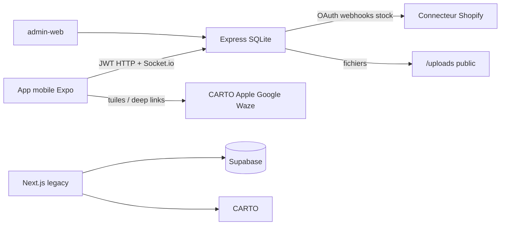

# 02 — Cartographie des données

Date : 2026-07-26 · Preuves issues du code post E0–E8.

---

## 1. Architecture des données

**Produit vivant :** SQLite `backend/data/mazone.db`  
**Legacy :** `supabase/migrations/0001_init.sql` + `src/`

---

## 2. Inventaire SQLite — colonnes à caractère personnel

### Identité & compte

| Table | Colonnes | Fichier |
|-------|----------|---------|
| `users` | name, first_name, last_name, email, password (bcrypt), phone, address, lat, lng, photo_url, role, transport, vehicle_plate, driver_online | `backend/src/db/index.js` |
| `admin_users` | email, password, name, level | idem |
| `client_addresses` | label, address, lat, lng, client_id | idem |
| `store_members` | user_id, store_id | idem |

### Commerce & commande

| Table | Colonnes | Note |
|-------|----------|------|
| `stores` | phone, email, address, lat, lng, photo_url, merchant_id | Coordonnées commerce |
| `orders` | client_id, delivery_address, total_price | Pas de order_items (dette) |
| `cart_items`, `store_favorites` | client_id | Comportement |

### Communication

| Table | Colonnes |
|-------|----------|
| `messages` | sender_id, content |
| `conversations` | user_a, user_b |
| `support_threads` / `support_messages` | user_id, content |
| `*_notifications` | user_id, title, body |

### Deuxième Âme

| Table | Colonnes |
|-------|----------|
| `digital_objects` | owner_id, payload, display, retention, expires_at |
| `identity_presentations` | user_id, handle, expires_at |
| `identity_events` | subject_id, verifier_id (append-only) |
| `event_subscriptions` | user_id, radius_km |
| `event_opportunity_inbox` | user_id, distance_km, meta |

### Intégrations (E8)

| Table | Contenu sensible |
|-------|------------------|
| `integration_secrets` | ciphertext AES-GCM (jetons OAuth) |
| `integration_installations` | shop_domain, config, installed_by |
| `integration_oauth_states` | state TTL 600s |
| `integration_inbox` / `outbox` | payloads sync |
| `external_bindings` | IDs externes (type customer prévu) |

### Stock (peu de PII)

`stock_levels`, `stock_movements`, journaux organe — IDs métier.

---

## 3. Supabase (legacy)

| Table | PII |
|-------|-----|
| `profiles` | full_name, phone, role |
| `orders` | delivery_address, customer_name |
| `driver_sessions` | lat, lng (géoloc livreur) |

RLS activé sur les 6 tables métier (`0001_init.sql`).

---

## 4. Stockage hors base

| Emplacement | Contenu | Risque |
|-------------|---------|--------|
| `backend/uploads/` | Photos profil / boutique / produit | Servi sans auth (`app.js`) |
| AsyncStorage mobile | JWT + JSON user | Non chiffré (`storage.js`) |
| localStorage admin | Token admin | `admin-web` |
| `data/.dev-secrets.json` | Secrets JWT générés hors prod | gitignoré |
| Cookies Supabase | Session web legacy | Sans bandeau |

---

## 5. Flux sortants

| Flux | Données | Destinataire |
|------|---------|--------------|
| Tuiles carte | IP / requêtes tuiles | CARTO |
| Navigation livreur | Coordonnées destination | Google Maps / Waze |
| OAuth + sync stock | Jetons, IDs produits/stock | Shopify (scopes limités) |
| Images démo web | URLs | Unsplash |

**Non constaté :** analytics marketing, push FCM/APNs, PSP paiement, email/SMS transactionnel.

---

## 6. Droits techniques — état

| Droit | API / UI | Statut |
|-------|----------|--------|
| Accès / rectification | `GET/PUT /api/users/me` | Partiel |
| Effacement | — | **Absent** |
| Portabilité | — | **Absent** |
| Opposition / limitation | — | **Absent** |
| Consentement horodaté | — | **Absent** |

---

## 7. Conservation — mécanismes existants vs manquants

| Mécanisme | Existe | Périmètre |
|-----------|--------|-----------|
| TTL OAuth states | Oui | Technique |
| TTL idempotency (7j) | Oui | Technique |
| TTL identity handles | Oui | Court |
| Wallet `retention` / `expires_at` | Oui | Produit |
| Archivage conversations ephemeral | Oui | Soft, pas purge |
| Purge messages / commandes / journaux | **Non** | — |
| Politique art. 5-1-e documentée | **Non** | — |
