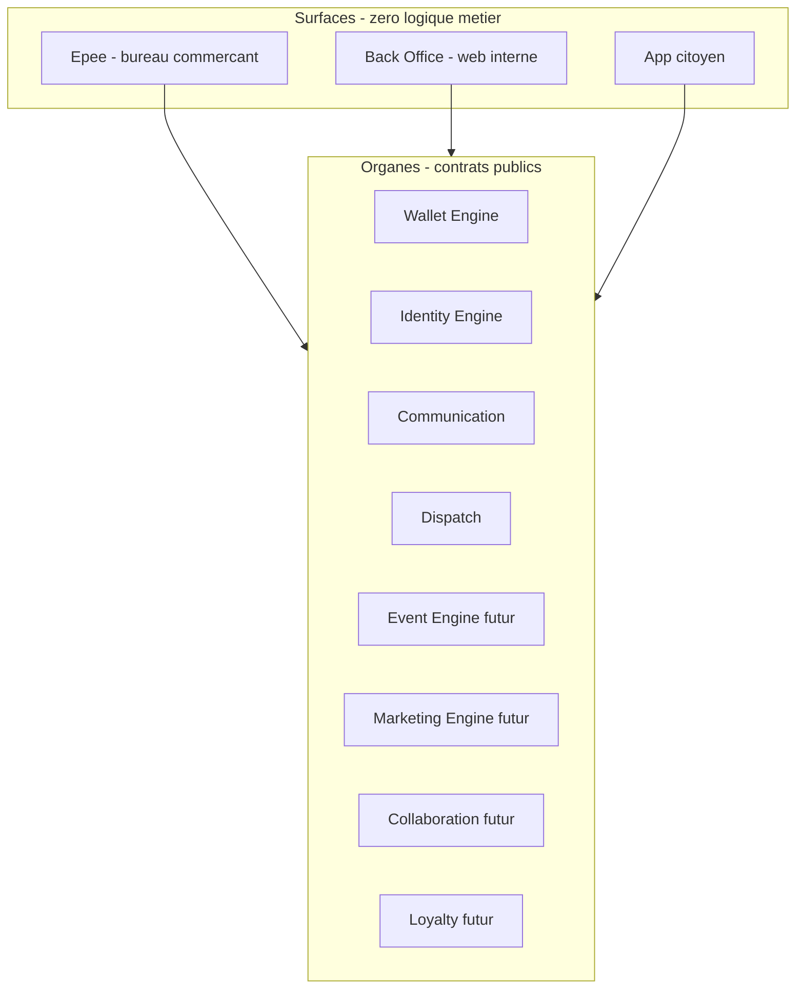
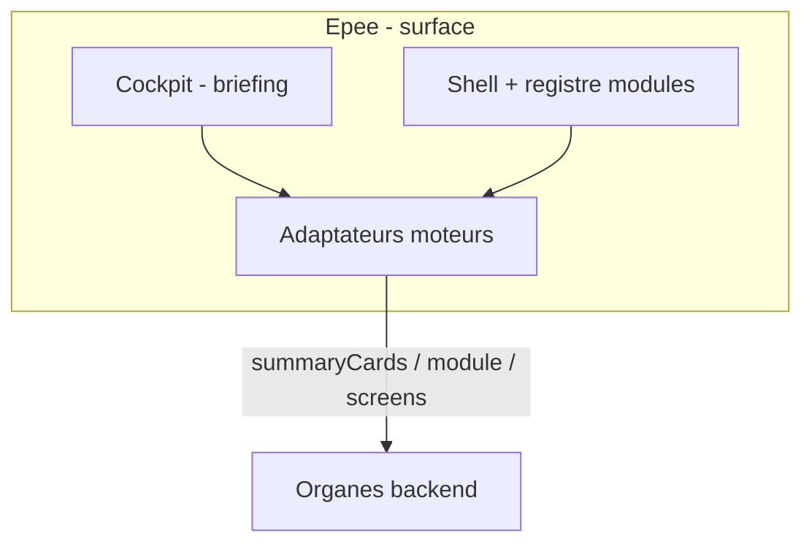
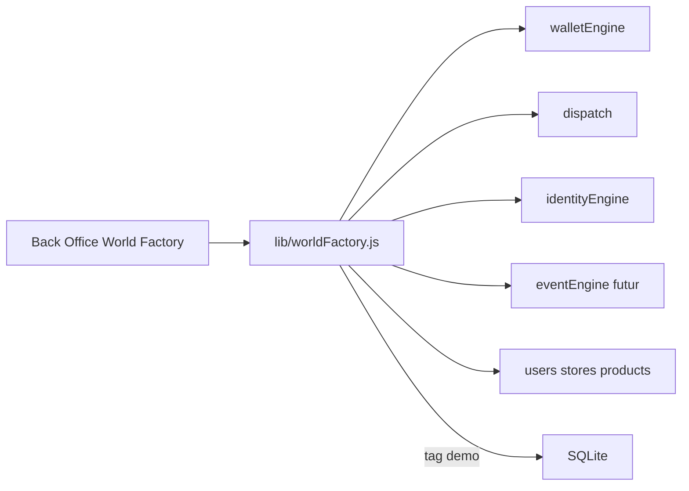

# Étude d'architecture — Le Bac à Sable de Ma Zone

**Date :** 15 juillet 2026
**Statut :** Proposition à valider — aucune implémentation
**Version Ma Zone de référence :** v9.0+ (Wallet Engine + Identity Engine)
**Références :** [ETUDE_IDENTITY_ENGINE.md](ETUDE_IDENTITY_ENGINE.md) · [AUDIT_WALLET_ENGINE_MAZONE.md](AUDIT_WALLET_ENGINE_MAZONE.md) · [REVUE_ARCHITECTURE_WALLET_N2.md](REVUE_ARCHITECTURE_WALLET_N2.md)

---

## Objet de ce document

Ce document présente l'**étude de conception** du Bac à Sable de Ma Zone : l'environnement qui permettra de développer, tester et démontrer les futurs organes (Event, Marketing, Collaboration, Fidélisation, Ville Augmentée…) dans des conditions réalistes.

**Aucun code. Aucune implémentation. Réflexion architecturale uniquement.**

Le Bac à Sable repose sur trois piliers :

1. **L'Épée** — bureau du commerçant, surface d'expression des moteurs métier
2. **Le Back Office Administrateur** — outil interne de l'équipe Ma Zone
3. **Le Monde de démonstration** — ville numérique vivante et peuplée

---

## Résumé exécutif

Avant de construire l'Event Engine (et les organes suivants), Ma Zone a besoin d'un **environnement de développement crédible** : un commerçant qui ouvre vraiment son commerce le matin, une équipe qui peupple une ville en quelques clics, et une base de données qui n'est plus un catalogue vide.

**Verdict d'architecte :** la vision est saine et alignée avec la philosophie des organes. Le risque principal n'est pas fonctionnel — c'est architectural : que l'Épée et le Back Office deviennent des amas d'écrans couplés aux moteurs.

**Phrase directrice :**

> L'Épée et le Back Office ne sont pas des organes. Ce sont des **surfaces**. Elles ne contiennent aucune logique métier ; elles composent et appellent les contrats publics des organes.

C'est la même discipline que le Wallet (les familles sont des vues, pas du métier) et l'Identity (le QR est un canal, pas l'organe). Une surface affiche et actionne. Un organe décide.

---

## État de l'existant (constats)

| Élément | État actuel |
|---------|-------------|
| App commerçant (Expo) | 4 onglets monolithiques : Boutique, Commandes, Inbox, Profil |
| Widgets / composition | Absents — écrans durs, pas de couche adaptateurs |
| Wallet / Identity côté commerçant | Absents (client uniquement) |
| Rôle `admin` | **Inexistant** — `users.role` = `client` \| `merchant` \| `driver` |
| Back Office | **Absent** |
| Seed réaliste | Minimal — `seed-wallet-demo.js` uniquement (6 objets pour un client) |
| Reset DB scripté | Absent — `rm mazone.db` manuel |

L'Épée existe en germe. Le Back Office et le Monde de démonstration n'existent pas.

---

## Principe fondateur — Surfaces vs Organes

| | Organe | Surface |
|--|--------|---------|
| **Exemples** | Wallet, Identity, Event, Marketing… | Épée, Back Office, App citoyen |
| **Responsabilité** | Décider, gouverner, journaliser | Afficher, composer, actionner |
| **Logique métier** | Oui (dans son périmètre) | **Jamais** |
| **Dépendances** | Les autres organes consomment son contrat | Consomme les contrats publics |
| **Extension** | Nouveau `kind` / `purpose` / entité | Nouvel adaptateur / module / recette |



**Conséquence :** chaque futur moteur enrichit les surfaces **sans les réécrire**, car elles ne connaissent que des contrats, pas des implémentations.

---

## Les trois piliers

### Vue d'ensemble

| Pilier | Public | Plateforme | Mission |
|--------|--------|------------|---------|
| **Épée** | Commerçant | Mobile Expo (app existante, refactorée) | Ouvrir son commerce — cockpit + modules |
| **Back Office** | Équipe Ma Zone | App web indépendante (React/Vite) | Administrer + peupler le monde de démo |
| **Monde de démonstration** | (données) | Backend `lib/worldFactory.js` | Ville vivante, rejouable, taguée |

Ces trois piliers ne collent jamais une logique métier. Ils orchestrent.

---

## Pilier 1 — L'Épée (bureau du commerçant)

### Vision

Quand le commerçant ouvre Ma Zone le matin, il ne ouvre pas un logiciel. **Il ouvre son commerce.**

> « Grâce à Ma Zone, le commerçant vend même lorsqu'il est fermé. »

Le matin, le cockpit lui raconte l'histoire de la nuit : commandes reçues, Click & Collect à préparer, messages, événements à venir, promotions actives.

L'Épée n'est pas un tableau de bord figé. C'est le **bureau du commerçant** — le lieu où tous les organes invisibles de Ma Zone deviennent visibles, compréhensibles et actionnables.

### Architecture en deux couches

#### A. Le Cockpit (accueil = briefing du matin)

- Un seul écran d'accueil.
- Il n'affiche **pas tout**. Il affiche **ce qui mérite attention aujourd'hui**, trié par priorité.
- Il n'agrège pas des moteurs en dur : chaque moteur contribue des **cartes de briefing** via un contrat uniforme.

**Contrat de carte (conceptuel) :**

```json
{
  "id": "orders-to-prep",
  "engine": "orders",
  "priority": 10,
  "title": "3 commandes à préparer",
  "metric": "2 Click & Collect · 1 livraison",
  "cta": "Voir les commandes",
  "deeplink": "Marketplace/Orders"
}
```

Le cockpit est un **agrégateur passif** : ajouter Event ou Collaboration ajoute des cartes, sans toucher au code du cockpit.

**Anti-surcharge :** plafonner le nombre de cartes visibles (ex. top 5–8), le reste est accessible via « Voir plus » ou les modules.

#### B. Les Modules (menu hamburger = capacités)

Chaque module représente une capacité offerte au commerçant :

| Famille | Modules |
|---------|---------|
| **Vendre** | Marketplace (produits, stock, commandes, Click & Collect, livraison, historique) |
| **Animer** | Événements · Promotions |
| **Réseau** | Collaborations · Carnet d'adresses · Clients |
| **Piloter** | Fidélisation · Statistiques · Messages · Mon commerce |

**Registre de modules (déclaratif, Open/Closed) :**

```js
// Conceptuel — merchantModuleRegistry
defineModule({
  id: 'events',
  label: 'Événements',
  family: 'animer',
  icon: 'calendar-outline',
  entitlement: 'engine.event',  // visible seulement si le moteur existe
  screen: 'EventsHome',
});
```

Le shell de l'Épée lit ce registre. Il ne connaît aucun module en dur. Un module n'apparaît que si son moteur existe et si le commerçant y a droit (`entitlement` / feature flag).

On peut livrer l'Épée avec 3 modules (Marketplace, Promotions, Messages) et en ajouter 10 sans refactor.

### Pattern adaptateur de moteur

Pour chaque organe exposé dans l'Épée, un petit **adaptateur** côté mobile :

| Méthode | Rôle |
|---------|------|
| `summaryCards()` | Cartes pour le cockpit |
| `module()` | Entrée hamburger |
| `screens()` | Navigation du module |

Le shell ne dépend que de ces adaptateurs. Chaque nouveau moteur = un adaptateur + des écrans de module.

### Identity n'est pas un module

Conformément à la vision validée : le commerçant ne pense jamais « je vais utiliser Identity ». Il pense « je gère mon événement ».

- Les fonctions Identity (scanner QR, vérifier identité, vérifier procurations) vivent **dans le module Événements**.
- Identity reste un **organe distinct** en backend (`identityEngine.js`).
- L'Épée l'invoque en arrière-plan depuis le contexte Event.

**UX groupée, moteurs découplés** — même leçon que les familles Wallet = vues de présentation.

### Anti-surcharge sur 10 ans — règles

1. Le cockpit **prioritise et plafonne** ; le détail vit dans les modules.
2. Tout module est **déclaratif**, lazy, et gated par entitlement.
3. **Aucune logique métier** dans l'Épée — elle compose des contrats.
4. Familles de modules pour garder un menu lisible (pas une liste à rallonge).
5. Un adaptateur = un fichier ; ajouter un moteur n'ouvre jamais le shell.



---

## Pilier 2 — Le Back Office Administrateur

### Vision

Application **web interne totalement indépendante** de l'app mobile.

- Ce n'est **pas** un produit utilisateur.
- Ce n'est **pas** un produit commerçant.
- C'est l'outil de l'**équipe Ma Zone**.

Il sera utilisé pendant toute la vie du projet — pensé comme un outil permanent, pas un utilitaire temporaire.

### Plateforme retenue

| Décision | Choix |
|----------|-------|
| Plateforme | App web dédiée (React + Vite), séparée |
| API | Même backend Express (`/api/admin/*`) |
| Indépendance | Jamais mêlée à Expo / mobile |

### Sécurité — rôle admin séparé

Le rôle `admin` n'existe pas aujourd'hui (`users.role` = `client` \| `merchant` \| `driver` seulement).

**Recommandation :** table `admin_users` **séparée** + authentification admin dédiée.

| Pourquoi pas `role: 'admin'` dans `users` ? |
|---------------------------------------------|
| Un administrateur interne ne doit jamais apparaître dans l'écosystème citoyen |
| Évite confusion / fuite dans listes clients, Wallets, Identity |
| Frontière nette : citoyens vs opérateurs plateforme |

Middleware admin distinct de `verifyToken` citoyen. Namespace `/api/admin/*` exclusivement.

### Deux faces du Back Office

#### Face A — Administration de l'écosystème

| Domaine | Capacités |
|---------|-----------|
| Utilisateurs | Lister, rechercher, suspendre, inspecter |
| Commerçants | Stores, validation, statut |
| Livreurs | Statut, broadcast (table déjà prévue) |
| Catégories | CRUD catégories |
| Quartiers | Plus tard (Zone-aware) |
| Rôles / paramètres | Feature flags, config système |
| Statistiques globales | Indicateurs agrégés |
| Organes | Inspecter / diagnostics si nécessaire |

Majoritairement lecture + modération. Pas d'écrans métier « Event » ou « Promotion » ici — ces logiques restent dans les organes (et s'expriment dans l'Épée).

#### Face B — World Factory (le plus important en MVP)

Créer rapidement une **vrai ville de démonstration** :

- citoyens, commerçants, livreurs ;
- Wallets peuplés, droits, billets ;
- événements, promotions, collaborations ;
- commandes simulées ;
- interactions (messages, notifications).

**Idée clé :** le Back Office pilote les **contrats publics** des moteurs.

```
World Factory  ≠  INSERT SQL direct
World Factory  =  wallet.issueObject(...)
               +  dispatch.createOrderWithDispatch(...)
               +  identity.issuePresentation(...)  (si besoin)
               +  eventEngine.createEvent(...)     (futur)
```

**Bénéfice majeur :** le Back Office devient le **premier consommateur réel** de chaque organe. Il dogfood les contrats exactement comme le feront les vrais flux. Un organe mal conçu se révèle immédiatement ici.

### Recettes de monde (world recipes)

Scénarios composables, déterministes et rejouables :

| Recette | Exemple |
|---------|---------|
| `quartier_anime` | N habitants, M commerçants, produits, commandes du jour |
| `festival_local` | Événements + billets Wallet + contrôles Identity |
| `soirée_commerciale` | Promotions + coupons + cartographie Click & Collect |
| `reset_demo` | Nettoyer tout ce qui est tagué `demo` |

Données taguées (`source_engine: 'demo'` / `batch_id`) — même esprit que `demo_seed` dans `seed-wallet-demo.js` — pour un nettoyage propre sans toucher les comptes réels.

---

## Pilier 3 — Le Monde de démonstration

### Vision

Une base de données **réaliste, riche et vivante** — pas une application vide. Habitants, commerçants, livreurs, Wallets, événements, commandes, promotions, interactions.

### Architecture

- Module backend `lib/worldFactory.js` : **orchestrateur** uniquement.
- Aucune logique métier propre : il enchaîne les appels aux organes existants.
- Exposition via `/api/admin/world/*` (protégé admin).
- Idempotent, rejouable, tagué, nettoyable.



### Relation avec seed existant

`backend/scripts/seed-wallet-demo.js` est le **prototype** de cette approche (in-process, tagué, idempotent). La World Factory le généralise : multi-entités, multi-recettes, exposée au Back Office, sans SQL métier.

---

## Comment cela accélère les futurs moteurs

Chaque nouveau moteur suit toujours le **même triptyque** :

| Étape | Livrable |
|-------|----------|
| **1. Organe** | `lib/*Engine.js` + registre + routes (contrat public) |
| **2. Adaptateur Épée** | Cartes cockpit + module hamburger + écrans |
| **3. Recette World Factory** | Scénario de démo dans le Back Office |

Exemple — **Event Engine** :

1. Backend : créer événements, émettre billets via Wallet, contrôle d'accès via Identity.
2. Épée : module « Événements » (création, billetterie, participants, scan Identity en arrière-plan).
3. Back Office : recette `festival_local` → ville peuplée, démontrable dès le jour 1.

L'Event Engine n'attend plus une base vide. Il arrive dans un monde vivant.

---

## Frontières à ne jamais franchir

| Interdit | Pourquoi |
|----------|----------|
| Logique métier dans l'Épée ou le Back Office | Ce sont des surfaces |
| SQL métier direct depuis le Back Office | Contourne les organes ; casse le dogfooding |
| Identity comme module séparé dans le menu | Le commerçant pense « événement », pas « Identity » |
| Admin dans la table `users` citoyens | Contamine l'écosystème |
| Cockpit qui affiche tout | Surcharge ; le détail vit dans les modules |
| Registre de modules en dur dans le shell | Empêche l'extension Open/Closed |

---

## Phasage recommandé (sans tout construire)

### Phase 0 — Socle World Factory + admin

- Table `admin_users` + auth admin + middleware
- Routes `/api/admin/*`
- `lib/worldFactory.js` minimal : créer citoyens/commerçants + peupler Wallets via APIs existantes
- Recette `quartier_anime` v1

**Débloque immédiatement** la démo et le dogfooding.

### Phase 1 — Shell Épée

- Refactorer l'app marchand Expo : cockpit agrégateur + registre de modules
- Brancher modules déjà couverts : Marketplace, Promotions, Clients, Messages, Mon commerce
- Adapter les écrans existants sans réécrire toute la logique métier (elle reste côté API)

### Phase 2 — Back Office Administration

- UI web React/Vite : gestion utilisateurs/commerçants/livreurs, stats globales, paramètres
- World Factory UI : lancer recettes, reset demo

### Phase 3+ — Moteurs successifs

- Event → Collaboration → Fidélisation → Marketing avancé…
- Chaque moteur : organe + adaptateur Épée + recette World Factory

**Event Engine n'ouvre officiellement qu'après la Phase 0 (au minimum) et idéalement après le shell Épée Phase 1** — sinon on développe un organe dans le vide.

---

## Décisions architecturales proposées (ADR)

| ID | Décision | Statut |
|----|----------|--------|
| **ADR-BS-001** | Épée et Back Office sont des surfaces, jamais des organes | À valider |
| **ADR-BS-002** | Épée = cockpit (cartes prioritaires) + modules déclaratifs (registre) | À valider |
| **ADR-BS-003** | Pattern adaptateur moteur (`summaryCards` / `module` / `screens`) | À valider |
| **ADR-BS-004** | Identity UX sous Événements ; Identity reste un organe distinct | À valider |
| **ADR-BS-005** | Back Office = app web indépendante (React/Vite) | À valider |
| **ADR-BS-006** | Admins hors `users` citoyens (`admin_users` séparée) | À valider |
| **ADR-BS-007** | World Factory pilote uniquement les contrats publics des organes | À valider |
| **ADR-BS-008** | Données démo taguées et nettoyables (pas de SQL métier direct) | À valider |
| **ADR-BS-009** | Triptyque systématique : organe + adaptateur Épée + recette World Factory | À valider |

---

## Ce qui est préparé mais non développé

| Élément | Préparation | Développement |
|---------|-------------|---------------|
| Event / Marketing / Collaboration / Loyalty | Contrats d'adaptateur + familles de modules | À l'ouverture officielle de chaque organe |
| Quartiers / Zone | Zone-aware déjà dans la philosophie Wallet | Plus tard |
| BI avancée | Module Statistiques simple d'abord | Pas de BI lourd en V1 |
| Multi-employés magasin | Table `store_members` déjà existante | Plus tard |
| Scanner commerçant Identity | Endpoint `POST /identity/verify` prêt | Dans le module Événements |

---

## Auto-évaluation (note CTO)

| Critère | Évaluation |
|---------|------------|
| Simplicité | Forte — deux couches Épée, Back Office dual face, factory sans métier |
| Modularité | Forte — registres + adaptateurs |
| Faible couplage | Forte — surfaces / organes séparés |
| Évolutivité | Forte — triptyque répétable 10 ans |
| Risque principal | Sur-construire le Back Office avant le shell Épée — mitigué par le phasage |

**Note :** architecture fondatrice, cohérente avec Wallet et Identity. Prête pour validation avant développement.

---

## Annexes

### Arborescence cible (conceptuelle)

```
backend/src/
├── lib/
│   ├── worldFactory.js          # Orchestrateur de recettes de démo
│   ├── walletEngine.js          # (existant)
│   ├── identityEngine.js        # (existant)
│   └── … futurs engines
├── routes/
│   └── admin.js                 # /api/admin/* (auth admin séparée)
└── db/index.js                  # + admin_users

admin-web/                       # App React/Vite indépendante
├── src/
│   ├── pages/                   # Admin + World Factory
│   └── api/                     # Client /api/admin/*

mobile/src/
├── screens/merchant/
│   ├── MerchantCockpitScreen.js # Briefing du matin
│   └── modules/                 # Écrans par module
├── merchant/
│   ├── moduleRegistry.js        # Registre déclaratif
│   └── adapters/                # Un adaptateur par moteur
└── navigation/                  # Shell Épée (drawer + modules)
```

### Correspondance avec organes existants

| Concept Wallet / Identity | Équivalent Bac à Sable |
|---------------------------|------------------------|
| Registre de kinds / purposes | Registre de modules Épée |
| `handledBy` / disclosure | Entitlements de modules |
| Surface client (Wallet tab, Identity screen) | Surface commerçant (Épée) |
| `seed-wallet-demo.js` | World Factory généralisée |
| Organe transversal | Organe métier futur + adaptateur |

### Trace documentaire

Cette étude constitue le cadre du Bac à Sable avant l'ouverture de l'Event Engine. Aucune implémentation tant que les ADR-BS ne sont pas validées.
