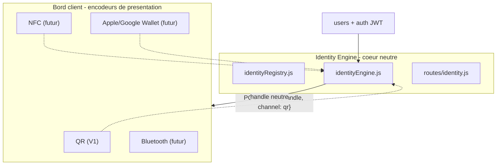
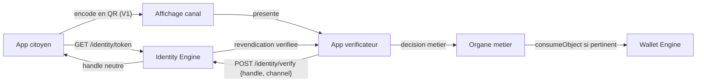
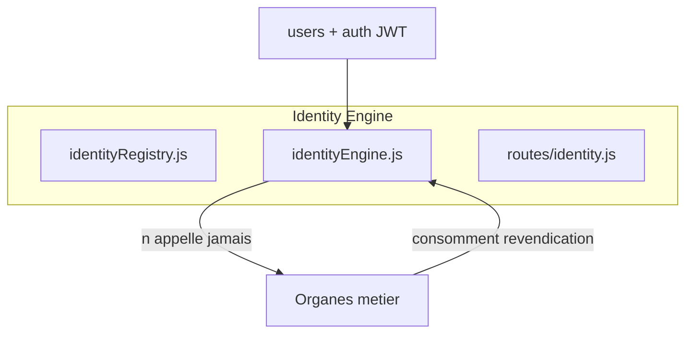

# Étude d'architecture — Identity Engine (Phase II)

**Date :** 15 juillet 2026
**Statut :** Proposition à valider — aucune implémentation
**Version Ma Zone de référence :** v9.0 (Wallet Engine intégré)
**Références :** [ETUDE_QR_IDENTITY_ENGINE.md](ETUDE_QR_IDENTITY_ENGINE.md) (étude initiale) · [PLAN_ETUDE_WALLET_ENGINE.md](PLAN_ETUDE_WALLET_ENGINE.md) · [REVUE_ARCHITECTURE_WALLET_N2.md](REVUE_ARCHITECTURE_WALLET_N2.md)

---

## Objet de ce document

Ce document présente l'**étude de conception définitive** du **Identity Engine**, deuxième organe transversal de Ma Zone (Phase II). Il intègre la réflexion architecturale complémentaire : le QR n'est pas l'organe — c'est le **premier canal de présentation** d'une identité numérique neutre.

**Aucun code. Aucune implémentation. Réflexion architecturale uniquement.**

---

## Résumé exécutif

Le Wallet Engine répond à la question : *« Quels sont mes droits numériques ? »*

L'Identity Engine répond à une autre : *« Qui est la personne qui souhaite exercer ces droits ? »*

**Verdict d'architecte :** évoluer de « QR Identity Engine » vers **« Identity Engine »**. Le QR n'est qu'un **canal de présentation** (le premier, en V1) ; l'organe gère l'identité numérique de façon **agnostique du transport**. L'architecture recommandée reste un miroir du Wallet Engine (registre déclaratif + moteur transactionnel + journal append-only), avec l'approche **handle opaque + validation serveur** (Approche C) — déjà neutre vis-à-vis du canal.

**Point critique :** l'identité n'accorde jamais un droit. Elle identifie uniquement. Les autres organes décident.

**Coût de l'évolution :** quasi nul — renommage conceptuel, un champ `channel` d'audit, présentation au bord client. Aucune sur-ingénierie.

---

## Évolution conceptuelle — De « QR Identity » à « Identity »

### La réflexion

L'étude initiale parlait d'un « QR Identity Engine ». Une réflexion complémentaire a émergé : le QR n'est peut-être pas l'organe, mais simplement le **premier moyen de présenter une identité**.

```
Aujourd'hui :          Demain (sans refonte) :
Identity               Identity
  ↓                      ↓
Présentation QR          Présentation QR
                         Présentation NFC
                         Présentation Apple Wallet
                         Présentation Google Wallet
                         Présentation Bluetooth
                         Présentation biométrique
                         …
```

### Pourquoi cette évolution est pertinente

L'Approche C retenue (handle opaque + validation serveur) rend cette évolution **quasi gratuite** : le handle `mz:id:7f3a9c2e` est **déjà agnostique du canal**. Un QR n'est qu'un rendu visuel d'un handle. Le même handle pourrait demain être transmis par NFC, embarqué dans un pass Apple Wallet, ou échangé en Bluetooth — **sans que le cœur ne change**.

Le QR n'a jamais été dans le moteur. Il vit à l'écran mobile (`IdentityScreen`). Nous avons déjà conçu un Identity Engine sans le nommer ainsi.

### Ce qui est préservé intégralement

- Simplicité actuelle
- Faible couplage
- Handle opaque + validation serveur
- Purposes
- Séparation stricte avec le Wallet
- Principe fondamental : **l'identité n'accorde jamais un droit ; elle identifie uniquement**

---

## Réponse aux 8 questions architecturales

### 1. Cette évolution est-elle pertinente ?

**Oui.** Pas comme ajout de fonctionnalités, mais comme **élévation conceptuelle** qui verrouille la pureté du noyau. Un organe nommé « QR Identity » invite les développeurs à faire fuiter des hypothèses QR dans le cœur au fil des années. Un organe nommé « Identity » garde le noyau pur pendant 10 ans.

### 2. Quels avantages ?

| Avantage | Explication |
|----------|-------------|
| **Nom protecteur** | Les noms dirigent le design sur la durée |
| **Canal = détail** | NFC, Apple Wallet, biométrie = ajouts au bord client, sans migration serveur |
| **Alignement long terme** | Compatible avec Verifiable Credentials / DID (étoile polaire) sans les implémenter |
| **Coût nul** | Rien n'est encore codé ; adopter le bon nom maintenant évite un renommage futur |

### 3. Quels inconvénients ?

Le seul risque réel : **sur-ingénierer** en construisant dès V1 un registre d'adaptateurs de canaux (NFC, BLE…) avec des stubs. Parade : ne rien construire de tel. Le handle étant neutre, **aucun adaptateur serveur n'est nécessaire**.

### 4. Compatible sans tout reconstruire ?

**Totalement** — et mieux : **rien n'est encore construit**. Les routes sont déjà `/api/identity`, l'écran est déjà `IdentityScreen`, l'objet est déjà une « présentation ». L'évolution est à ~90 % déjà là dans l'étude initiale.

### 5. Verdict CTO : quel nom ?

**Identity Engine**, sans hésitation. « QR Identity » décrit une *implémentation* ; « Identity » décrit une *responsabilité*. On nomme les organes par leur responsabilité, pas par leur canal.

### 6. Organisation des couches de présentation (sans alourdir V1)



**V1 :** un seul encodeur au bord — QR dans `IdentityScreen` (`react-native-qrcode-svg`). Le moteur expose `GET /api/identity/token` ; l'écran rend le handle en QR.

**Concession unique à l'avenir :** champ `channel` (nullable, défaut `qr`) sur `identity_events`, pour l'audit (« ce handle a été présenté via QR »). Un champ, additif, gratuit. Pas d'interface, pas de registre d'adaptateurs.

### 7. Vrai gain ou simple vocabulaire ?

~70 % clarté conceptuelle, ~30 % concret (champ `channel` + garder tout nom « QR » hors du cœur). Les 70 % comptent : sur 10 ans, le nom est ce qui empêche l'érosion architecturale.

### 8. Solution encore meilleure ?

L'étoile polaire long terme : modèle **Verifiable Credentials / DID** (W3C) — identité = émetteur de « claims » signées, indépendantes du transport. Notre couple `handle → revendication` en est une version minimale et pragmatique. **Non recommandé en V1** (sur-ingénierie), mais `verifyPresentation` retournant une *revendication* est délibérément dans cette direction.

---

## Identité vs Présentation — Le modèle en couches

### Principe fondateur

| Couche | Responsabilité | Où ça vit |
|--------|----------------|-----------|
| **Identité** (cœur) | Produire et valider des preuves d'identité ; retourner une revendication | `identityEngine.js`, `identityRegistry.js` |
| **Présentation** (bord) | Encoder le handle dans un canal physique (QR, NFC, Wallet…) | `IdentityScreen.js`, futurs encodeurs client |

Le cœur ne connaît **aucun** canal. Il manipule uniquement des handles opaques et des revendications.

### Schéma



---

## Positionnement dans l'écosystème Ma Zone

| Organe | Question | Responsabilité |
|--------|----------|----------------|
| **Wallet Engine** | « Quels droits ai-je ? » | Registre des objets numériques du citoyen |
| **Identity Engine** | « Qui suis-je physiquement ? » | Preuve d'identité présentable et vérifiable |
| **Event / Orders / Marketing…** | « Que faire de cette personne ? » | Logique métier, décisions |

---

## 1. Vision générale

### Mission exacte

L'Identity Engine est le **pont entre le citoyen réel et son identité numérique**. Sa mission unique :

1. **Produire** une preuve d'identité présentable (handle neutre) pour un citoyen authentifié ;
2. **Valider** une preuve présentée par un vérificateur autorisé ;
3. **Retourner** une revendication d'identité vérifiée — jamais un droit, jamais une décision.

Le **canal** (QR en V1) n'appartient qu'à la couche de présentation au bord client.

### Revendication d'identité vérifiée

```json
{
  "subjectId": "uuid-utilisateur",
  "displayName": "Marie Dupont",
  "photoUrl": "/uploads/...",
  "purpose": "identity",
  "verifiedAt": "2026-07-15T10:30:00Z",
  "verificationId": "uuid-evenement-audit"
}
```

Pas de liste de billets. Pas de statut de commande. Pas de « accès autorisé ».

### Responsabilités explicitement refusées

| Hors périmètre | Pourquoi |
|----------------|----------|
| Consommer un billet / un droit | Wallet + organe métier |
| Connaître commandes, événements, promotions | Couplage interdit |
| Décider d'autoriser un accès, retrait, procuration | Décision métier |
| Stocker des droits numériques | C'est le Wallet |
| Choisir ou imposer un canal de présentation | Décision UX au bord client |
| Générer des QR de billets (v1) | Extension future — présentation d'objet Wallet |

### Positionnement architectural

- **Organe transversal** : consommé par de nombreux moteurs, dépendant d'**aucun**.
- **Dépendances autorisées** : `users`, `auth` (JWT).
- **Dépendances interdites** : Wallet, Orders, Event, Marketing, Dispatch, Communication.
- **Direction des appels** : les organes métier consomment l'Identity Engine ; l'Identity Engine ne les appelle jamais.

---

## 2. Architecture proposée

### Principe directeur : miroir du Wallet Engine

| Couche Wallet | Couche Identity | Rôle |
|---------------|-----------------|------|
| `walletRegistry.js` | `identityRegistry.js` | Métadonnées déclaratives, Open/Closed |
| `walletEngine.js` | `identityEngine.js` | Logique transactionnelle, journal, API in-process |
| `routes/wallet.js` | `routes/identity.js` | Routes HTTP bornées |
| `digital_objects` + `digital_object_events` | `identity_presentations` + `identity_events` | Projection + ledger append-only |
| Socket `wallet:object_*` | Socket `identity:*` | Notifications temps réel |

### Arborescence prévue

```
backend/src/
├── lib/
│   ├── identityRegistry.js      # Purposes, TTL, rôles vérificateurs, contrat de divulgation
│   └── identityEngine.js        # Génération, validation, rotation, révocation, audit
├── routes/
│   └── identity.js              # GET /token, POST /verify, GET /history
└── db/index.js                  # Tables identity_presentations + identity_events

mobile/src/
├── screens/client/
│   └── IdentityScreen.js        # Canal QR V1 : rend le handle en QR plein écran
├── context/
│   └── IdentityContext.js       # (optionnel) rotation + socket
├── components/client/
│   └── ClientDrawerContent.js   # pictogramme d'accès à l'identité (à côté avatar)
└── api/index.js                 # getIdentityToken(), verifyIdentity()
```

### Modèle de données

#### Table `identity_presentations`

| Colonne | Type | Rôle |
|---------|------|------|
| `id` | TEXT PK | Identifiant du jeton (jti) |
| `user_id` | TEXT FK → users | Citoyen propriétaire |
| `handle` | TEXT UNIQUE | Valeur opaque (canal-agnostique) |
| `purpose` | TEXT | Usage (`identity`, futur : `access`, `pickup`…) |
| `status` | TEXT | `active` · `used` · `expired` · `revoked` |
| `expires_at` | TEXT | Expiration (TTL court) |
| `created_at` | TEXT | Horodatage |

#### Table `identity_events` (journal append-only)

| Colonne | Type | Rôle |
|---------|------|------|
| `id` | TEXT PK | UUID événement |
| `presentation_id` | TEXT FK | Jeton concerné |
| `subject_id` | TEXT | Citoyen identifié |
| `verifier_id` | TEXT | Utilisateur ayant vérifié |
| `verifier_role` | TEXT | Rôle du vérificateur |
| `purpose` | TEXT | Usage au moment de l'événement |
| `channel` | TEXT | Canal de présentation (`qr`, futur : `nfc`, `wallet`, `ble`…) — **audit uniquement** |
| `type` | TEXT | `issued` · `validated` · `rejected` · `expired` · `revoked` · `rotated` |
| `outcome` | TEXT | Résultat |
| `reason` | TEXT | Motif de rejet (optionnel) |
| `idempotency_key` | TEXT | Clé anti-rejeu |
| `created_at` | TEXT | Horodatage immuable |

Le champ `channel` est la **seule concession V1 à l'avenir multi-canal**. Il n'influence pas la logique du moteur — il documente comment le handle a été présenté, pour l'audit et les statistiques.

### API publique du moteur (in-process)

**Commandes :** `issuePresentation`, `rotatePresentation`, `verifyPresentation({ handle, channel?, ... })`, `revokeAll`

**Requêtes :** `getActivePresentation`, `getPresentationEvents`, `getVerificationHistory`

**Registre :** `getPurpose`, `listPurposes`, `getDisclosureContract`, `getVerifierRoles`

### Routes HTTP

| Méthode | Route | Auth | Rôle |
|---------|-------|------|------|
| `GET` | `/api/identity/token` | `verifyToken` | Citoyen — retourne handle + métadonnées |
| `POST` | `/api/identity/verify` | `verifyToken` + rôle vérificateur | `{ handle, purpose, channel? }` → revendication ou rejet |
| `GET` | `/api/identity/history` | `verifyToken` | Citoyen — historique de ses vérifications |

### Canaux de présentation

| Canal | Statut V1 | Où ça vit | Impact serveur |
|-------|-----------|-----------|----------------|
| **QR** | Implémenté | `IdentityScreen.js` + `react-native-qrcode-svg` | Aucun — rend le handle |
| **NFC** | Préparé, non développé | Futur encodeur client | Aucun — transmet le même handle |
| **Apple / Google Wallet** | Préparé, non développé | Futur pass embarquant le handle | Aucun |
| **Bluetooth** | Préparé, non développé | Futur encodeur client | Aucun |
| **Biométrique** | Préparé, non développé | Futur (lien identité physique) | À définir selon usage |

**Anti-sur-ingénierie :** pas de registre d'adaptateurs backend. Le handle est neutre ; chaque canal est un encodeur au bord client.

---

## 3. Communication avec les autres organes

### Principe : faible couplage, sens unique



| Organe | Interaction | Qui décide ? |
|--------|-------------|--------------|
| **Wallet** | Après identification, organe métier appelle `wallet.consumeObject(...)` | Organe métier — pas Identity |
| **Orders** | Retrait Click & Collect : identifier le client | Orders vérifie identité + objet Wallet |
| **Event** | Contrôle d'accès : identifier le porteur | Event vérifie identité, consomme billet Wallet |
| **Marketplace / Marketing / Dispatch** | Identification en point de vente ou terrain | Chaque organe applique sa logique |
| **Communication** | Aucune dépendance directe | — |

### Flux type — contrôle d'accès événement

```
1. Citoyen ouvre IdentityScreen → GET /api/identity/token → handle affiché en QR
2. Agent scanne → POST /api/identity/verify { handle, purpose: "access", channel: "qr" }
3. Identity Engine retourne revendication { subjectId, displayName, verifiedAt }
4. App agent appelle Event Engine : "subjectId X se présente pour Y"
5. Event vérifie billet Wallet de X pour Y
6. Si valide → Event appelle wallet.consumeObject(...)
7. Event décide : accès autorisé ou refusé
```

L'Identity Engine n'a participé qu'à l'étape 3.

---

## 4. Sécurité

### Approche retenue : Handle opaque + validation serveur (Approche C)

Le handle `mz:id:7f3a9c2e` est **canal-agnostique**. Qu'il soit encodé en QR, transmis par NFC ou embarqué dans un pass Wallet, la validation serveur est identique.

| Principe | Mécanisme |
|----------|-----------|
| **Authenticité** | Validation serveur exclusive |
| **Anti-falsification** | Handle aléatoire (`crypto.randomBytes`) |
| **Anti-rejeu** | Usage unique + TTL court + idempotency_key |
| **Rotation** | Nouveau handle périodiquement |
| **Révocation** | `revokeAll(userId)` au logout / incident |
| **Vie privée** | Revendication minimale (contrat de divulgation par purpose) |
| **Audit** | Chaque tentative dans `identity_events` (avec `channel`) |

Approches A (JWT session dans QR) et B (jeton signé hors-ligne) : rejetées ou réservées extension future, comme dans l'étude initiale.

---

## 5. Cycle de vie

- **Identité** : naît avec le compte (`users.id`). Permanente.
- **Jeton de présentation** : créé à la demande (ouverture écran identité). Éphémère, rotatif.
- **Canal** : choisi par le client au bord (QR en V1). N'impacte pas le cycle de vie du jeton.
- **Révocation** : `revokeAll` au logout. Tous les jetons actifs invalidés.

---

## 6. Philosophie — garantir la séparation

### L'identité n'accorde jamais un droit

Trois garde-fous structurels (inchangés) :

1. **Contrat de divulgation** — le moteur ne retourne que les champs déclarés par `purpose`.
2. **Zéro dépendance métier** — `identityEngine.js` ne `require` aucun organe métier.
3. **Validation fail-fast** — registre validé au chargement (miroir ADR-005 Wallet).

### Formulation révisée du principe

> *« L'identité n'accorde jamais un droit. Elle identifie uniquement. Le QR (ou tout autre canal) n'est qu'un moyen de présenter cette identité. »*

### Distinction : identité personnelle vs présentation d'objet

| | Identité personnelle (v1) | Présentation d'objet Wallet (futur) |
|--|---------------------------|-------------------------------------|
| **Référence** | `users.id` | `digital_objects.id` |
| **Question** | « Qui êtes-vous ? » | « Quel droit présentez-vous ? » |
| **Canal V1** | QR à côté de la photo de profil | QR via capability `show_qr` d'un objet |
| **Consommation** | Ne consomme rien | Organe métier consomme via Wallet |

---

## 7. Évolutivité

### Extension par le registre (purposes)

`definePurpose()` dans `identityRegistry.js` — usages futurs déclaratifs, sans modifier le cœur.

### Extension par les canaux (bord client)

Nouveau canal = nouvel encodeur dans l'app mobile. **Aucune migration serveur.** Le moteur reçoit le même `handle` ; seul `channel` change dans l'audit.

### Extensions préparées, non développées

- Mode hors-ligne signé (champ `mode` dans le schéma)
- Présentation d'objet Wallet (`expectedRef`)
- Purposes multiples (`access`, `pickup`, `civic`, `proxy`)
- Verifiable Credentials / DID (étoile polaire long terme)

---

## 8. Risques et parades

| Risque | Parade |
|--------|--------|
| Fuiter des hypothèses QR dans le cœur | Nommer l'organe « Identity », pas « QR Identity » |
| Sur-ingénierer les canaux en V1 | Un seul canal (QR) ; pas de registre d'adaptateurs |
| Dérive en organe-dieu | Contrat de divulgation + zéro dépendance métier |
| Rejeu par capture | Usage unique + TTL + rotation |
| Confusion identité / objet Wallet | Deux concepts nommés distinctement |

---

## Décisions architecturales (ADR)

| ID | Décision | Statut |
|----|----------|--------|
| **ADR-ID-001** | L'Identity Engine identifie uniquement ; jamais de décision métier | À valider |
| **ADR-ID-002** | Approche C (handle opaque + validation serveur) comme fondation | À valider |
| **ADR-ID-003** | Architecture miroir du Wallet (registry + engine + ledger + routes) | À valider |
| **ADR-ID-004** | V1 = identité personnelle ; présentation d'objet Wallet = extension | À valider |
| **ADR-ID-005** | Contrat de divulgation par `purpose`, validé au chargement (fail-fast) | À valider |
| **ADR-ID-006** | Zéro dépendance de l'Identity Engine vers les organes métier | À valider |
| **ADR-ID-007** | Mode hors-ligne (Approche B) préparé mais non développé en V1 | À valider |
| **ADR-ID-008** | L'organe s'appelle **Identity Engine** ; le QR est un canal, pas l'organe | À valider |
| **ADR-ID-009** | Champ `channel` sur `identity_events` (audit) ; présentation au bord client uniquement | À valider |

---

## Ce qui est préparé mais non développé en V1

| Élément | Préparation | Développement |
|---------|-------------|---------------|
| Canaux NFC / Wallet / BLE / biométrie | Handle neutre + champ `channel` | Encodeurs au bord client, à la demande |
| Présentation d'objet Wallet (`show_qr`) | Format handle extensible | Après v1 identité |
| Purposes multiples | `definePurpose()` dans le registre | À la demande des organes |
| Mode hors-ligne signé | Champ `mode` dans le schéma | Si besoin terrain confirmé |
| Scanner mobile (expo-camera) | Route `POST /verify` prête | App vérificateur par organe |
| IdentityContext + socket | Événements `identity:*` définis | Si UX temps réel requise |

---

## Prochaines étapes (après validation)

1. Valider les 9 ADR proposées.
2. Développer le noyau backend (`identityRegistry` + `identityEngine` + tables + routes).
3. Développer l'écran mobile `IdentityScreen` (canal QR) + pictogramme drawer.
4. Brancher le premier cas d'usage réel (ex. retrait Click & Collect via Orders).
5. Documenter le contrat d'intégration pour les futurs organes et canaux.

---

## Auto-évaluation (note CTO)

| Critère | Évaluation |
|---------|------------|
| Simplicité | Forte — un purpose, un canal V1, moteur minimal |
| Robustesse | Forte — validation serveur, anti-rejeu, audit |
| Évolutivité | Renforcée — canaux au bord, handle neutre, registre déclaratif |
| Séparation des responsabilités | Forte — identité vs présentation, identité vs Wallet |
| Risque principal | Sur-ingénierie des canaux — mitigé par ADR-ID-008/009 |

**Note :** architecture saine, alignée Ma Zone, prête pour 10 ans. L'élévation « Identity Engine » renforce les fondations sans complexifier la V1.

---

## Annexes

### Arborescence cible (noms définitifs)

```
backend/src/lib/identityRegistry.js
backend/src/lib/identityEngine.js
backend/src/routes/identity.js
backend/src/db/index.js
mobile/src/screens/client/IdentityScreen.js
mobile/src/context/IdentityContext.js       (optionnel)
mobile/src/components/client/ClientDrawerContent.js
mobile/src/api/index.js
```

### Correspondance Wallet ↔ Identity

| Concept Wallet | Équivalent Identity |
|----------------|---------------------|
| `DigitalObject` | Jeton de présentation (`identity_presentations`) |
| `digital_object_events` | `identity_events` (+ champ `channel`) |
| `walletRegistry.js` / `defineKind` | `identityRegistry.js` / `definePurpose` |
| `issueObject` | `issuePresentation` |
| `consumeObject` | `verifyPresentation` (identifie, ne consomme pas) |
| `show_qr` capability | Canal QR pour objet Wallet (extension) |
| Capabilities `handledBy` | Contrat de divulgation par purpose |

### Trace documentaire

Ce document remplace conceptuellement [ETUDE_QR_IDENTITY_ENGINE.md](ETUDE_QR_IDENTITY_ENGINE.md), conservé comme trace de l'évolution de la réflexion.
