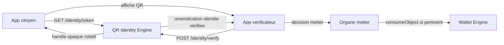
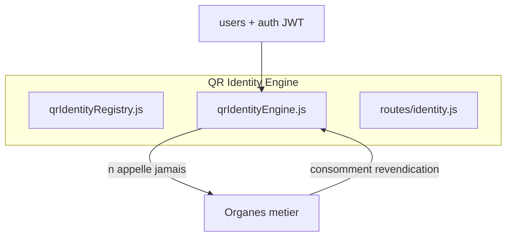

# Étude d'architecture — QR Identity Engine (Phase II)

**Date :** 15 juillet 2026
**Statut :** Proposition à valider — aucune implémentation
**Version Ma Zone de référence :** v9.0 (Wallet Engine intégré)
**Références :** [PLAN_ETUDE_WALLET_ENGINE.md](PLAN_ETUDE_WALLET_ENGINE.md) · [REVUE_ARCHITECTURE_WALLET_N2.md](REVUE_ARCHITECTURE_WALLET_N2.md) · [CHANTIER_WALLET_ADR_002_005.md](CHANTIER_WALLET_ADR_002_005.md)

---

## Objet de ce document

Ce document présente l'**étude de conception** du QR Identity Engine, deuxième organe transversal de Ma Zone (Phase II). Il développe la vision d'architecte, les propositions d'architecture, les flux, les risques et les décisions à valider avant toute implémentation.

**Aucun code. Aucune implémentation. Réflexion architecturale uniquement.**

---

## Résumé exécutif

Le Wallet Engine répond à la question : *« Quels sont mes droits numériques ? »*

Le QR Identity Engine répond à une autre : *« Qui est la personne qui souhaite exercer ces droits ? »*

**Verdict d'architecte :** le QR Identity doit être un organe **minimal, transversal et asymétrique** — il produit et valide des preuves d'identité, sans jamais accorder un droit ni prendre une décision métier. L'architecture recommandée **miroir le Wallet Engine** (registre déclaratif + moteur transactionnel + journal append-only + routes HTTP bornées), avec une approche de sécurité **handle opaque + validation serveur** (Approche C).

**Point critique :** le QR n'est pas un billet, pas une promotion, pas un Wallet. C'est uniquement une **identité numérique sécurisée**. Les autres organes décident.

---

## Positionnement dans l'écosystème Ma Zone

| Organe | Question | Responsabilité |
|--------|----------|----------------|
| **Wallet Engine** | « Quels droits ai-je ? » | Registre des objets numériques du citoyen, cycle de vie des entitlements |
| **QR Identity Engine** | « Qui suis-je physiquement ? » | Preuve d'identité présentable et vérifiable |
| **Event / Orders / Marketing…** | « Que faire de cette personne ? » | Logique métier, décisions, consommation des droits |



---

## 1. Vision générale

### Mission exacte

Le QR Identity Engine est le **pont entre le citoyen réel et son identité numérique**. Sa mission unique :

1. **Produire** une preuve d'identité présentable (QR) pour un citoyen authentifié ;
2. **Valider** une preuve présentée par un vérificateur autorisé ;
3. **Retourner** une revendication d'identité vérifiée — jamais un droit, jamais une décision.

Une revendication d'identité vérifiée ressemble conceptuellement à :

```json
{
  "subjectId": "uuid-utilisateur",
  "displayName": "Marie Dupont",
  "photoUrl": "/uploads/...",
  "purpose": "identity",
  "verifiedAt": "2026-07-15T10:30:00Z",
  "verificationId": "uuid-evenement-audit"
}
```

C'est tout. Pas de liste de billets. Pas de statut de commande. Pas de « accès autorisé ».

### Responsabilités explicitement refusées

| Hors périmètre | Pourquoi |
|----------------|----------|
| Consommer un billet / un droit | C'est le Wallet + l'organe métier |
| Connaître les commandes, événements, promotions | Couplage interdit — organe transversal |
| Décider d'autoriser un accès, un retrait, une procuration | Décision métier |
| Stocker des droits numériques | C'est le Wallet |
| Générer des QR de billets (v1) | Extension future — QR d'objet, pas QR d'identité |

### Positionnement architectural

- **Organe transversal** : consommé par de nombreux moteurs, dépendant d'**aucun**.
- **Dépendances autorisées** : `users` (table existante), `auth` (JWT middleware).
- **Dépendances interdites** : Wallet, Orders, Event, Marketing, Dispatch, Communication.
- **Direction des appels** : les organes métier consomment le QR Identity ; le QR Identity ne les appelle jamais.

---

## 2. Architecture proposée

### Principe directeur : miroir du Wallet Engine

Le Wallet Engine a établi des conventions éprouvées dans Ma Zone. Le QR Identity Engine les reproduit fidèlement :

| Couche Wallet | Couche QR Identity | Rôle |
|---------------|-------------------|------|
| `walletRegistry.js` | `qrIdentityRegistry.js` | Métadonnées déclaratives, point d'extension Open/Closed |
| `walletEngine.js` | `qrIdentityEngine.js` | Logique transactionnelle, journal, API in-process |
| `routes/wallet.js` | `routes/identity.js` | Routes HTTP bornées |
| `digital_objects` + `digital_object_events` | `identity_presentations` + `identity_events` | Projection d'état + ledger append-only |
| Socket `wallet:object_*` | Socket `identity:*` | Notifications temps réel |

### Arborescence prévue

```
backend/src/
├── lib/
│   ├── qrIdentityRegistry.js    # Usages (purpose), TTL, rôles vérificateurs, contrat de divulgation
│   └── qrIdentityEngine.js      # Génération, validation, rotation, révocation, audit
├── routes/
│   └── identity.js              # GET /token (citoyen), POST /verify (vérificateur)
└── db/index.js                  # Tables identity_presentations + identity_events

mobile/src/
├── screens/client/
│   └── IdentityScreen.js        # QR plein écran (nom, photo, code rotatif)
├── context/
│   └── QrIdentityContext.js     # (optionnel) rotation + socket
├── components/client/
│   └── ClientDrawerContent.js   # pictogramme QR à côté de l'avatar
└── api/index.js                 # getIdentityToken(), verifyIdentity()
```

### Modèle de données

#### Table `identity_presentations` (projection d'état courant)

| Colonne | Type | Rôle |
|---------|------|------|
| `id` | TEXT PK | Identifiant du jeton (jti) |
| `user_id` | TEXT FK → users | Citoyen propriétaire |
| `handle` | TEXT UNIQUE | Valeur encodée dans le QR (opaque, aléatoire) |
| `purpose` | TEXT | Usage déclaré (`identity`, futur : `access`, `pickup`…) |
| `status` | TEXT | `active` · `used` · `expired` · `revoked` |
| `expires_at` | TEXT | Expiration absolue (TTL court) |
| `created_at` | TEXT | Horodatage de création |

Index : `(user_id, status)`, `(handle)` unique.

#### Table `identity_events` (journal append-only)

| Colonne | Type | Rôle |
|---------|------|------|
| `id` | TEXT PK | UUID événement |
| `presentation_id` | TEXT FK | Jeton concerné |
| `subject_id` | TEXT | Citoyen identifié |
| `verifier_id` | TEXT | Utilisateur ayant scanné (si applicable) |
| `verifier_role` | TEXT | Rôle du vérificateur |
| `purpose` | TEXT | Usage au moment de l'événement |
| `type` | TEXT | `issued` · `validated` · `rejected` · `expired` · `revoked` · `rotated` |
| `outcome` | TEXT | Résultat (validated, replay, expired, unauthorized…) |
| `reason` | TEXT | Motif de rejet (optionnel) |
| `idempotency_key` | TEXT | Clé anti-rejeu (scan) |
| `created_at` | TEXT | Horodatage immuable |

Index : `(presentation_id, created_at)`, index unique partiel sur `(idempotency_key)` si non null.

### API publique du moteur (in-process)

**Commandes (écritures) :**

| Fonction | Signature | Rôle |
|----------|-----------|------|
| `issuePresentation` | `({ userId, purpose }, io?)` | Crée un jeton de présentation actif |
| `rotatePresentation` | `({ userId, purpose }, io?)` | Invalide l'ancien, émet un nouveau (rotation) |
| `verifyPresentation` | `({ handle, verifierId, verifierRole, purpose, idempotencyKey? }, io?)` | Valide ou rejette ; retourne revendication ou erreur |
| `revokeAll` | `({ userId, reason? }, io?)` | Invalide tous les jetons actifs (logout, incident) |

**Requêtes (lectures) :**

| Fonction | Rôle |
|----------|------|
| `getActivePresentation(userId, purpose?)` | Jeton actif courant (pour l'écran QR) |
| `getPresentationEvents(presentationId)` | Historique audit d'un jeton |
| `getVerificationHistory(userId, filters?)` | Historique des scans pour un citoyen |

**Registre (lecture pure) :**

| Fonction | Rôle |
|----------|------|
| `getPurpose(purposeId)` | Métadonnées d'un usage |
| `listPurposes()` | Catalogue des usages déclarés |
| `getDisclosureContract(purposeId)` | Champs d'identité autorisés à divulguer |
| `getVerifierRoles(purposeId)` | Rôles admis à vérifier |

### Routes HTTP

| Méthode | Route | Auth | Rôle |
|---------|-------|------|------|
| `GET` | `/api/identity/token` | `verifyToken` | Propriétaire (citoyen) — retourne handle + métadonnées d'affichage |
| `POST` | `/api/identity/verify` | `verifyToken` + rôle vérificateur | Reçoit `{ handle, purpose }`, retourne revendication ou rejet |
| `GET` | `/api/identity/history` | `verifyToken` | Propriétaire — historique de ses vérifications |

**Ce qui n'est PAS exposé en HTTP :** `revokeAll` (appelé en interne au logout), `rotatePresentation` (déclenché par le client via refresh du token).

### Événements Socket.io

| Événement | Cible | Quand |
|-----------|-------|-------|
| `identity:presentation_rotated` | `user_{userId}` | Nouveau jeton émis (rotation) |
| `identity:verified` | `user_{userId}` | Scan réussi (notification citoyen) |
| `identity:revoked` | `user_{userId}` | Tous les jetons invalidés |

### Intégration mobile (UX — hors cœur, mais anticipée)

L'utilisateur accède à son identité numérique via un **pictogramme QR** à côté de sa photo de profil (drawer `ClientDrawerContent.js`). Un clic ouvre `IdentityScreen` en plein écran : QR rotatif, nom, photo, indication de validité.

Cette décision UX n'impacte pas l'architecture interne : le moteur expose `GET /api/identity/token`, l'écran consomme et rafraîchit périodiquement (rotation ~30–60 s).

---

## 3. Communication avec les autres organes

### Principe : faible couplage, sens unique

Le QR Identity Engine ne `require` aucun organe métier. Les organes métier (ou leurs applications vérificatrices) consomment une **revendication d'identité vérifiée** produite par `verifyPresentation`.



### Par organe

| Organe | Interaction | Qui décide ? |
|--------|-------------|--------------|
| **Wallet** | Après identification, l'organe métier appelle `wallet.consumeObject({ objectId, consumerEngine: 'event', idempotencyKey })` | L'organe métier (Event, Orders…) — pas le QR |
| **Marketplace** | Identification du client en point de vente physique (futur) | Marketplace vérifie l'identité, applique sa logique commerciale |
| **Orders** | Retrait Click & Collect : identifier le client au comptoir | Orders vérifie identité + objet Wallet `pickup_ticket` |
| **Dispatch** | Identification livreur/client (futur, si scan physique) | Dispatch applique sa logique de mission |
| **Communication** | Aucune dépendance directe | — |
| **Event Engine** | Contrôle d'accès : identifier le porteur avant consommation du billet | Event vérifie identité, puis consomme l'objet Wallet |
| **Marketing** | Attribution promotionnelle en point de vente (futur) | Marketing applique ses règles |
| **Futurs organes** | Consomment `verifyPresentation` via registre de `purpose` | Chaque organe reste décideur |

### Flux type — contrôle d'accès événement

```
1. Citoyen ouvre IdentityScreen → GET /api/identity/token → QR affiché
2. Agent scanne le QR → POST /api/identity/verify { handle, purpose: "access" }
3. QR Identity retourne { subjectId, displayName, verifiedAt, verificationId }
4. App agent appelle Event Engine : "subjectId X se présente pour l'événement Y"
5. Event Engine vérifie le billet Wallet de X pour Y
6. Si billet valide → Event appelle wallet.consumeObject(...)
7. Event décide : accès autorisé ou refusé
```

Le QR Identity n'a participé qu'à l'étape 3. Il ignore l'existence de l'événement, du billet, et de la décision.

### Flux type — retrait Click & Collect

```
1. Client présente son QR d'identité au comptoir
2. Commerçant scanne → revendication d'identité vérifiée
3. App commerçant cherche les objets Wallet `pickup_ticket` actifs de subjectId
4. Commerçant confirme le retrait → Orders appelle wallet.consumeObject
```

Encore une fois : le QR identifie. Orders et Wallet gèrent le droit.

---

## 4. Sécurité

### Comparaison des trois approches

#### Approche A — QR = JWT de session

Le QR encode le JWT d'authentification actuel (`{ id, name, email, role }`, expiry 30 jours).

| Avantages | Inconvénients |
|-----------|---------------|
| Simple à implémenter | **Rejetée** : une photo du QR = compromission totale du compte |
| Pas de round-trip serveur pour afficher | Jeton longue durée, plein accès API |
| | Impossible de révoquer sans invalider toute la session |
| | Divulgation maximale (email, rôle) |

**Verdict : rejetée.** Le JWT de session sert à authentifier l'app, pas à prouver une présence physique.

#### Approche B — Jeton signé auto-porté (JWT court / TOTP)

Le QR encode un JWT signé courte durée contenant `subjectId` + `purpose` + `exp`. Le vérificateur valide la signature localement (clé publique partagée).

| Avantages | Inconvénients |
|-----------|---------------|
| Vérifiable hors-ligne (portiques, zones sans réseau) | Révocation difficile (jeton valide jusqu'à expiry) |
| Pas de round-trip serveur au scan | Nécessite de distribuer une clé aux vérificateurs |
| | Risque de rejeu si pas de nonce serveur |
| | Complexité de rotation des clés |

**Verdict : réservée comme extension future** (mode hors-ligne), pas comme fondation v1.

#### Approche C — Handle opaque + validation serveur (RECOMMANDÉE)

Le QR encode uniquement un **handle aléatoire opaque** (ex. `mz:id:7f3a9c2e`). Le vérificateur appelle `POST /api/identity/verify` ; le serveur résout l'identité, marque le jeton comme utilisé, journalise l'événement.

| Avantages | Inconvénients |
|-----------|---------------|
| Révocable instantanément | Nécessite connectivité au scan |
| Rotatable (nouveau handle toutes les 30–60 s) | Round-trip serveur obligatoire |
| Aucun secret dans le QR | |
| Anti-rejeu : usage unique + TTL court | |
| Divulgation minimale (contrat par purpose) | |
| Audit complet (qui a scanné qui, quand) | |

**Verdict : fondation v1.** Le format de handle est conçu pour accueillir plus tard un préfixe `mz:signed:` (mode B) sans migration de schéma.

### Principes de sécurité retenus

| Principe | Mécanisme |
|----------|-----------|
| **Authenticité** | Validation serveur exclusive — jamais de confiance au contenu client |
| **Anti-falsification** | Handle aléatoire cryptographiquement sûr (`crypto.randomBytes`) |
| **Anti-rejeu** | Usage unique par jeton + TTL court (60–120 s) + idempotency_key sur scan |
| **Rotation** | Nouveau handle émis périodiquement ; ancien invalidé |
| **Révocation** | `revokeAll(userId)` au logout ou incident ; statut `revoked` en base |
| **Vie privée** | Revendication minimale bornée par `getDisclosureContract(purpose)` |
| **Autorisation** | `POST /verify` réservé aux rôles déclarés dans le registre |
| **Audit** | Chaque tentative (succès ou échec) inscrite dans `identity_events` |

### Contrat de divulgation (miroir ADR-005 du Wallet)

Le registre déclare, par `purpose`, quels champs d'identité peuvent être exposés lors d'une vérification :

```js
// Exemple conceptuel — qrIdentityRegistry.js
definePurpose({
  id: 'identity',
  label: 'Identification personnelle',
  ttlSeconds: 60,
  rotationSeconds: 30,
  verifierRoles: ['merchant', 'driver'],
  disclosure: ['displayName', 'photoUrl'],  // PAS email, PAS role, PAS id interne
});
```

Validation au chargement du module (fail-fast) : si un `purpose` tente d'exposer un champ hors allowlist globale, le serveur refuse de démarrer.

---

## 5. Cycle de vie

### Naissance de l'identité

L'**identité numérique** n'est pas un objet à créer : elle **est** l'utilisateur (`users.id`). Dès qu'un compte client existe, l'identité existe. Aucune table supplémentaire « profil d'identité » n'est nécessaire en v1.

### Naissance d'un jeton de présentation

Un jeton est créé **à la demande**, lorsque le citoyen ouvre l'écran QR :

```
GET /api/identity/token
  → issuePresentation({ userId, purpose: 'identity' })
  → handle opaque, expires_at = now + 60s
  → événement ledger : type = 'issued'
```

### Rotation

Tant que l'écran QR est ouvert, le client rafraîchit périodiquement (toutes les ~30 s) :

```
rotatePresentation({ userId, purpose: 'identity' })
  → ancien jeton : status = 'expired'
  → nouveau jeton : status = 'active'
  → événement ledger : type = 'rotated'
```

### Utilisation (scan)

```
verifyPresentation({ handle, verifierId, verifierRole, purpose, idempotencyKey })
  → si valide : status = 'used', retourne revendication
  → si rejeu (idempotency_key connu) : retourne replay sans double-comptage
  → si expiré/révoqué : rejet + événement 'rejected'
```

### Expiration

Un job périodique (ou vérification lazy au prochain `issuePresentation`) marque les jetons dépassés en `expired`.

### Révocation globale

Au logout, changement de mot de passe, ou incident de sécurité :

```
revokeAll({ userId, reason: 'logout' })
  → tous les jetons actifs : status = 'revoked'
  → socket : identity:revoked → user_{userId}
```

### Régénération

Le citoyen peut à tout moment rouvrir l'écran QR → nouveau jeton. Aucune « identité figée » : seuls les jetons de présentation sont éphémères ; l'identité sous-jacente est permanente.

---

## 6. Philosophie — garantir la séparation sur le long terme

### Le QR n'accorde jamais un droit

Ce principe doit être **structurel**, pas seulement documenté. Trois garde-fous architecturaux :

**1. Contrat de divulgation (registre)**

Le moteur ne peut retourner que les champs déclarés dans `disclosure` pour un `purpose`. Pas de champ métier (billets, commandes, promotions) dans la revendication.

**2. Aucune dépendance vers les organes métier**

`qrIdentityEngine.js` ne contient aucun `require('../lib/walletEngine')`, aucun `require('../routes/orders')`. Si un développeur tente d'ajouter une telle dépendance, c'est une violation architecturale visible en revue de code.

**3. Validation fail-fast au chargement (miroir ADR-005)**

Comme `validateCapabilityContract()` pour le Wallet, le registre QR Identity valide au démarrage que :
- chaque `purpose` respecte le contrat de divulgation ;
- aucun champ interdit n'est exposé ;
- les rôles vérificateurs sont des rôles Ma Zone connus.

### Analogie avec le Wallet

| Wallet | QR Identity |
|--------|-------------|
| « Cet objet propose cette action » (capabilities descriptives) | « Cette personne est identifiée » (revendication descriptive) |
| Le Wallet n'exécute pas la logique métier des actions `handledBy: 'source'` | Le QR Identity ne décide pas de l'issue du scan |
| ADR-005 : allowlist `handledBy: 'wallet'` | Contrat de divulgation par `purpose` |

### Distinction structurante : deux QR différents

| | QR d'identité personnelle (v1) | QR d'objet / entitlement (futur) |
|--|--------------------------------|----------------------------------|
| **Référence** | L'utilisateur (`users.id`) | Un objet Wallet (`digital_objects.id`) |
| **Question** | « Qui êtes-vous ? » | « Quel droit présentez-vous ? » |
| **Accès UX** | À côté de la photo de profil | Via capability `show_qr` d'un objet Wallet |
| **Consommation** | Ne consomme rien | L'organe métier consomme l'objet Wallet après identification |
| **Périmètre v1** | Oui | Préparé, non développé |

Confondre les deux est le piège classique qui transforme le QR Identity en « générateur de billets ». La v1 se concentre exclusivement sur le QR d'identité personnelle.

---

## 7. Évolutivité

### Extension par le registre (Open/Closed)

Comme `defineKind()` pour le Wallet, `definePurpose()` dans `qrIdentityRegistry.js` permet d'ajouter de nouveaux usages sans modifier le cœur :

```js
// Futurs usages — déclaratifs uniquement, pas de code métier dans le moteur
definePurpose({ id: 'access', verifierRoles: ['merchant'], ttlSeconds: 30, disclosure: ['displayName'] });
definePurpose({ id: 'pickup', verifierRoles: ['merchant'], ttlSeconds: 60, disclosure: ['displayName', 'photoUrl'] });
definePurpose({ id: 'civic', verifierRoles: ['merchant', 'driver'], ttlSeconds: 120, disclosure: ['displayName'] });
```

Chaque `purpose` reste **identifiant** : il précise le contexte de la vérification, pas la décision.

### Usages futurs anticipés

| Usage | Purpose | Vérificateur | Ce que le QR fait | Ce que l'organe métier fait |
|-------|---------|--------------|-------------------|----------------------------|
| **Procuration** | `proxy` | `merchant` | Identifie le porteur | Vérifie l'objet Wallet `proxy` du porteur |
| **Événement** | `access` | `merchant` | Identifie le porteur | Vérifie et consomme le billet Wallet |
| **Retrait** | `pickup` | `merchant` | Identifie le client | Vérifie et consomme le `pickup_ticket` |
| **Réservation** | `reservation` | `merchant` | Identifie le client | Vérifie la réservation dans son moteur |
| **Points civiques** | `civic` | `merchant` | Identifie le citoyen | Applique la règle d'attribution |
| **Badge / fidélité** | `loyalty` | `merchant` | Identifie le client | Met à jour l'objet Wallet `loyalty_card` |

Dans tous les cas : le QR Identity identifie. L'organe métier décide et agit sur le Wallet si nécessaire.

### Mode hors-ligne (extension sans refonte)

Le schéma `identity_presentations` peut accueillir un champ `mode: 'online' | 'signed'` sans migration destructive. En mode `signed`, le handle devient un JWT court signé (Approche B) pour les portiques à faible connectivité. La validation serveur reste le mode par défaut.

### QR d'objet (extension sans refonte)

La primitive `verifyPresentation` peut être généralisée en `verifyToken({ handle, expectedRef?, purpose })` où `expectedRef` pointe vers un `digital_objects.id`. Le moteur vérifie que le handle correspond à l'objet attendu — toujours sans consommer. La consommation reste à l'organe métier via `wallet.consumeObject`.

---

## 8. Risques architecturaux et parades

| Risque | Gravité | Parade dès v1 |
|--------|---------|---------------|
| **JWT de session dans le QR** | Critique | Approche C uniquement ; revue de code explicite |
| **Rejeu par capture d'écran** | Haute | Usage unique + TTL 60 s + rotation 30 s |
| **Dérive en « organe-dieu »** (retourne droits, décisions) | Haute | Contrat de divulgation + zéro dépendance métier + fail-fast |
| **Vie privée du citoyen** | Haute | Revendication minimale ; pas d'email/rôle dans disclosure |
| **QR Identity appelle le Wallet** | Haute | Interdit par architecture ; revue systématique |
| **Confusion QR identité / QR billet** | Moyenne | Deux concepts nommés distinctement ; v1 = identité seule |
| **Besoin hors-ligne imprévu** | Moyenne | Format handle extensible ; mode `signed` préparé |
| **Scan non autorisé** | Moyenne | Rôle vérificateur requis + audit complet |
| **Pas de révocation** | Moyenne | `revokeAll` au logout ; statut `revoked` |
| **Sur-ingénierie v1** | Moyenne | Un seul `purpose: 'identity'` ; registre prêt, usages futurs déclaratifs |

### Pièges classiques à éviter

1. **« Le QR ouvre la porte »** — Non. Le QR identifie. L'Event Engine ouvre la porte.
2. **« Le scan consomme le billet »** — Non. Le scan identifie. L'organe métier consomme via Wallet.
3. **« Le QR contient la liste des droits »** — Non. C'est le Wallet qui liste les droits.
4. **« Un QR unique permanent par utilisateur »** — Non. Jetons éphémères rotatifs uniquement.
5. **« Le commerçant scanne et c'est réglé »** — Non. Le commerçant obtient une identité vérifiée, puis son application applique la logique métier.

---

## Décisions architecturales proposées (ADR)

| ID | Décision | Statut proposé |
|----|----------|----------------|
| **ADR-QR-001** | Le QR Identity identifie uniquement ; jamais de décision métier | À valider |
| **ADR-QR-002** | Approche C (handle opaque + validation serveur) comme fondation v1 | À valider |
| **ADR-QR-003** | Architecture miroir du Wallet (registry + engine + ledger + routes) | À valider |
| **ADR-QR-004** | v1 = QR d'identité personnelle uniquement ; QR d'objet = extension | À valider |
| **ADR-QR-005** | Contrat de divulgation par `purpose`, validé au chargement (fail-fast) | À valider |
| **ADR-QR-006** | Zéro dépendance du QR Identity vers les organes métier | À valider |
| **ADR-QR-007** | Mode hors-ligne (Approche B) préparé mais non développé en v1 | À valider |

---

## Ce qui est préparé mais non développé en v1

| Élément | Préparation | Développement |
|---------|-------------|---------------|
| QR d'objet / entitlement (`show_qr` Wallet) | Format handle extensible, `expectedRef` | Après v1 identité |
| Purposes multiples (`access`, `pickup`, `civic`…) | `definePurpose()` dans le registre | À la demande des organes |
| Mode hors-ligne signé | Champ `mode` dans le schéma | Si besoin terrain confirmé |
| Scanner mobile (expo-camera) | Route `POST /verify` prête | App vérificateur par organe |
| Procuration | Objet Wallet `proxy` (futur) + purpose `proxy` | Event / Orders Engine |
| QrIdentityContext + socket | Événements `identity:*` définis | Si UX temps réel requise |

---

## Prochaines étapes (après validation)

1. Valider les 7 ADR proposées.
2. Développer le noyau backend (`qrIdentityRegistry` + `qrIdentityEngine` + tables + routes).
3. Développer l'écran mobile `IdentityScreen` + pictogramme drawer.
4. Brancher le premier cas d'usage réel (ex. retrait Click & Collect via Orders).
5. Documenter le contrat d'intégration pour les futurs organes émetteurs/vérificateurs.

---

## Auto-évaluation (note CTO préliminaire)

| Critère | Évaluation |
|---------|------------|
| Simplicité | Forte — un seul purpose v1, moteur minimal |
| Robustesse | Forte — validation serveur, anti-rejeu, audit |
| Évolutivité | Forte — registre déclaratif, format extensible |
| Séparation des responsabilités | Forte — garde-fous structurels (ADR-QR-005/006) |
| Risque principal | Tentation de faire « tout en un scan » — mitigé par ADR et documentation |

**Note préliminaire :** architecture saine, alignée sur les conventions Ma Zone et le Wallet Engine. Prête pour validation avant développement.

---

## Annexes

### Arborescence cible

```
backend/src/lib/qrIdentityRegistry.js
backend/src/lib/qrIdentityEngine.js
backend/src/routes/identity.js
backend/src/db/index.js                    (tables identity_*)
mobile/src/screens/client/IdentityScreen.js
mobile/src/context/QrIdentityContext.js    (optionnel)
mobile/src/components/client/ClientDrawerContent.js  (modification)
mobile/src/api/index.js                    (endpoints identity)
```

### Dépendances npm à prévoir (implémentation)

| Package | Usage |
|---------|-------|
| `react-native-qrcode-svg` + `react-native-svg` | Affichage QR (mobile) |
| `expo-camera` | Scanner (futur, app vérificateur) |
| `crypto` (Node built-in) | Génération handle aléatoire (backend) |

Aucune nouvelle dépendance backend critique : `crypto` est natif Node.js.

### Références croisées Wallet ↔ QR Identity

| Concept Wallet | Équivalent QR Identity |
|----------------|------------------------|
| `DigitalObject` | Jeton de présentation (`identity_presentations`) |
| `digital_object_events` | `identity_events` |
| `walletRegistry.js` / `defineKind` | `qrIdentityRegistry.js` / `definePurpose` |
| `issueObject` | `issuePresentation` |
| `consumeObject` | `verifyPresentation` (identifie, ne consomme pas) |
| `WALLET_HANDLED_ALLOWLIST` | Contrat de divulgation par purpose |
| `show_qr` capability | QR d'objet (extension future) |
| `wallet:object_*` socket | `identity:*` socket |
