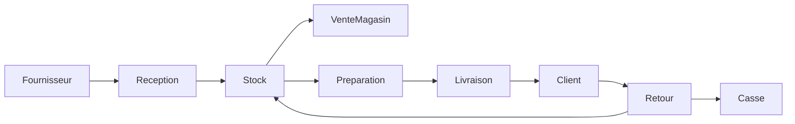
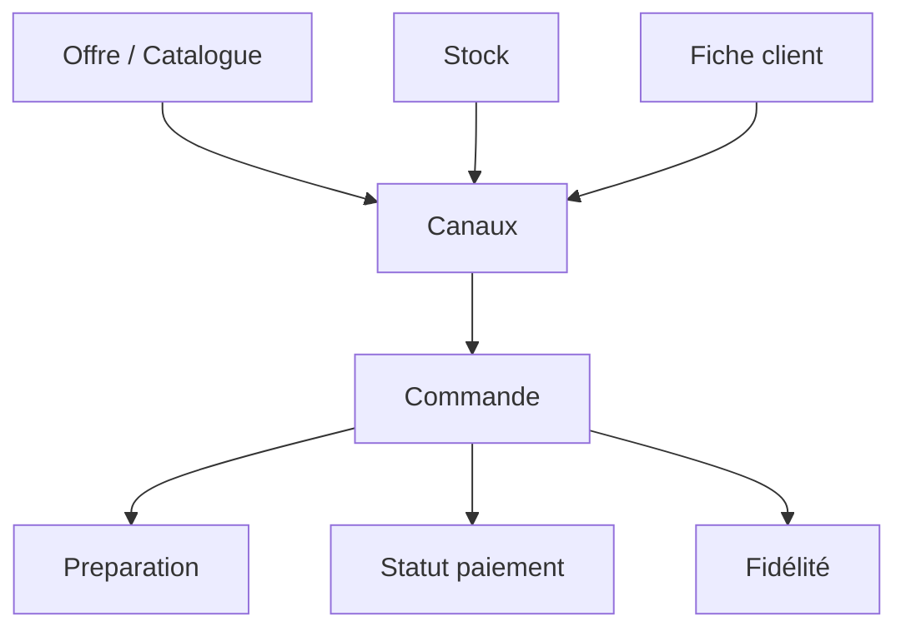
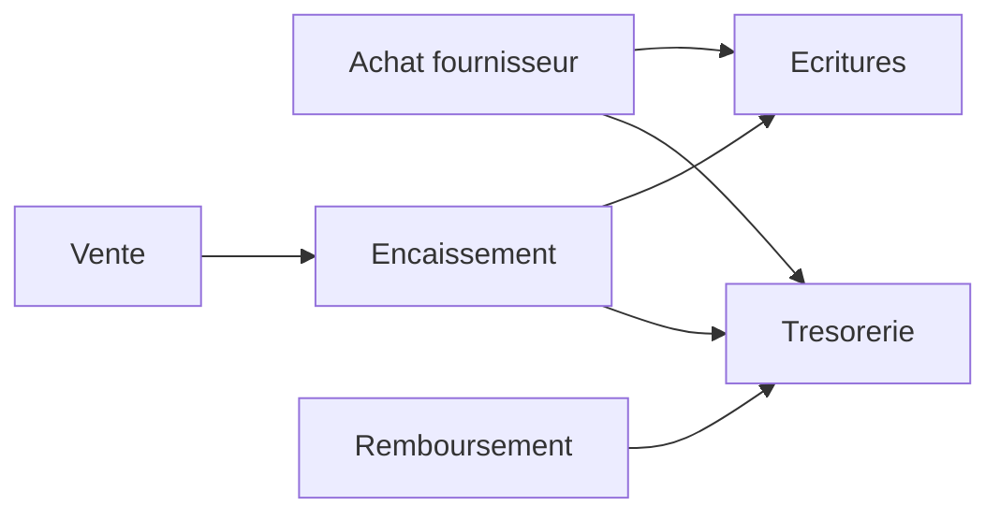

# Cartographie_Metier_V1

**Encyclopédie métier du commerce moderne — document de recherche pour validation**

| | |
|---|---|
| **Nature** | Plan de travail + recherches (PAS une fiche FD, PAS une architecture) |
| **Date** | 2026-07-24 |
| **Statut** | Brouillon de recherche — en attente de validation Adam / Reda |
| **Phase** | Fondation Ma Zone |
| **Posture** | Architecte-chercheur : mettre à l'épreuve, ne pas confirmer |
| **Suite prévue** | Après validation → GO pour FD-001 → puis plan d'implémentation → puis FD-002 |
| **Périmètre doc** | Document **unique consolidé** (verticaux inclus au §11, pas d'annexe) |

> **Piège évité :** ce document n'est pas un catalogue de logiciels.  
> Les logiciels sont des **manifestations temporaires** de besoins métier.  
> Si tous les logiciels actuels disparaissaient dans dix ans, ce document devrait rester pertinent.

---

## Légende d'étiquetage (obligatoire)

| Code | Signification |
|------|---------------|
| `[FAIT]` | Observé / documenté (réglementation, doc officielle, donnée sourcée) |
| `[PRATIQUE]` | Usage courant concordant chez plusieurs sources indépendantes |
| `[EDITEUR]` | Recommandation ou positionnement explicite d'un éditeur |
| `[HYPOTHESE]` | Plausible, non triangulé ici |
| `[DEDUCTION]` | Interprétation du chercheur à partir des faits et pratiques |

**Règle :** une affirmation structurante s'appuie idéalement sur au moins deux sources indépendantes.

---

# 0. Pourquoi un commerce existe

## 0.1 Pourquoi existe un commerce ?

`[PRATIQUE]` Un commerce existe pour **mettre une offre (produit, service, expérience) à la disposition d'un client**, au bon endroit, au bon moment, à un prix acceptable, avec une promesse de disponibilité et de confiance.  
Sources : [Retail Dogma — retail business model](https://www.retaildogma.com/retail-business/) · [BCG — Elements of a Retail Business Model](https://www.bcg.com/publications/2010/strategy-elements-retail-business-model)

`[DEDUCTION]` Le commerce n'est pas « une caisse ». La caisse est la dernière seconde d'une chaîne de décisions (quoi vendre, combien acheter, à quel prix, qui sert, comment encaisser, comment se réapprovisionner).

## 0.2 Quels sont ses objectifs ?

Objectifs durables, indépendants des outils :

1. **Attirer** une demande (trafic, notoriété locale, fidélité).
2. **Convertir** (disponibilité, prix, conseil, expérience).
3. **Encaisser** correctement (conformité, exactitude, liquidités).
4. **Renouveler** l'offre (réassort, saisonnalité, nouveautés).
5. **Protéger la marge** (coût d'achat, démarque, commissions, main-d'œuvre).
6. **Rester solvable** (cash flow : payer fournisseurs / loyer / salaires avant d'être payé soi-même).

`[PRATIQUE]` Le cash flow est souvent plus critique que le « profit papier » : le commerçant paie le stock avant de le vendre.  
Sources : [Order.co — retail cash flow 2026](https://www.order.co/blog/finance/retail-cash-flow-management/) · [Credibly — retail cash flow tips](https://www.credibly.com/incredibly/blog/retail-cash-flow-management-tips/) · [IJRISS — cash flow as lifeline](https://rsisinternational.org/journals/ijriss/view/cash-flow-as-the-lifeline-of-enterprises-insights-into-the-fundamental-logic-of-retail-business-operations)

## 0.3 Grands flux qui traversent l'activité

Trois flux fondamentaux :

| Flux | Sens | Exemples |
|------|------|----------|
| **Logistique / physique** | Fournisseur → magasin → client (ou retour) | Réception, mise en rayon, livraison, casse |
| **Information** | Qui sait quoi, quand | Catalogue, stock, commande, client, planning |
| **Financier** | Argent et engagements | Achat, vente, paiement, remboursement, écriture comptable |

`[DEDUCTION]` La plupart des « logiciels du commerçant » existent parce qu'un de ces flux dépasse ce qu'un carnet / Excel peut tenir sans erreur.

## 0.4 Comment crée-t-il de la valeur ?

`[PRATIQUE]` Selon le vertical, la valeur se crée différemment :

| Vertical | Valeur créée | Actif critique |
|----------|--------------|----------------|
| Retail généraliste | Assortiment + accessibilité | Stock + emplacement |
| Alimentaire / épicerie | Disponibilité + fraîcheur + conseil | Rotation + DLC |
| Restauration / CHR | Expérience consommable « ici et maintenant » | Capacité table + cuisine + timing |
| Services (beauté, artisans) | Temps qualifié + relation | Agenda / capacité humaine |

Sources synthèses croisées : Retail Dogma · guides fiches techniques restauration · Planity / Square Appointments · Clictill épicerie (voir §7).

## 0.5 Quelles sont ses contraintes ?

- **Trésorerie** immobilisée dans le stock / matières / acomptes.
- **Temps** (ouvertures, coup de feu, créneaux, délais fournisseurs).
- **Conformité** (TVA / caisse ISCA–NF525 en France ; traçabilité alimentaire ; métrologie balances).
- **Main-d'œuvre** (coût, formation, droits de caisse).
- **Espace** (rayon, tables, atelier).
- **Promesse client** (disponibilité affichée vs réalité).

`[FAIT]` France : assujetti TVA qui enregistre les paiements de particuliers via un logiciel de caisse doit respecter les critères **ISCA** (inaltérabilité, sécurisation, conservation, archivage) ; preuve par certificat (NF525 / LNE) ou attestation éditeur selon le cadre en vigueur. Amende typique : **7 500 €** par système non conforme.  
Sources : [economie.gouv.fr — certification logiciels de caisse](https://www.economie.gouv.fr/entreprises/gerer-son-entreprise-au-quotidien/gerer-sa-comptabilite-et-ses-demarches/ce-quil-faut-savoir-sur-la-certification-des-logiciels-de-caisse) · [INFOCERT NF525](https://infocert.org/nf525/) · [La Caisse Idéale — NF525 2026](https://www.lacaisseideale.fr/articles/caisse-enregistreuse-nf525/)

`[DEDUCTION]` La conformité n'est pas un différenciateur : c'est un **prérequis**. Les différenciateurs sont ailleurs (offre, service, disponibilité).

---

# 1. Posture et méthode

## 1.1 Pourquoi cette recherche avant toute architecture

Ma Zone vise, à terme, à s'interconnecter puis à remplacer progressivement des briques du commerce de proximité.  
Avant de décider **comment** construire, il faut comprendre **comment le métier fonctionne réellement**.

Ce document répond à une seule question :

> **Comment fonctionne réellement un commerce moderne ?**

Il ne répond pas à : « Comment Ma Zone doit-elle s'architecturer ? » (réservé à FD-002, après FD-001 validée).

## 1.2 Posture critique

Nous ne cherchons pas à confirmer Ma Zone.  
Nous cherchons ce qui, dans l'industrie, **contredit ou nuance** nos intuitions.  
Voir §11.

## 1.3 Périmètre

Commerce de proximité au sens large :

1. Retail généraliste  
2. Alimentaire / épicerie  
3. Restauration / CHR  
4. Services (beauté, artisans, rendez-vous)

---

# 2. Le commerce expliqué à un néophyte

## 2.1 Une journée type (retail / épicerie — narration)

1. **Réception** — Un fournisseur livre. On compte, on contrôle, on range (FIFO si périssable). Le commerçant décide s'il accepte un écart.
2. **Mise en rayon** — Étiquettes, prix, faces. Décision : démarquer un produit bientôt périmé ?
3. **Vente** — Clients, scan / pesée, conseils, file. Décision : accepter une remise ? Un remboursement ?
4. **Pilotage court** — « Qu'est-ce qui manque ? » « Qu'est-ce qui ne tourne pas ? » Décision : commander ce soir ou attendre ?
5. **Clôture** — Compter la caisse, comparer au théorique, éditer le Z, ranger.

Sources opérationnelles : [Lightspeed — checklists ouverture/fermeture restaurant](https://fr.lightspeedhq.be/blog/avantages-listes-verifications-quotidiennes-ouverture-fermeture-restaurant/) · [Clictill — stocks / inventaire](https://www.clictill.com/fonctionnalites-logiciel-caisse/gestion-stocks/) · [Trade.Easy — FIFO alimentaire](https://www.trade-easy.fr/la-methode-fifo-pour-votre-gestion-de-stock-de-produits-alimentaires/)

## 2.2 Une journée type (CHR — narration)

Ouverture → mise en place → service (accueil, table, commande, bon cuisine, pacing, addition) → entre-services (réassort, 86) → clôture (écarts, offerts, Z).  
L'unité de valeur n'est pas le SKU rayon : c'est la **table + le temps de service + le plat produit**.

## 2.3 Une journée type (services — narration)

**Beauté :** l'agenda est l'usine. Un no-show = capacité brûlée.  
**Artisan :** devis → signature → chantier → facture. La relation s'étale sur des jours/semaines.

`[FAIT]/[PRATIQUE]` Baromètre Planity 2025 (données éditeur / presse) : annulation moyenne ~12,4 % ; no-show ~3,1 % ; rappels et arrhes réduisent fortement ces pertes.  
Sources : [Coiffure Actu — baromètre Planity 2025](https://coiffure-actu.fr/barometre-planity-2025-280-millions-rendez-vous-coiffure/) · [Planity — rappels](https://info.planity.com/solution/logiciel-rendez-vous) · [Square Appointments — deposits](https://squareup.com/help/us/en/article/8096-deposits-on-square-appointments)

---

# 3. Cartographie des acteurs

| Acteur | Rôle métier | Motivation principale | Données qu'il détient / influence |
|--------|-------------|----------------------|----------------------------------|
| **Client** | Achète / consomme / réserve | Obtenir ce qu'il veut, vite, sans mauvaise surprise | Identité, préférences, historique, moyens de paiement |
| **Commerçant / exploitant** | Décide de l'offre et de la politique | Marge, survie, réputation locale | Assortiment, prix, règles, équipes |
| **Employé** | Exécute (vente, service, production) | Faire son service correctement, droits limités | Actions en caisse, droits, pointages |
| **Fournisseur** | Fournit biens / matières | Vendre, être payé | Catalogue amont, tarifs, délais, lots |
| **Livreur / transporteur** | Déplace biens ou repas | Livrer à temps, être rémunéré | Missions, preuves de livraison, géo |
| **Plateforme** | Met en relation / amplifie | Commission, volume, captation relation | Catalogue miroir, avis, clients plateforme |
| **PSP / banque** | Encaissement carte / virement | Sécuriser le paiement, frais | Transactions, litiges |
| **Administration** | Contrôle fiscal / sanitaire | Conformité, recettes fiscales, sécurité alimentaire | Preuves ISCA, traçabilité, déclarations |
| **Partenaire** (comptable, franchise…) | Conseil / consolidation | Exactitude, reporting | Écritures, agrégats |
| **Plateforme locale type marketplace** | Canal additionnel | (à analyser sans a priori) | Commandes, clients, stocks affichés |

`[DEDUCTION]` Chaque acteur « tire » la vérité vers son intérêt. D'où les conflits de propriété des données (§6).

---

# 4. Cartographie des objets métier

Pour chaque objet : définition · cycle de vie · qui crée / modifie / consomme.

| Objet | Définition métier | Cycle de vie | Crée | Modifie | Consomme |
|-------|-------------------|--------------|------|---------|----------|
| **Produit / offre** | Ce qui peut être vendu | Conception → actif → archivé | Commerçant / fournisseur | Merchandising | Canaux de vente |
| **Variante** | Déclinaison (taille, parfum…) | Liée au produit | Commerçant | Commerçant | Caisse / site |
| **Catalogue** | Ensemble vendable + présentation | Versionné / publié | Commerçant / marketing | Enrichissement | Tous canaux |
| **Stock (on-hand)** | Quantité physique présente | Continu | Réception / inventaire | Ventes, casse, transferts | Décision de vente / commande |
| **Mouvement de stock** | Événement qui change le stock | Append-only métier | Opérations | — (immuable une fois posé) | Pilotage, audit |
| **Commande client** | Engagement de vente | Brouillon → payée → honorée / annulée | Client / canal | Ops / OMS | Préparation, livraison, compta |
| **Paiement** | Règlement d'un montant | Autorisé → capturé / refusé / remboursé | PSP / caisse | Litiges | Compta, caisse |
| **Ticket / addition** | Preuve d'encaissement (souvent réglementaire) | Émis → clos (Z) | Caisse | Annulation contrôlée | Client, fisc, compta |
| **Facture** | Document commercial / fiscal | Émise → payée / annulée | Commerçant | Avoirs | Client, compta |
| **Réservation / RDV** | Engagement de capacité | Réservé → honoré / no-show / annulé | Client / staff | Politique | Planning |
| **Promotion** | Règle temporaire de prix / avantage | Planifiée → active → expirée | Marketing / gérant | Gérant | Canaux |
| **Fidélité** | Compteur / statut relationnel | Continu | Programme | Achats / règles | Création d'avantage |
| **Wallet / objet numérique** | Droit / billet / preuve détenue par le client | Émis → actif → consommé / expiré | Organe métier | Organe métier | Client, contrôle |
| **Livraison** | Promesse d'acheminement | Assignée → livrée / échec | Ops | Livreur | Client |
| **Retour** | Remontée physique du bien | Demandé → inspecté → restocké / détruit | Client / magasin | Qualité | Stock, marge |
| **Remboursement** | Décision financière inverse | Approuvé → exécuté | Autorité selon seuil | — | Trésorerie, compta |
| **Client (fiche)** | Identité relationnelle | Créée → enrichie → fusionnée | Tous points de contact | CRM / staff | Marketing, service |
| **Employé** | Capacité humaine + droits | Actif / inactif | RH / gérant | Planning | Caisse, service |
| **Écriture comptable** | Trace financière | Postée → figée (exercice) | Compta / export caisse | Rare (OD) | Déclarations |
| **Événement local** | Initiative temporelle (atelier, dégustation…) | Annoncé → live → clos | Commerçant / ville | Organisateur | Habitants, stocks associés |

`[DEDUCTION]` Distinguer **objet mutable** (stock, prix) et **objet qui devient immuable** (ticket validé, écriture postée, mouvement journalisé) est un invariant du commerce (§8).

---

# 5. Cartographie des décisions métier

Un logiciel ne manipule pas seulement des données : il **instrumente des décisions**.

| Décision | Qui décide (typique TPE) | Qui décide (organisation plus large) | Enjeu |
|----------|--------------------------|--------------------------------------|-------|
| **Prix de vente** | Exploitant | Merchandising + finance + conseil prix ; exceptions escaladées | Marge vs compétitivité |
| **Remise** | Employé (seuils) / manager | Droits par rôle + garde-fous | Fraude & érosion marge |
| **Promotion** | Exploitant | Marketing + merchandising + finance | Trafic vs marge |
| **Markdown / démarque** | Exploitant / rayon | Planning + pricing + finance | Sortie de stock vs image |
| **Rupture affichée (86)** | Cuisine / manager / rayon | Propagée à tous les canaux | Promesse client |
| **Commande fournisseur** | Exploitant | Acheteur / planner (ROP, open-to-buy) | Cash immobilisé vs rupture |
| **Réception / écart** | Magasinier / gérant | Supply + qualité | Stock réel |
| **Acceptation commande client** | Auto si stock / capacité | OMS / règles ATP | Oversell |
| **Annulation commande** | Manager / politique | CS + règles | Coût & relation |
| **Réservation / surbooking** | Gérant / politique | Système + règles no-show | Capacité |
| **Remboursement** | Seuils : employé → manager → régional | Politique + PIN / workflow | Fraude & CX |
| **Retour physique** | Magasin (inspection) | Reverse logistics | Restock vs casse |
| **Écriture comptable** | Expert-comptable / export | Finance | Conformité |
| **Embauche / planning** | Gérant | RH + manager | Coût main-d'œuvre |

Sources décisions prix / markdown : [Umbex — pricing governance](https://umbrex.com/resources/retail-industry-playbooks/retail-pricing-architecture-playbook/pricing-rules-guardrails-governance-and-tools/) · [Umbex — markdown governance](https://umbrex.com/resources/retail-industry-playbooks/markdown-optimization-playbook/markdown-operating-model-and-governance/) · [LinkedIn / Kakas — retailer pricing](https://www.linkedin.com/pulse/retailer-pricing-frameworks-kpis-examples-armin-kakas-nmqle)

Sources remboursements : [Eposly — refund approval framework](https://eposly.io/blogs-insights/a-framework-for-standardising-your-retail-refund-approval-process/) · [Glyde — returns SOP](https://glydehq.com/templates/sop-returns-processing-retail) · [Umbex — returns policy](https://umbrex.com/resources/retail-industry-playbooks/returns-reduction-reverse-logistics-playbook/returns-policy-design-and-customer-experience/)

Sources réassort : [Shopappy — ROP / safety stock](https://shopappy.com/logistics/warehousing-inventory/safety-stock-reorder-points-retail) · [Xorosoft — inventory planning](https://xorosoft.com/inventory-planning-guide/) · [Impact Analytics — retail inventory](https://www.impactanalytics.ai/blog/retail-inventory-management)

`[PRATIQUE]` Pattern récurrent : **recommandation / approbation / exécution / contrôle** sont des rôles séparés dès que l'organisation grossit.  
`[DEDUCTION]` Pour une TPE, une seule personne cumule tout — d'où le besoin d'outils simples. Pour une plateforme multi-commerçants, il faudra modéliser des **droits de décision**, pas seulement des données.

---

# 6. Propriété des données au niveau attribut

## 6.1 Invariant industriel

`[PRATIQUE]` **Un champ = un seul propriétaire.** Si deux systèmes écrivent le même attribut, le drift est certain.  
Sources : [Creatuity — field-by-field ownership](https://www.creatuity.com/insights/source-of-truth-in-b2b-commerce-erp-vs-pim-vs-oms-vs-ecommerce-field-by-field-guide/) · [humCommerce — PIM/ERP ownership](https://humcommerce.com/knowledge-center/complete-guide-to-pim-erp-data-integration/) · [humCommerce — PIM governance playbook](https://humcommerce.com/knowledge-center/the-pim-data-governance-playbook-who-owns-what-and-why-it-matters/) · [Uphance — ERP+ecommerce+POS](https://www.uphance.com/blog/erp-ecommerce-pos-integration-architecture/)

## 6.2 Exemple produit — qui possède quoi ?

| Attribut | Propriétaire métier habituel | Système de record fréquent | Notes |
|----------|------------------------------|----------------------------|-------|
| Identifiant SKU / EAN | Ops / achats | ERP / caisse / MDM | Ancre d'identité — souvent immuable une fois publié |
| Nom commercial | Merchandising / gérant | PIM ou caisse | Peut différer par canal |
| Description marketing | Marketing | PIM | « Froide » enrichie |
| Photos | Marketing / DAM | PIM / DAM | Standards qualité |
| Prix de vente | Pricing / gérant | ERP / caisse (selon setup) | Chaude ; pas via PIM en live |
| Coût d'achat | Achats / finance | ERP | Sensible ; rarement exposé canaux |
| Stock on-hand | Magasin / WMS | ERP / IMS / POS magasin | Très chaude |
| Disponibilité promise (ATP) | Ops / OMS | OMS | Calculée, ≠ stock physique |
| TVA / taxe | Finance / conformité | ERP / fiscal | Réglementaire |
| Dimensions / poids | Logistique / technique | ERP / PLM | Technique, souvent read-only marketing |
| Allergènes / DLC règles | Qualité / réglementaire | Fiche / ERP | Hard lock si manquant (alimentaire/CHR) |

Sources : humCommerce · Creatuity · LynkPIM governance · Innowinds product master data

## 6.3 Autres domaines (synthèse)

| Domaine | Propriétaire typique |
|---------|----------------------|
| Client identité (email, téléphone) | Relation client / CRM — avec règles de survivorship |
| Historique d'achat | Canal qui a réalisé la vente (puis consolidé) |
| Solde fidélité | Programme fidélité (un seul moteur) |
| Statut commande | OMS / ops commande |
| Écriture comptable | Comptabilité (immuable après clôture) |
| Créneau RDV | Agenda / capacité |

`[DEDUCTION]` « Source de vérité » n'est **pas** un système entier : c'est une **matrice attribut × propriétaire**.

---

# 7. Familles de besoins (pas familles de logiciels)

Pour chaque famille : **problème métier d'abord**, puis incarnation temporaire.

## 7.1 Encaisser et prouver la vente (besoin « caisse »)

- **Problème :** enregistrer une vente vite, sans erreur, de façon inaltérable, clôturer la journée.
- **Décisions instrumentées :** validation ticket, annulation, remise, moyen de paiement.
- **Incarnations temporaires :** POS Lightspeed, SumUp, L'Addition, Clictill, Square, Odoo POS…

## 7.2 Savoir ce qu'on a (besoin « stock »)

- **Problème :** éviter rupture et surstock ; connaître le réel ; déclencher le réassort.
- **Décisions :** ROP, quantité commandée, inventaire, démarque.
- **Incarnations :** modules stock POS, IMS, WMS, ERP…

`[PRATIQUE]` Formule largement partagée : point de commande ≈ demande pendant délai + stock de sécurité.  
Sources : Shopappy · Xorosoft · Linenow glossary ROP

## 7.3 Décrire et publier l'offre (besoin « catalogue / PIM »)

- **Problème :** une offre cohérente sur tous les canaux sans ressaisie.
- **Décisions :** quoi publier, quels attributs obligatoires, quel canal reçoit quoi.
- **Incarnations :** PIM (Akeneo, Salsify…), back-office e-commerce, fiche caisse.

## 7.4 Honorer une commande multi-canal (besoin « OMS »)

- **Problème :** une commande arrive (site, magasin, marketplace) — d'où la servir, que promettre, comment suivre.
- **Décisions :** allocation, split, click & collect, annulation.
- **Incarnations :** OMS dédiés, ERP « assez bon » en mono-canal, modules commerce.

`[PRATIQUE]` Débat vivant : ERP = vérité financière / stock physique ; OMS = orchestration et ATP.  
Sources : [OneStock — OMS vs ERP](https://www.onestock-retail.com/blog/oms-vs-erp-the-architecture-shift-reshaping-commerce/) · [Ayata](https://ayatacommerce.com/erp-vs-oms-are-we-asking-the-wrong-question/) · [Pipe17](https://pipe17.com/blog/oms-vs-erp/)

## 7.5 Connaître et fidéliser le client (besoin « CRM / fidélité »)

- **Problème :** se souvenir du client, le reconnaître, le récompenser, éviter les doublons.
- **Décisions :** fusion de fiches, avantages, segmentation.
- **Incarnations :** CRM, CDP, modules fidélité caisse / e-commerce.

## 7.6 Encaisser sans porter le risque carte (besoin « paiement »)

- **Problème :** accepter CB / mobile, gérer litiges, séparer encaissement et compta.
- **Décisions :** capture, refund, 3DS…
- **Incarnations :** Stripe, SumUp, Qonto terminals, Zettle…

`[DEDUCTION]` Le paiement n'est **pas** le catalogue ni le stock. Les confondre crée des architectures fragiles.

## 7.7 Tenir les comptes (besoin « comptabilité »)

- **Problème :** traduire l'activité en écritures fiables, déclarer, piloter.
- **Décisions :** plan comptable, OD, clôtures.
- **Incarnations :** expert-comptable + exports caisse (Pennylane, etc.).

## 7.8 Acheter et recevoir (besoin « fournisseurs »)

- **Problème :** commander, suivre les livraisons, valoriser le stock.
- **Décisions :** choix fournisseur, quantité, acceptation écart.

## 7.9 Allouer du temps (besoin « réservation »)

- **Problème :** vendre de la capacité (table, créneau, artisan).
- **Décisions :** politique no-show, durée, qui peut être booké.

## 7.10 Déplacer la marchandise (besoin « livraison »)

- **Problème :** promesse logistique tenue (dernier km, tournées, preuve).
- **Décisions :** assignation, échec, reprogrammation.

## 7.11 Vendre hors du magasin physique (besoin « e-commerce / marketplace »)

- **Problème :** étendre le rayon d'action sans doubler le chaos opérationnel.
- **Décisions :** quels SKU en ligne, quels buffers, quelles substitutions.

## 7.12 Faire venir / revenir (besoin « marketing »)

- **Problème :** trafic et rétention.
- **Décisions :** campagne, offre, canal.

## 7.13 Organiser les humains (besoin « employés »)

- **Problème :** qui travaille quand, avec quels droits.
- **Décisions :** planning, droits caisse, formation.

## 7.14 Comprendre ce qui se passe (besoin « statistiques »)

- **Problème :** décider avec des faits (CA, marge, ruptures, no-shows).
- **Décisions :** quelles actions correctives.

---

# 8. Temporalité des données

`[PRATIQUE]`/`[DEDUCTION]` Toutes les données n'ont pas le même rythme. L'industrie distingue implicitement données **chaudes** (hot), **tièdes**, **froides**, et **immuables**.  
Sources conceptuelles : [humCommerce — hot vs cold product data](https://humcommerce.com/knowledge-center/complete-guide-to-pim-erp-data-integration/) · [net-work.pro — retail analytics tiering](https://net-work.pro/building-cost-effective-scalable-retail-analytics-pipelines-) · [Access — hot/cold/immutable](https://www.accesscorp.com/blog/cold-hot-immutable-data-storage-in-cloud-explained/)

| Donnée | Rythme | Devenir immuable ? | Implication sync |
|---------|--------|--------------------|------------------|
| Stock on-hand | Continu (minutes) | Non | Temps réel / quasi |
| Prix de vente | Fréquent (jours) | Non (mais versionné) | Propagation rapide |
| Disponibilité ATP | Continu | Non (calculée) | Event-driven |
| Catalogue / descriptions | Lent (jours–semaines) | Non | Batch OK |
| Photos | Lent | Non | Batch |
| Fiche client | Moyen | Non | Merge / golden record |
| Commande (état) | Événementiel | Statuts successifs | Event stream |
| Ticket validé | Une fois | **Oui** (ISCA) | Append-only |
| Facture émise | Une fois (+ avoir) | Quasi | Export contrôlé |
| Écriture comptable | Périodique | **Oui** après clôture | Jamais « sync écrasante » |
| Mouvement de stock | Événementiel | **Oui** (journal) | Idempotence |
| RDV passé | Une fois | Oui (historique) | Lecture |

`[DEDUCTION]` Synchroniser une facture comme un stock (écrasement temps réel) est une erreur de catégorie métier.

---

# 9. Qualité des données (vue métier)

## 9.1 Problèmes observés

| Problème | Manifestation commerçant | Pratique industrielle |
|----------|--------------------------|----------------------|
| **Doublons client** | Même personne 3 fois → fidélité fausse | Golden record, matching exact + flou |
| **Incohérences** | Prix caisse ≠ site | Un propriétaire par champ |
| **Incomplet** | Fiche sans allergène / photo | Gates de publication (« ready to publish ») |
| **Multi-sources produit** | Fournisseur + caisse + marketplace | Survivorship rules |
| **Erreur de sync** | Oversell, stock fantôme | Event-driven + réconciliation + idempotence |
| **Conflits** | Deux mises à jour simultanées | Compare-and-set / journal de mouvements |

Sources : [Cleanlist — golden record](https://www.cleanlist.ai/glossary/golden-record) · [CDP.com — golden record](https://cdp.com/glossary/golden-record/) · [LatentView — MDM golden record](https://www.latentview.com/blog/mdm-golden-record/) · [Oracle — duplicate resolution](https://docs.oracle.com/en/cloud/saas/customer-data-management/fagcd/overview-of-duplicate-resolution-setup.html) · [nventory — inventory sync failures](https://nventory.io/blog/why-multichannel-inventory-sync-failing) · [Kensium — ERP-ecommerce failures](https://www.kensium.com/blog/why-erp-ecommerce-integrations-fail-at-scale)

`[PRATIQUE]` Les taux de doublons CRM de 10–30 % sont fréquemment cités dans la littérature qualité de données (à traiter comme ordre de grandeur, pas constante universelle).  
`[DEDUCTION]` La qualité n'est pas un projet IT : c'est une **discipline métier** (qui a le droit de créer une fiche ? qui fusionne ?).

---

# 10. Flux (information, financiers, logistiques)

## 10.1 Flux logistique (schéma)

## 10.2 Flux information (schéma)

## 10.3 Flux financier (schéma)

`[DEDUCTION]` Une plateforme qui touche un seul flux (ex. commande) sans comprendre les deux autres crée des externalités (stock, cash, conformité).

---

# 11. Verticaux du commerce de proximité (intégral)

Cette section est **intégrée au corps du document** (plus d'annexe séparée). Elle détaille, pour chaque vertical, la valeur créée, la journée type, les objets métier, les décisions, les besoins avant outil, les frictions, les invariants et les points de tension — afin de préparer toute éventualité (retail, alimentaire, CHR, services).

## 11.0 Retail généraliste (rappel)

Le retail généraliste (mode, maison, multi-spécialistes, indépendant non alimentaire) a déjà été traité dans les sections 0–10 via le modèle d'assortiment, de stock SKU, de cash flow et de multi-canal. Ses objets centraux : **SKU + stock + prix + canal**. Ses frictions dures : **drift multi-canal**, oversell, réconciliation. Les verticaux ci-dessous ajoutent les réalités qui **ne rentrent pas** dans ce modèle SKU pur.

## 11.1 Cadre transverse (tous verticaux)

#### Encaissement et fiscalité France

- `[FAIT]` Depuis le 1er janvier 2018, tout assujetti à la TVA qui enregistre les règlements clients via un logiciel / système de caisse doit respecter les conditions **ISCA** : inaltérabilité, sécurisation, conservation, archivage. Référentiel de certification reconnu : **NF525** (INFOCERT / AFNOR) ; équivalent LNE également cité dans la pratique.  
  Sources : [INFOCERT NF525](https://infocert.org/nf525/) · [BOI-TVA-DECLA-30-10-30](https://bofip.impots.gouv.fr/) (référencé par INFOCERT) · [Hayot — comparatif caisse restaurant NF525](https://hayot-expertise.fr/blog/logiciel-caisse-restaurant-nf525-comparatif-2026)

- `[FAIT]` Sanction classique : amende de **7 500 €** par système d’encaissement non conforme (art. 1770 duodecies CGI), avec mise en demeure de régularisation.  
  Sources : [INFOCERT](https://infocert.org/nf525/) · [ZenPOS — NF525/LNE 2026](https://zenpos.fr/blog/certification-nf525-lne-caisse-restaurant-2026.html)

- `[DEDUCTION]` La conformité caisse n’est **pas** un différenciateur métier : c’est un prérequis. Les différenciateurs apparaissent ensuite (objets métier du vertical, rythme du coup de feu, traçabilité, capacité, etc.).

#### Traçabilité alimentaire (CHR + épicerie)

- `[FAIT]` Règlement (CE) n°178/2002 art. 18 : obligation de résultat — identifier fournisseurs et entreprises destinataires, disposer de systèmes/procédures pour communiquer ces infos aux autorités ; étiquetage / identification adéquats. Pas d’obligation de moyen technique unique.  
  Sources : [Règlement 178/2002 consolidé](https://ceta-reunion.re/wp-content/uploads/2023/08/CELEX-02002R0178-20210327-FR-TXT.pdf) · [DGAL note de service N2005-8026](https://info.agriculture.gouv.fr/boagri/instruction-N2005-8026/telechargement) · [Instruction DGAL 2024-528](https://info.agriculture.gouv.fr/boagri/instruction-2024-528/telechargement)

---

## 11.2 Restauration / CHR

### A. Pourquoi ce commerce existe / valeur créée

- `[PRATIQUE]` Un établissement CHR crée de la valeur en transformant des **matières** en **expérience consommable ici et maintenant** (repas, boisson, ambiance, rythme de service), et/ou en formats dérivés (à emporter, livraison, événementiel). La marge se joue sur le triangle **coût matière + main-d’œuvre + occupation** (couverts / tables / tours).  
  Sources : guides fiches techniques [ProRestauration](https://www.prorestauration.fr/fiches-techniques/fiche-technique-restauration/) · [Komia](https://www.komia.io/blog/fiche-technique-restauration-creer-gerer-rentabiliser-recettes) · [Combo](https://combohr.com/fr/blog/restauration-fiches-de-cuisine)

- `[FAIT]` Le **food cost** (coût matière / prix de vente HT) est l’indicateur de rentabilité matière le plus cité ; cibles courantes de la littérature métier traditionnelle : environ **28–35 %**.  
  Sources : [Combo](https://combohr.com/fr/blog/restauration-fiches-de-cuisine) · [Evolve Food](https://evolve-food.fr/fiche-recette-restaurant/) · [Coopeo](https://www.coopeo.fr/restauration/fiche-technique-restauration/)

- `[DEDUCTION]` La « valeur » n’est pas le plat seul : c’est la **capacité à servir au bon moment** (table libre, cuisine synchronisée, addition juste). Les outils de caisse CHR le confirment en mettant plan de salle, bons cuisine et addition au centre.

### B. Journée type du commerçant (opérations concrètes)

Séquence type (variante selon service midi/soir, brasserie vs gastronomique) :

1. **Ouverture / mise en place** — `[PRATIQUE]` Ouverture locaux, contrôle hygiène/équipements, réassort stations (bar, salle, cuisine), briefing plats du jour / ruptures, ouverture de session caisse / fonds de caisse.  
   Sources : [Lightspeed — checklists ouverture/fermeture](https://fr.lightspeedhq.be/blog/avantages-listes-verifications-quotidiennes-ouverture-fermeture-restaurant/) · [Agendrix — checklist ouverture](https://www.agendrix.com/fr-fr/ressources/checklist-ouverture-restaurant) · [Tableview — checklists 2026](https://www.tableview.com/fr/blog/listes-de-controle-pour-louverture-et-la-fermeture-dun-restaurant/)

2. **Service** — `[PRATIQUE]` Accueil → placement table → prise de commande → envoi bon cuisine / bar → suivi pacing / courses → encaissement (éventuellement split, multi-moyens) → libération table.  
   Sources : [L’Addition — prise de commande](https://www.laddition.com/fr/logiciel-caisse-prise-de-commande) · [Toast FOH skills](https://support.toasttab.com/en/front-of-house-skills-101) · [Lightspeed — plans de salle](https://k-series-support.lightspeedhq.com/hc/fr-fr/articles/1260804656689-%C3%80-propos-des-plans-de-salle-et-des-tables)

3. **Entre-services / back-office court** — `[PRATIQUE]` Réassort, inventaire express des denrées critiques, ajustement carte (86 / rupture), commandes fournisseurs si besoin.

4. **Fermeture / clôture** — `[FAIT]`/`[PRATIQUE]` Comptage fonds, rapprochement théorique vs réel, revue annulations/offerts/remises, édition du **Z de caisse**, nettoyage, sécurisation. Les Z sont à conserver longtemps (souvent cité : 8 ans pour le livre de caisse / pièces).  
   Sources : [Libeo — clôture caisse restaurant](https://libeo.io/blog/restaurant-comment-gerer-sa-caisse-en-fin-de-journee) · [Tableview](https://www.tableview.com/fr/blog/listes-de-controle-pour-louverture-et-la-fermeture-dun-restaurant/) · [INFOCERT ISCA — conservation/clôtures](https://infocert.org/nf525/)

### C. Objets métier spécifiques CHR

| Objet | Nature | Sources |
|-------|--------|---------|
| **Table / plan de salle** | Unité d’occupation spatiale ; état (libre/occupée), couverts, serveur, montant. | [L’Addition](https://www.laddition.com/fr/logiciel-caisse-restaurant) · [Lightspeed K-Series](https://k-series-support.lightspeedhq.com/hc/fr-fr/articles/1260804656709-Cr%C3%A9ation-et-gestion-de-plans-de-salle-et-de-tables) · [La Caisse Idéale — avis L’Addition](https://www.lacaisseideale.fr/articles/laddition-avis/) |
| **Addition / check** | Agrégat de lignes vendues à une table ou un siège ; divisible ; multi-paiements. | Idem + [Toast payments](https://support.toasttab.com/en/front-of-house-skills-101) |
| **Bon / ticket cuisine (ou KDS)** | Message de production : plat, modifs, allergènes, priorité, station. | [L’Addition blog service](https://blog.laddition.com/fr/comment-laddition-aide-gagner-temps-argent-service) · [Lightspeed KDS](https://www.lightspeedhq.fr/caisse/restaurant/ecran-affichage-cuisine/) · [UpMenu Toast vs Lightspeed](https://www.upmenu.com/blog/toast-vs-lightspeed/) |
| **Fiche technique / recette** | Grammages brut/net, coûts, procédé, allergènes, dressage ; base du food cost. | [ProRestauration](https://www.prorestauration.fr/fiches-techniques/fiche-technique-restauration/) · [Komia](https://www.komia.io/blog/fiche-technique-restauration-creer-gerer-rentabiliser-recettes) · [Evolve Food](https://evolve-food.fr/fiche-recette-restaurant/) |
| **Matière / mercuriale** | Ingrédient acheté, prix d’achat, rendement, DLC interne. | Idem guides fiches techniques |
| **Couverts / panier moyen / CA serveur** | Indicateurs de pilotage de journée. | [L’Addition reporting](https://www.laddition.com/fr/logiciel-caisse-restaurant) · [Entrepreneur Hero — avis L’Addition](https://www.entrepreneurhero.fr/logiciels-de-caisse/avis-caisse-laddition/) |
| **Canal de commande** | Sur place / à emporter / click & collect / livraison plateforme. | [L’Addition Click & Collect](https://www.laddition.com/fr/logiciel-caisse-restaurant) · [SumUp POS Pro / ex-Tiller](https://quelle-caisse.fr/solution/sumup-pos-pro) · [Toast — flux unifié](https://butteredsideup.substack.com/p/what-toast-looks-like-in-a-real-restaurant) |

- `[EDITEUR]` L’Addition insiste sur **réseau local / fonctionnement hors Internet** pendant le service — besoin métier de continuité du coup de feu.  
  Source : [laddition.com](https://www.laddition.com/fr/logiciel-caisse-restaurant)

### D. Décisions métier critiques (qui décide quoi)

| Décision | Qui (typique) | Enjeu |
|----------|---------------|-------|
| Carte / prix / food cost cible | Exploitant / chef + gérant | Rentabilité matière |
| 86 / rupture produit en service | Cuisine ou manager → propagé salle | Promesse client |
| Placement / priorité tables | Maître d’hôtel / manager | Occupation & expérience |
| Offerts, remises, annulations | Manager (souvent droit restreint en caisse) | Fraude & marge |
| Staffing du service | Manager | Coût main-d’œuvre vs qualité |
| Choix canaux livraison | Exploitant | Commission vs volume |
| Clôture & écarts caisse | Manager / responsable | Conformité & cash |

- `[PRATIQUE]` Les annulations / offerts / remises en clôture sont des **signaux de formation, de politique et parfois de fraude** — pas de simples « bugs ».  
  Source : [Tableview — clôture manager](https://www.tableview.com/fr/blog/listes-de-controle-pour-louverture-et-la-fermeture-dun-restaurant/)

- `[DEDUCTION]` En CHR, la décision critique pendant le service est **temps réel et irréversible** (un plat lancé coûte) ; le back-office (carte, fiches, fournisseurs) est **différé**.

### E. Problèmes que les logiciels cherchent à résoudre (besoin AVANT outil)

**Besoins durables :**

1. Synchroniser salle ↔ cuisine sans erreur orale.  
2. Connaître l’état de la salle (tables, attente, montants) en un coup d’œil.  
3. Encaisser vite et de façon conforme (ISCA / NF525).  
4. Continuer le service même si Internet tombe.  
5. Piloter food cost / stocks / ruptures.  
6. Agréger les canaux (salle, click & collect, livraisons) sans chaos opérationnel.  
7. Former vite des serveurs temporaires.

**Exemples d’incarnation (pas un catalogue) :**

- Besoin 1–2 → plan de salle + envoi bon : **L’Addition**, **Lightspeed Restaurant**, **Toast**.  
- Besoin 3 → caisses certifiées / attestées FR : L’Addition (LNE cité), SumUp POS Pro, etc.  
- Besoin 4 → mode réseau local / offline CHR : L’Addition.  
- Besoin 5 → fiches techniques + inventaire : éditeurs back-office culinaire (Komia, Melba cités dans guides) + modules stock POS.  
- Besoin 6 → intégration Deliveroo/Uber Eats/Just Eat dans la caisse : SumUp POS Pro (ex-Tiller) ; Toast côté agrégation canaux (US/marché Toast).

Sources : [L’Addition](https://www.laddition.com/fr/logiciel-caisse-restaurant) · [Lightspeed FR](https://www.lightspeedhq.fr/) · [Quelle Caisse — SumUp POS Pro](https://quelle-caisse.fr/solution/sumup-pos-pro) · [UpMenu](https://www.upmenu.com/blog/toast-vs-lightspeed/)

### F. Frictions et erreurs récurrentes

- `[PRATIQUE]` Erreurs de bon (oubli modif, mauvaise cuisson, mauvais poste) → plats refaits, gaspillage, tension salle/cuisine.  
- `[PRATIQUE]` Rupture non communiquée à la salle.  
- `[PRATIQUE]` Fragmentation des canaux : plusieurs tablettes livraison + caisse → tickets manqués ou doublons.  
- `[FAIT]`/`[PRATIQUE]` Pression commission livraison (ordres de grandeur cités : **~25–30 %** en livraison plateforme, baisse possible en mode « marketplace » où le resto livre lui-même ~**15–17 %**).  
  Source : [Commande Ici — commissions livraison](https://commandeici.com/blogs/guide-restaurateur/reduire-commissions-livraison-strategies-concretes)
- `[PRATIQUE]` Écarts de clôture, offerts non tracés, food cost théorique ≠ réel (gaspillage, portions, vol).  
- `[HYPOTHESE]` Dans beaucoup de TPE, les fiches techniques ne sont **pas** à jour → décisions de prix « au feeling ».

### G. Invariant commerce vs spécifique CHR

| Invariant | Spécifique CHR |
|-----------|----------------|
| Vendre quelque chose à un prix, encaisser, comptabiliser | L’unité de production est souvent la **table + le temps de service** |
| Catalogue / offre | Catalogue = carte + options + courses ; périssable transformé |
| Stock | Stock = matière **transformée** (recettes), pas seulement SKU rayon |
| Client | Client « session » courte ; fidélité = habitués + canaux |
| Équipe | Division salle / cuisine / bar avec **protocoles de communication** |
| Conformité caisse | + hygiène / allergènes / HACCP au quotidien |

### H. Mise à l’épreuve d’une plateforme locale (marketplace + livraison + événements) — posture critique

- `[DEDUCTION]` Le CHR vit au **coup de feu** : toute plateforme qui ajoute une charge cognitive (écran de plus, menu désynchronisé, commande qui n’arrive pas en cuisine) sera rejetée même si « belle ».  
- `[PRATIQUE]` Les restaurateurs cherchent déjà à **réduire les tablettes** et unifier les flux (Toast narrative ; SumUp POS Pro + agrégateurs). Une marketplace locale qui force une double saisie répète l’échec connu des plateformes mal intégrées.  
  Sources : [Buttered Side Up — Toast réel](https://butteredsideup.substack.com/p/what-toast-looks-like-in-a-real-restaurant) · [SumUp POS Pro](https://quelle-caisse.fr/solution/sumup-pos-pro)
- `[FAIT]`/`[PRATIQUE]` La livraison n’est rentable que si le modèle économique (commission + packaging + temps cuisine) tient ; sinon le resto subventionne le canal.  
- `[DEDUCTION]` Un « événement » local (soirée, pop-up) perturbe staffing, carte et stocks — objets que le POS gère déjà mal s’ils ne sont pas planifiés ; une plateforme événements externe sans lien avec capacité réelle (couverts, cuisine) crée de la **surréservation opérationnelle**.  
- `[DEDUCTION]` Point de tension : **qui possède le client** (avis, historique, panier) — les plateformes de livraison sont accusées de capturer la relation (analogie retail : [PanierLocal](http://panierlocal.polsia.app/)).

---

## 11.3 Alimentaire / épicerie

### A. Pourquoi ce commerce existe / valeur créée

- `[PRATIQUE]` L’épicerie crée de la valeur par **disponibilité locale de denrées** (assortiment, fraîcheur, conseil, proximité, dépannage), parfois par spécialisation (bio, fine, ethnique, vrac). La marge se joue sur **rotation × marge unitaire − démarque / casse**.  
  Sources : [Clictill épicerie](https://www.clictill.com/secteur-activite/epicerie/) · [AVS — caisse épicerie](https://avstech.fr/secteurs/epiceries/) · [Zhsunyco — stocks épiceries](https://www.zhsunyco.com/fr/gestion-des-stocks-dans-les-epiceries/)

- `[DEDUCTION]` Contrairement au CHR, la transformation est limitée : la valeur est surtout **assortiment + confiance + accessibilité** (horaires, proximité, conseil).

### B. Journée type du commerçant

1. **Réception fournisseurs** — `[PRATIQUE]` Contrôle quantités, température si besoin, saisie / scan lots & DLC, mise en réserve puis rayon selon **FIFO**.  
   Sources : [Trade.Easy — FIFO alimentaire](https://www.trade-easy.fr/la-methode-fifo-pour-votre-gestion-de-stock-de-produits-alimentaires/) · [HR Associés — FIFO](https://www.hr-associes.fr/blog/gestion-stocks-e-commerce-guide-pour-optimiser-rentabilite) · [AVS DLC](https://avstech.fr/secteurs/epiceries/)

2. **Mise en rayon / étiquetage** — `[PRATIQUE]` Rotation physique (anciens devant), prix (étiquette, parfois ESL), démarque sur DLC proches.

3. **Vente au comptoir** — `[PRATIQUE]` Scan code-barres, pesée vrac / fruits-légumes (balance poids-prix), multi-paiements (CB, espèces, titres), file d’attente aux heures de pointe.  
   Sources : [Clictill](https://www.clictill.com/secteur-activite/epicerie/) · [SumUp épicerie](https://www.sumup.com/fr-fr/types-d-entreprise/epicerie/) · [Odoo POS scale](https://www.odoo.com/documentation/19.0/applications/sales/point_of_sale/pos_hardware.html)

4. **Pilotage** — `[PRATIQUE]` Alertes stock / DLC, commandes fournisseurs, inventaires tournants, reporting marges.  
   Sources : [Clictill stocks](https://www.clictill.com/fonctionnalites-logiciel-caisse/gestion-stocks/) · [Clictill inventaire](https://www.clictill.com/fonctionnalites-logiciel-caisse/gestion-stocks/inventaire/)

5. **Clôture** — `[FAIT]` Même logique ISCA / Z de caisse que les autres commerces assujettis.

### C. Objets métier spécifiques alimentaire

| Objet | Nature | Sources |
|-------|--------|---------|
| **SKU / article code-barres** | Unité catalogue (EAN…) | [Sage Clictill fiche](https://www.sage.com/fr-fr/-/media/files/sagedotcom/france/documents/pdf/documentation/fp-sage-clictill_112023.pdf) · [Odoo POS features](https://www.odoo.com/app/point-of-sale-features) |
| **Lot / n° série** | Traçabilité amont/aval, rappels | [Clictill inventaire](https://www.clictill.com/fonctionnalites-logiciel-caisse/gestion-stocks/inventaire/) · [Règlement 178/2002](https://ceta-reunion.re/wp-content/uploads/2023/08/CELEX-02002R0178-20210327-FR-TXT.pdf) |
| **DLC / DDM** | Date limite consommation / durabilité minimale | [Trade.Easy](https://www.trade-easy.fr/la-methode-fifo-pour-votre-gestion-de-stock-de-produits-alimentaires/) · [AVS](https://avstech.fr/secteurs/epiceries/) · [DGAL 2024-528](https://info.agriculture.gouv.fr/boagri/instruction-2024-528/telechargement) |
| **Poids-prix / balance** | Article vendu au kg ; barcode dynamique poids/prix | [Odoo weighing](https://www.odoo.com/app/point-of-sale-features) · [AVS balance](https://avstech.fr/secteurs/epiceries/) · [Sage Clictill — articles poids/prix](https://www.sage.com/fr-fr/-/media/files/sagedotcom/france/documents/pdf/documentation/fp-sage-clictill_112023.pdf) |
| **Colisage / unité d’achat vs vente** | Carton fournisseur ≠ unité caisse | [Clictill stocks](https://www.clictill.com/fonctionnalites-logiciel-caisse/gestion-stocks/) |
| **Démarque / casse** | Perte valeur (DLC, casse, vol) | [Zhsunyco](https://www.zhsunyco.com/fr/gestion-des-stocks-dans-les-epiceries/) · [AVS promos DLC](https://avstech.fr/secteurs/epiceries/) |
| **Seuil de réassort** | Point de commande | [Clictill](https://www.clictill.com/secteur-activite/epicerie/) |

- `[FAIT]` Balance à usage commercial : vérification périodique obligatoire (métrologie).  
  Source : [AVS](https://avstech.fr/secteurs/epiceries/)

### D. Décisions métier critiques

| Décision | Qui | Enjeu |
|----------|-----|-------|
| Assortiment / références | Exploitant | Place rayon + trésorerie immobilisée |
| Prix / marge par famille | Exploitant | Compétitivité vs GMS / drives |
| Quantité commandée fournisseur | Exploitant / responsable rayon | Rupture vs surstock / DLC |
| Démarque sur DLC proches | Équipe magasin (règles) | Casse vs image |
| Choix fournisseurs locaux vs grossiste | Exploitant | Différenciation + logistique |
| Ouverture canal e-commerce / marketplace | Exploitant | Charge opérationnelle + commissions |

- `[PRATIQUE]` FIFO est à la fois **physique** (rangement) et **comptable** (valorisation) ; en alimentaire périssable, négliger le FIFO = casse.  
  Sources : [Trade.Easy](https://www.trade-easy.fr/la-methode-fifo-pour-votre-gestion-de-stock-de-produits-alimentaires/) · [Zhsunyco](https://www.zhsunyco.com/fr/gestion-des-stocks-dans-les-epiceries/) · [HR Associés](https://www.hr-associes.fr/blog/gestion-stocks-e-commerce-guide-pour-optimiser-rentabilite)

### E. Besoins avant outil → incarnations

**Besoins :**

1. Encaisser vite une file (scan, multi-moyens).  
2. Savoir ce qu’il y a en stock **réellement**.  
3. Suivre DLC / lots pour limiter casse et répondre aux autorités.  
4. Vendre au poids sans erreur de prix.  
5. Commander juste (seuils, historiques).  
6. Fidéliser le quartier.  
7. Unifier boutique physique et canal digital sans double stock fantôme.

**Incarnations :**

- 1–2, 5–6 → **Clictill** (épicerie, stocks, fidélité, NF525).  
- 1, 4 → **Odoo POS** (balance, barcodes dynamiques poids/prix) ; caisses épicerie avec balance (ex. Logic’S / AVS).  
- 1–2 → **SumUp** solutions épicerie / retail.  
- 7 → intégrations e-commerce citées par Clictill (Shopify, Prestashop).

Sources : [Clictill épicerie](https://www.clictill.com/secteur-activite/epicerie/) · [Odoo POS](https://www.odoo.com/app/point-of-sale-features) · [SumUp épicerie](https://www.sumup.com/fr-fr/types-d-entreprise/epicerie/)

### F. Frictions et erreurs récurrentes

- `[PRATIQUE]` Stock théorique ≠ physique (oublis réception, casse non saisie, vol).  
- `[PRATIQUE]` DLC non saisies → alertes inutiles ou absentes → casse.  
- `[PRATIQUE]` Erreurs étiquetage poids-prix / balance non vérifiée.  
- `[PRATIQUE]` Surstock « pour ne pas manquer » → trésorerie et péremption.  
- `[PRATIQUE]` Marketplaces / drives captent clients ; commissions et perte de relation.  
  Source : [PanierLocal — diagnostic](http://panierlocal.polsia.app/)
- `[DEDUCTION]` Double saisie catalogue (caisse vs site vs marketplace) = erreurs de prix et ruptures « fantômes » en ligne.

### G. Invariant vs spécifique

| Invariant | Spécifique alimentaire |
|-----------|------------------------|
| Catalogue + prix + encaissement | Péremption (DLC/DDM) comme contrainte dure |
| Stock | FIFO physique + lots + colisage |
| Client | Panier multi-références, passage rapide |
| Fournisseur | Livraisons fréquentes, chaîne du froid partielle |
| Conformité caisse | + traçabilité 178/2002 + métrologie balances |

### H. Mise à l’épreuve plateforme locale — critique

- `[DEDUCTION]` L’épicerie a des **centaines/milliers de SKU** : une marketplace qui exige une « fiche produit riche » par article crée un coût d’entrée prohibitif pour l’indépendant.  
- `[PRATIQUE]` Le stock périssable change **plusieurs fois par jour** ; un stock marketplace non synchronisé en quasi temps réel ment au client.  
- `[FAIT]`/`[PRATIQUE]` Livrer des courses (froid, poids, substitution) est logistiquement plus dur qu’une pizza : casse, ruptures en préparation, fenêtres horaires.  
- `[DEDUCTION]` Click & collect (préparé en magasin) est souvent plus réaliste que livraison pour l’indépendant — confirmé par le positionnement de solutions « site propre » type PanierLocal.  
- `[DEDUCTION]` Un événement local (« panier du marché », dégustation) peut booster le trafic **si** le stock et le staffing suivent ; sinon file, rupture, avis négatifs.

---

## 11.4 Services — beauté, artisans, rendez-vous

### A. Pourquoi ce commerce existe / valeur créée

- `[PRATIQUE]` **Beauté / bien-être :** valeur = compétence + temps dédié + relation (coiffeur attitré, institut). L’actif critique est la **capacité calendaire** (créneaux × collaborateurs), pas un stock de produits (même s’il existe un retail annexé).  
  Sources : [Planity Pro](https://info.planity.com/) · [Planity RDV](https://info.planity.com/solution/logiciel-rendez-vous) · [Rapport branche coiffure CNEC 2024](https://cnec.asso.fr/wp-content/uploads/2024/12/rapport-de-branche-COIFFURE-2024-donnees-2023.pdf)

- `[PRATIQUE]` **Artisans (plombier, électricien, etc.) :** valeur = diagnostic + intervention + conformité (devis, normes, assurances). L’unité n’est pas toujours le « créneau salon » mais le **chantier / intervention** (déplacement, devis, facture, relances).  
  Sources : [ArtisanFacture](https://www.artisanfacture.fr/) · [ChantierFlow](https://chantierflow.com/logiciel-devis-artisan) · [MyTour artisans](https://mytour.tech/artisans-multiservices/)

- `[DEDUCTION]` Dans les deux cas, vendre du **temps qualifié** : le no-show ou le devis non signé = capacité gaspillée.

### B. Journée type

#### Beauté / salon

1. Ouverture, check planning du jour, stocks consommables.  
2. Accueil clients RDV + walk-in éventuels.  
3. Exécution prestations (enchaînement, retards en cascade).  
4. Encaissement (+ vente produits).  
5. Relances / confirmation J+1, gestion annulations, remplissage trous.  
6. Clôture caisse.

Sources opérationnelles : [Planity — rappels SMS 24h, prépaiement](https://info.planity.com/solution/logiciel-rendez-vous) · [Square Appointments — deposits / no-show](https://squareup.com/help/us/en/article/8096-deposits-on-square-appointments)

#### Artisan

1. Appels / urgences / planification tournées.  
2. Déplacements, diagnostics sur site.  
3. Devis (sur place ou soir), signatures.  
4. Achats matériel, interventions.  
5. Facturation, relances, administratif (souvent le soir).  

Sources : [MyTour](https://mytour.tech/artisans-multiservices/) · [ArtisanFacture](https://www.artisanfacture.fr/) · [ArtiPilot](https://artipilot.fr/)

### C. Objets métier spécifiques services

| Objet | Beauté | Artisan | Sources |
|-------|--------|---------|---------|
| **Rendez-vous / créneau** | Central | Planning interventions | Planity · Square Appointments |
| **Prestation / service** | Durée + prix + collaborateur | Ligne de devis / type intervention | Planity · ArtisanFacture |
| **Collaborateur / ressource** | Coiffeur / praticien | Compagnon / véhicule | Planity |
| **Client / fiche** | Historique coupes, allergies, préférences | Adresse, équipements, historique chantiers | Planity · MyTour |
| **Politique d’annulation / arrhes** | Critique CA | Acompte devis | Planity · Square |
| **Devis → facture** | Moins central (ticket caisse) | Cœur du métier | ChantierFlow · Plune |
| **No-show** | Créneau perdu | Moins « créneau fixe », mais déplacement à vide | Baromètre Planity · 3Ci |

- `[FAIT]`/`[PRATIQUE]` Données Planity 2025 (280 M RDV) : annulation moyenne **12,4 %** ; no-show complet **3,1 %** ; rappel auto −40 % no-shows ; arrhes 10–20 % −55 % annulations (chiffres éditeur / presse métier).  
  Sources : [Coiffure Actu — baromètre Planity 2025](https://coiffure-actu.fr/barometre-planity-2025-280-millions-rendez-vous-coiffure/) · [3Ci — coût no-show](https://3ci.fr/conseils/le-no-show-un-rendez-vous-non-honore-coute-bien-plus-quune-heure-perdue/) · [Planity rappels](https://info.planity.com/solution/logiciel-rendez-vous)

### D. Décisions métier critiques

| Décision | Qui | Enjeu |
|----------|-----|-------|
| Grille tarifs & durée prestations | Gérant | Remplissage vs rentabilité horaire |
| Qui peut être booké pour quelle presta | Gérant | Qualité / formation |
| Politique no-show / arrhes | Gérant | CA protégé vs friction client |
| Acceptation walk-in vs surbooking | Équipe | File d’attente vs trous |
| Priorité urgences (artisan) | Artisan | Client perdu vs chantier planifié |
| Devis : prix / marge / délai | Artisan | Transformation devis→chantier |
| Embauche / sous-traitance | Gérant | Capacité |

### E. Besoins avant outil → incarnations

**Besoins beauté :**

1. Remplir l’agenda sans téléphoner toute la journée.  
2. Réduire no-shows.  
3. Encaisser conformément (NF525).  
4. Visibilité locale (Google, géoloc).  
5. Vendre cartes cadeaux / retail.

**Incarnations :** Planity (agenda + page + rappels + caisse) ; Square Appointments (deposits, hold card no-show).

**Besoins artisans :**

1. Devis rapide et conforme.  
2. Signature / acompte.  
3. Facturation (et préparation facture électronique).  
4. Planning tournées / multi-employés.  
5. Historique client / chantier.

**Incarnations :** ArtisanFacture, ChantierFlow, MyTour, ArtiPilot, Plune (facture / API).

Sources : [Planity](https://info.planity.com/solution/logiciel-rendez-vous) · [Square deposits](https://squareup.com/help/gb/en/article/8096-deposits-on-square-appointments) · [Square cancellation](https://my.squareup.com/help/gb/en/article/5493-set-a-custom-cancellation-policy-with-square-appointments) · [ChantierFlow](https://chantierflow.com/logiciel-devis-artisan)

### F. Frictions et erreurs récurrentes

- `[PRATIQUE]` No-shows et annulations tardives (coût : créneau non refillable).  
- `[PRATIQUE]` Retards en cascade (une coupe qui déborde).  
- `[PRATIQUE]` Double booking (téléphone + outil en ligne mal synchronisé).  
- `[PRATIQUE]` Artisan : devis non suivis, impayés, administratif nocturne.  
- `[PRATIQUE]` Tension « commission plateforme vs abonnement » (Planity revendique abonnement sans commission — modèle à croiser avec marketplaces commissionnées).  
  Source : [Newsroom Planity](https://newsroom.planity.com/a-propos)

### G. Invariant vs spécifique

| Invariant | Spécifique services |
|-----------|---------------------|
| Offre + prix + encaissement | Offre = **temps** + compétence |
| Client | Relation longue, préférences, confiance |
| Stock | Secondaire (consommables) vs central retail |
| Planning | **Objet premier** (sauf artisan urgence) |
| Document commercial | Ticket caisse vs **devis/facture** réglementés |

### H. Mise à l’épreuve plateforme locale — critique

- `[DEDUCTION]` Pour la beauté, une marketplace locale qui **ne synchronise pas** l’agenda réel (ou charge une commission sur RDV) concurrence directement Planity/Treatwell etc. ; le commerçant compare au modèle abonnement sans commission.  
- `[DEDUCTION]` La « livraison » a peu de sens pour une coupe ; en revanche un **événement** (journée portes ouvertes, atelier) peut remplir — mais cannibalise les créneaux productifs si mal cadré.  
- `[DEDUCTION]` Pour l’artisan, marketplace + livraison est souvent **hors sujet** ; le besoin est lead qualifié + devis + planification. Forcer un parcours « panier / livraison » est une erreur de modèle mental.  
- `[PRATIQUE]` Le client beauté booke 24/7 ; le commerçant veut des **règles** (délai min, presta sur diagnostic, prépaiement). Une plateforme trop « ouverte » augmente les no-shows.  
  Sources : [Planity conditions de réservation](https://info.planity.com/solution/logiciel-rendez-vous) · [Square policies](https://my.squareup.com/help/us/en/article/5493-set-a-custom-cancellation-policy-with-square-appointments)

---

## 11.5 Tableau croisé — invariants vs spécificités

| Dimension | Invariant commerce | CHR | Épicerie | Services |
|-----------|-------------------|-----|----------|----------|
| Unité de vente | Transaction | Assiette / boisson / table | SKU / kg | Créneau / prestation / chantier |
| Contrainte temps | Horaires d’ouverture | Coup de feu + tours de table | File caisse + DLC | Capacité agenda |
| Stock | Oui (sauf pur service) | Matière → recette | Lots + DLC + FIFO | Consommables (+ retail) |
| Document clé | Ticket / facture | Addition + Z | Ticket + BL fournisseurs | RDV / devis-facture |
| Risque principal | Écart caisse / rupture | Food cost + service raté | Casse DLC + rupture | No-show / devis mort |
| Canal digital sensible | Omnicanal | Livraison + C&C | Drive / C&C | Booking en ligne |

---

## 11.6 Points de tension pour une plateforme « vie locale »

Sans proposer de solution produit — uniquement des **points de tension métier** :

1. **Source de vérité opérationnelle** — `[DEDUCTION]` Le commerçant a déjà une caisse / un agenda / un stock. Toute plateforme qui devient une *deuxième vérité* (prix, stock, RDV, commandes) recrée la double saisie déjà dénoncée en ERP↔marketplace.  
   Source analogique : [Dealry — double saisie ERP/marketplace](https://dealry.fr/erp-et-marketplace-b2b-comment-les-integrer/)

2. **Économie de commission** — `[PRATIQUE]` Au-delà d’un seuil, le canal n’est plus rentable (CHR livraison ; retail marketplace).  
   Sources : [Commande Ici](https://commandeici.com/blogs/guide-restaurateur/reduire-commissions-livraison-strategies-concretes) · [PanierLocal](http://panierlocal.polsia.app/)

3. **Continuité du service** — `[EDITEUR]`/`[PRATIQUE]` Hors-ligne / réseau local est un besoin CHR réel ; une plateforme 100 % cloud non résiliente échoue au pire moment.

4. **Hétérogénéité des objets** — `[DEDUCTION]` Table/addition ≠ lot/DLC ≠ créneau/devis. Un modèle « produit panier unique » aplatit des réalités incompatibles.

5. **Événements** — `[DEDUCTION]` Un événement local augmente la demande **par à-coups** ; sans gestion de capacité (tables, stocks, créneaux), il produit file, rupture, no-show inversé (trop de monde) et avis négatifs.

6. **Propriété de la relation client** — `[PRATIQUE]` Les commerçants indépendants sont sensibilisés à la captation marketplace ; les outils qui promettent « votre marque, vos clients » répondent à cette peur.  
   Source : [PanierLocal](http://panierlocal.polsia.app/) · [Planity modèle abonnement](https://newsroom.planity.com/a-propos)

7. **Conformité** — `[FAIT]` NF525 / ISCA et, pour l’alimentaire, traçabilité 178/2002 : une plateforme qui enregistre des règlements ou des flux alimentaires sans s’inscrire dans ces cadres expose le commerçant.

---

## 11.7 Index des sources verticaux

#### Réglementation / certification
- https://infocert.org/nf525/
- https://info.agriculture.gouv.fr/boagri/instruction-N2005-8026/telechargement
- https://info.agriculture.gouv.fr/boagri/instruction-2024-528/telechargement
- https://ceta-reunion.re/wp-content/uploads/2023/08/CELEX-02002R0178-20210327-FR-TXT.pdf

#### CHR — éditeurs & guides
- https://www.laddition.com/fr/logiciel-caisse-restaurant
- https://www.laddition.com/fr/logiciel-caisse-prise-de-commande
- https://blog.laddition.com/fr/comment-laddition-aide-gagner-temps-argent-service
- https://www.lightspeedhq.fr/
- https://k-series-support.lightspeedhq.com/hc/fr-fr/articles/1260804656689-%C3%80-propos-des-plans-de-salle-et-des-tables
- https://www.lightspeedhq.fr/caisse/restaurant/ecran-affichage-cuisine/
- https://support.toasttab.com/en/front-of-house-skills-101
- https://www.upmenu.com/blog/toast-vs-lightspeed/
- https://quelle-caisse.fr/solution/sumup-pos-pro
- https://www.prorestauration.fr/fiches-techniques/fiche-technique-restauration/
- https://www.komia.io/blog/fiche-technique-restauration-creer-gerer-rentabiliser-recettes
- https://combohr.com/fr/blog/restauration-fiches-de-cuisine
- https://libeo.io/blog/restaurant-comment-gerer-sa-caisse-en-fin-de-journee
- https://www.tableview.com/fr/blog/listes-de-controle-pour-louverture-et-la-fermeture-dun-restaurant/
- https://commandeici.com/blogs/guide-restaurateur/reduire-commissions-livraison-strategies-concretes

#### Alimentaire — éditeurs & guides
- https://www.clictill.com/secteur-activite/epicerie/
- https://www.clictill.com/fonctionnalites-logiciel-caisse/gestion-stocks/
- https://www.clictill.com/fonctionnalites-logiciel-caisse/gestion-stocks/inventaire/
- https://www.sage.com/fr-fr/-/media/files/sagedotcom/france/documents/pdf/documentation/fp-sage-clictill_112023.pdf
- https://www.sumup.com/fr-fr/types-d-entreprise/epicerie/
- https://www.odoo.com/app/point-of-sale-features
- https://www.odoo.com/documentation/19.0/applications/sales/point_of_sale/pos_hardware.html
- https://avstech.fr/secteurs/epiceries/
- https://www.trade-easy.fr/la-methode-fifo-pour-votre-gestion-de-stock-de-produits-alimentaires/
- https://www.zhsunyco.com/fr/gestion-des-stocks-dans-les-epiceries/
- https://www.hr-associes.fr/blog/gestion-stocks-e-commerce-guide-pour-optimiser-rentabilite
- http://panierlocal.polsia.app/

#### Services — éditeurs & guides
- https://info.planity.com/
- https://info.planity.com/solution/logiciel-rendez-vous
- https://newsroom.planity.com/a-propos
- https://coiffure-actu.fr/barometre-planity-2025-280-millions-rendez-vous-coiffure/
- https://squareup.com/help/us/en/article/8096-deposits-on-square-appointments
- https://my.squareup.com/help/us/en/article/5493-set-a-custom-cancellation-policy-with-square-appointments
- https://3ci.fr/conseils/le-no-show-un-rendez-vous-non-honore-coute-bien-plus-quune-heure-perdue/
- https://cnec.asso.fr/wp-content/uploads/2024/12/rapport-de-branche-COIFFURE-2024-donnees-2023.pdf
- https://www.artisanfacture.fr/
- https://chantierflow.com/logiciel-devis-artisan
- https://mytour.tech/artisans-multiservices/
- https://artipilot.fr/

---

# 12. Invariants de l'industrie (matière première future)

Ce que presque tous les grands acteurs convergent à faire — **indépendamment de la marque du logiciel** :

1. **Un propriétaire par attribut** (pas « un système maître de tout »).
2. **Séparer stock physique et disponibilité promise** (on-hand vs ATP / reserved).
3. **Journaliser les mouvements** plutôt qu'écraser des compteurs sans histoire.
4. **Droits de décision par rôle** (remises, remboursements, annulations).
5. **Clôtures et preuves** (Z, totaux, audit).
6. **Event-driven** quand la donnée est chaude ; batch quand elle est froide.
7. **Idempotence + réconciliation** dès qu'il y a multi-canal.
8. **Golden record / survivorship** pour le client multi-sources.
9. **Gates de publication** pour le catalogue (incomplet = non publié).
10. **Hors-ligne / continuité** là où le métier ne peut pas s'arrêter (CHR surtout).

Sources croisées : Creatuity · humCommerce · Uphance · OneStock · Shopify inventory states · Zettle movements · NF525/ISCA · Planity/Square no-show

---

# 13. Philosophies concurrentes (non tranchées)

| Débat | Option A | Option B | Commentaire |
|-------|----------|----------|-------------|
| Vérité stock | ERP / ledger central | POS magasin maître du rayon | Les deux existent ; le drift apparaît quand on nie le choix |
| Orchestration commande | ERP suffit | OMS dédié | Seuil de complexité canaux/lieux |
| Contenu produit | Dans l'ERP | PIM dédié | Au-delà d'un seuil de canaux / SKU |
| Commerce platform-centric | Shopify/Square comme hub | ERP-centric | TPE vs mid-market |
| Fidélité | Dans la caisse | Moteur séparé | Portabilité et multi-canal |

`[DEDUCTION]` FD-002 ne devra pas « choisir une religion » sans regarder le vertical et la taille du commerçant.

---

# 14. Frictions et erreurs récurrentes

1. Overselling (fenêtre de sync / buffers mal gérés).  
2. Stock théorique ≠ physique.  
3. Prix ou catalogue désynchronisés entre canaux.  
4. Retours qui ne remettent pas le stock vendable.  
5. Bundles / kits mal décomposés.  
6. Rate limits API → échecs silencieux.  
7. Double saisie (caisse + site + marketplace).  
8. Captation de la relation client par les plateformes.  
9. Food cost / fiches techniques non tenus (CHR).  
10. No-shows non traités (services).

Sources : nventory · Kensium · Uphance · Beanstalk inventory sync · §11 verticaux

---

# 15. Hypothèses Ma Zone mises à l'épreuve

| Hypothèse / intuition | Ce que l'industrie dit | Verdict provisoire |
|-----------------------|------------------------|--------------------|
| « Un modèle canonique interne = seule vérité » | La vérité est **par attribut**, pas par plateforme | `[DEDUCTION]` À reformuler : Ma Zone peut être vérité sur *certains* attributs, miroir sur d'autres |
| « Miroir de stock suffit » | Les vues par canal qui exigent réconciliation sont exactement ce que l'industrie condamne | `[PRATIQUE]` Le miroir naïf est dangereux ; il faut journal + réservation + réconciliation |
| « on_hand / reserved / available » | Aligné OMS (ATP) vs stock physique | `[PRATIQUE]` Direction saine si les rôles restent séparés |
| « Connecter puis remplacer » | Strangler fig connu ; mais chaque remplacement = nouveau propriétaire d'attributs | `[DEDUCTION]` Valide si la matrice de propriété évolue explicitement |
| « OS du commerce » (cumul marketplace + OMS + CRM + événementiel…) | Les stacks matures **séparent** les responsabilités | `[DEDUCTION]` Risque de flou : il faudra séquencer quel rôle Ma Zone assume en premier |
| « Event-driven + idempotence » | Invariant confirmé | `[PRATIQUE]` Renforce les patterns déjà présents dans le code Ma Zone |
| Wallet = objets numériques (pas PSP) | Séparation paiement / entitlement est saine | `[DEDUCTION]` Cohérent avec l'industrie (ne pas contredire) |
| OV = diffusion, pas type d'événement | n/a industrie POS classique | `[HYPOTHESE]` Spécificité Ma Zone — à juger hors référentiel POS |

---

# 16. Contraintes et questions pour une future architecture (sans la construire)

## 16.1 Contraintes que toute architecture devra respecter

1. Modéliser des **besoins et décisions**, pas des marques de logiciels.
2. Propriété **attribut par attribut**.
3. Respecter la **temporalité** (chaud / froid / immuable).
4. Instrumenter les **droits de décision** (seuils remise / remboursement).
5. Séparer **paiement**, **catalogue**, **stock physique**, **disponibilité promise**.
6. Prévoir **hors-ligne / continuité** pour certains verticaux.
7. Intégrer la **conformité ISCA** comme prérequis FR, pas comme feature.
8. Traiter la **qualité** (doublons, survivorship) comme processus métier.
9. Ne pas imposer un catalogue riche là où le métier vend au poids / à la minute / à la table.
10. Mesurer le coût d'entrée pour l'indépendant (temps de saisie).

## 16.2 Questions ouvertes (à trancher plus tard, pas ici)

1. Quel rôle Ma Zone assume-t-elle **en premier** (canal de commande ? OMS léger ? CRM de quartier ? animation ?) ?
2. Pour chaque attribut critique, Ma Zone est-elle **propriétaire**, **miroir**, ou **calculateur** (ATP) ?
3. Comment gérer CHR (recettes) vs retail (SKU) dans un même modèle d'offre sans forcer l'un dans l'autre ?
4. Quelle politique de vérité en cas de conflit caisse vs plateforme ?
5. Comment la conformité caisse du commerçant interagit-elle avec une commande née hors caisse ?

## 16.3 Ce que ce document n'est pas

- Pas une FD-001.  
- Pas un plan d'implémentation.  
- Pas une FD-002.  
- Pas un choix Shopify vs Odoo vs autre.

---

# 17. Sources (socle — non exhaustif)

**Modèle retail / cash :** Retail Dogma · BCG · Order.co · Credibly · IJRISS  
**Décisions prix / retours :** Umbex playbooks · Eposly · Glyde · Kakas  
**Stock / ROP :** Shopappy · Xorosoft · Impact Analytics · Linenow  
**Propriété données :** Creatuity · humCommerce · LynkPIM · Innowinds · Dawiso  
**OMS vs ERP :** OneStock · Ayata · Pipe17 · Uphance  
**Qualité / golden record :** Cleanlist · CDP.com · LatentView · Oracle CDM  
**Sync failures :** nventory · Kensium · Beanstalk · Bizowie  
**Conformité FR :** economie.gouv.fr · INFOCERT NF525 · La Caisse Idéale · Fiskaly  
**Verticaux :** L'Addition · Lightspeed · Toast · Clictill · Odoo POS · SumUp · Planity · Square Appointments · guides FIFO / fiches techniques · Coiffure Actu  

Détail verticaux : **intégré au §11** (plus d'annexe séparée).

---

# 18. Ce que nous devons être capables d'expliquer après validation

À une personne n'ayant jamais travaillé dans le commerce :

1. Pourquoi un commerce existe et comment il crée de la valeur.  
2. Quels flux (logistique, info, argent) le traversent.  
3. Quels acteurs tirent quelles vérités.  
4. Quels objets métier existent et lesquels deviennent immuables.  
5. Quelles **décisions** sont prises (pas seulement quelles données).  
6. Pourquoi chaque **famille de besoin** existe (avant tout logiciel).  
7. Comment l'industrie répartit la propriété **attribut par attribut**.  
8. Pourquoi certaines données sont chaudes et d'autres froides.  
9. Quelles erreurs reviennent partout (oversell, drift, doublons…).  
10. Quelles philosophies concurrentes existent sans dogme.  
11. Quelles hypothèses Ma Zone sont fragiles.  
12. Quelles contraintes une future architecture devra respecter — sans l'écrire.

---

*Cartographie_Metier_V1 — document de recherche pour validation — Phase Fondation Ma Zone — 2026-07-24*  
*Prochaine étape après GO humain : rédaction de FD-001 (pas avant).*
