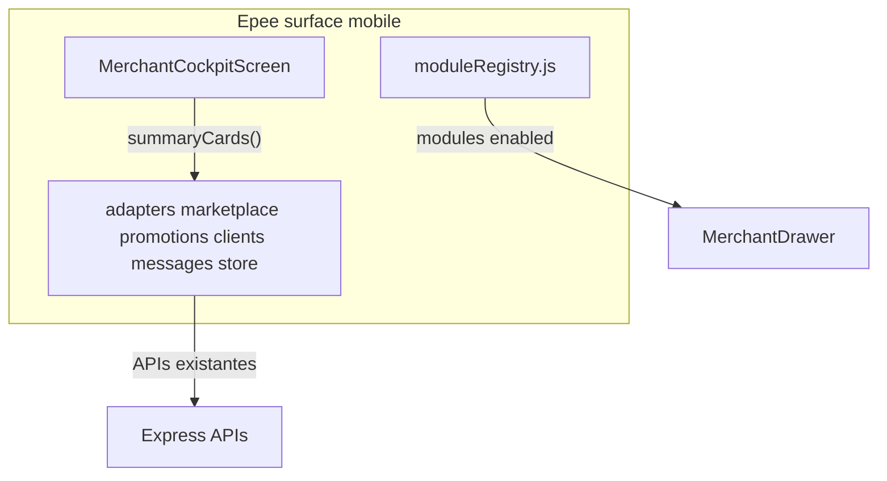

# Plan d'implémentation — Phase 1 · Shell Épée (Merchant Workspace)

**Date :** 15 juillet 2026
**Statut :** Plan à valider avant développement — aucune implémentation dans ce document
**Références :** [ETUDE_BAC_A_SABLE_MAZONE.md](ETUDE_BAC_A_SABLE_MAZONE.md) · [CHANTIER_WORLD_FACTORY_V1.md](CHANTIER_WORLD_FACTORY_V1.md)
**Public :** Architectes Ma Zone — deuxième incrément du Bac à Sable

---

## Objet de ce document

Ce document présente le **plan d'implémentation** de la Phase 1 du Bac à Sable : transformer l'app marchand Expo en **shell Épée** (Cockpit briefing + registre de modules + adaptateurs).

Suite logique de la Phase 0 (World Factory + auth admin, déjà livrée).

**Aucune UI Back Office.** Aucun nouveau moteur métier. Les écrans existants restent ; la navigation et l'accueil deviennent le bureau évolutif du commerçant.

---

## Résumé exécutif

Quand le commerçant ouvre Ma Zone, il doit avoir le sentiment d'**ouvrir son commerce**. Le tableau de bord actuel (4 onglets monolithiques) devient un **Cockpit** qui raconte la journée, priorise les actions, et un **menu hamburger** qui donne accès aux modules déclaratifs.

**Objectif architectural :** poser le terrain pour qu'Event, Marketing, Collaboration et Fidélisation s'y branchent plus tard **sans refactor** du shell.

---

## Philosophie

| Principe | Application Phase 1 |
|----------|---------------------|
| Surface, pas organe | L'Épée compose ; zéro règle métier nouvelle |
| Modularité | Registre de modules Open/Closed |
| Faible couplage | Adaptateurs → APIs existantes |
| Vision Cockpit | Priorités, Vie du commerce + slots préparés (Objectifs, Suggestions, Santé) |
| Pas de sur-ingénierie | Stubs pour l'intelligence future ; pas d'IA aujourd'hui |

---

## Décisions concrètes

1. **Navigation** — remplacer `MerchantTabs` (4 onglets) par un **Drawer + Cockpit** (même pattern que le drawer client).
2. **Cockpit** — cartes de briefing agrégées depuis des adaptateurs, triées par `priority`, plafond ~6 cartes.
3. **Slots futurs** — blocs UI stubs pour Objectifs, Suggestions, Santé (libellés + espace réservé).
4. **Pas de nouvelle API cockpit backend** — les adaptateurs appellent `getMyStore`, `getMerchantOrders`, communication, promos. Un endpoint briefing unifié pourra arriver plus tard sans casser le contrat de carte.

---

## Architecture cible

---

## Contrat de carte (uniforme)

Chaque adaptateur expose `summaryCards(ctx) → BriefingCard[]` :

| Champ | Rôle |
|-------|------|
| `id` | Identifiant stable |
| `engine` | Source (marketplace, promotions…) |
| `section` | `priorities` \| `life` |
| `priority` | Tri (plus petit = plus urgent) |
| `title` | Titre affiché |
| `metric` | Sous-ligne optionnelle |
| `cta` | Libellé d'action |
| `deeplink` | Navigation vers un module / écran |

Sections layout Cockpit aussi : `objectives`, `suggestions`, `health` — **stubs uniquement** en V1.

---

## Modules V1

### Enabled (visibles)

| Famille | Module | Destinations existantes |
|---------|--------|-------------------------|
| **Vendre** | Marketplace | AddProduct, ManageStock, MerchantOrders, CreateStore |
| **Animer** | Promotions | ManagePromotions, CreatePromotion, PromotionDetail |
| **Réseau** | Clients | MesClients |
| **Piloter** | Messages | MerchantInbox (+ support) |
| **Piloter** | Mon commerce | CreateStore / fiche boutique |
| **Piloter** | Statistiques | Écran placeholder (indicateurs basiques si calculables) |

### Declared but disabled (invisibles)

Événements · Collaborations · Fidélisation · Carnet d'adresses — `enabled: false` tant que les moteurs n'existent pas.

---

## Structure du Cockpit

1. **Header** — bonjour + nom boutique + bouton menu (drawer)
2. **Priorités** — cartes `section: 'priorities'`
3. **Vie du commerce** — cartes `section: 'life'` (nuit, commandes reçues…)
4. **Objectifs** — stub (« Bientôt : vos objectifs du jour »)
5. **Suggestions** — stub (« Votre copilote proposera des actions »)
6. **Santé** — stub compact (« État général à venir »)
7. **Accès rapide** — modules enabled (dérivé du registre, pas en dur)

Empty state boutique absente : CTA « Créer ma boutique » (comportement actuel conservé).

---

## Fichiers principaux

### À créer

| Fichier | Rôle |
|---------|------|
| `mobile/src/merchant/moduleRegistry.js` | `defineModule`, familles, entitlements |
| `mobile/src/merchant/adapters/*.js` | marketplace, promotions, clients, messages, store |
| `mobile/src/merchant/briefing.js` | Agrège, trie, plafonne les cartes |
| `mobile/src/screens/merchant/MerchantCockpitScreen.js` | Accueil briefing |
| `mobile/src/components/merchant/MerchantDrawerContent.js` | Menu hamburger |
| `mobile/src/components/merchant/BriefingCard.js` | Carte UI |

### À modifier

| Fichier | Rôle |
|---------|------|
| `mobile/src/navigation/index.js` | `MerchantRoot` = Drawer à la place de `MerchantTabs` |
| `mobile/src/screens/merchant/DashboardScreen.js` | Déprécier / rediriger vers Cockpit |

Les écrans feature sous `screens/merchant/` ne sont **pas réécrits**.

---

## Hors périmètre

| Élément | Pourquoi |
|---------|----------|
| Back Office web / World Factory UI | Phase 2 |
| Event Engine, scan Identity, Collaborations, Fidélité | Moteurs futurs |
| Objectifs réels, suggestions IA, score santé | Slots seulement |
| Endpoint backend briefing unifié | Plus tard |
| Refonte visuelle stock / promos / commandes | Pas dans cet incrément |

---

## Vérifications prévues

- Login commerçant → Cockpit s'affiche ; drawer liste uniquement modules enabled
- Cartes commandes / promos cliquables vers les bons écrans
- Modules disabled absents du menu
- Flux existants (stock, commandes, messagerie) toujours joignables
- Lints propres ; aucune régression client / driver

---

## Phasage Bac à Sable (rappel)

| Phase | Contenu | Statut |
|-------|---------|--------|
| **0** | World Factory + auth admin + `/api/admin` | Livré |
| **1** | Shell Épée (ce plan) | À développer |
| **2** | Back Office web | Plus tard |
| **3+** | Chaque moteur = organe + adaptateur Épée + recette World Factory | Plus tard |

---

## Critère de succès

À la fin de cet incrément, le commerçant ouvre Ma Zone et voit un **bureau** : briefing du matin, priorités, vie du commerce, et un menu de modules extensible. Ajouter demain le module Événements = une entrée dans le registre + un adaptateur — **sans toucher au shell**.
