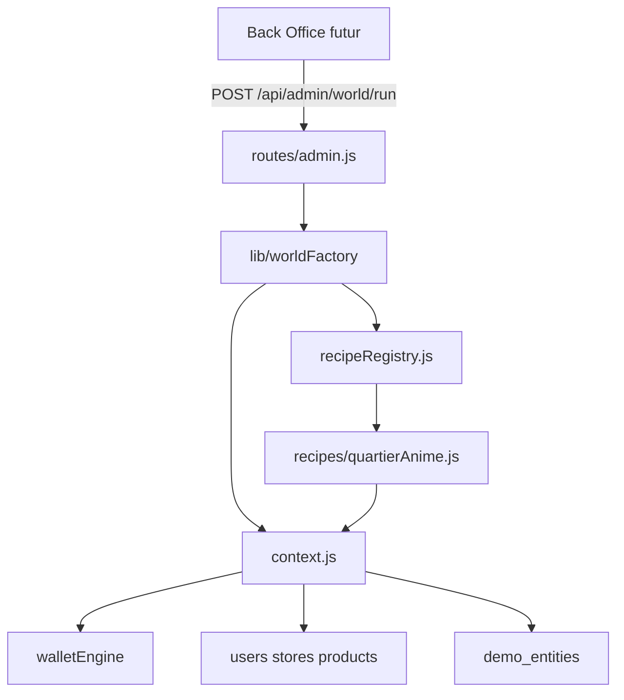

# Plan d'implémentation — Fondations backend du Bac à Sable

**Date :** 15 juillet 2026
**Statut :** Plan à valider avant développement — aucune implémentation dans ce document
**Références :** [ETUDE_BAC_A_SABLE_MAZONE.md](ETUDE_BAC_A_SABLE_MAZONE.md) · Wallet Engine · Identity Engine
**Public :** Architectes Ma Zone — premier incrément du Bac à Sable

---

## Objet de ce document

Ce document présente le **plan d'implémentation** du premier incrément du Bac à Sable : les **fondations backend** (World Factory + auth admin séparée + `/api/admin`).

**Aucune UI.** Tout sera testable en headless. Ce choix (fondations backend d'abord) a été validé explicitement.

Le Bac à Sable fait désormais partie intégrante de l'architecture Ma Zone. Il n'est pas un utilitaire temporaire : c'est l'environnement dans lequel naîtront et seront testés tous les futurs organes.

---

## Résumé exécutif

**Incrément :** construire un moteur capable de peupler un monde de démonstration **sans connaître à l'avance** tous les types de mondes futurs — + une identité admin hors de l'écosystème citoyen.

**Verdict :** architecture miroir des organes déjà validés (registre déclaratif + moteur + provenance auditée), faible couplage, zéro UI, zéro sur-ingénierie des scénarios.

**Débloqué immédiatement après livraison :** démo peuplée, dogfooding des contrats Wallet, terrain pour Event / Marketing / Collaboration.

---

## Philosophie rappelée

Le Bac à Sable ne sert pas uniquement à vérifier que du code fonctionne. Il doit permettre de :

- tester une vision ;
- tester des interactions et parcours ;
- tester des organes et des collaborations ;
- expérimenter de nouveaux concepts sans reconstruire le monde à chaque fois.

Question directrice pour chaque choix technique :

> « Est-ce que cette architecture facilitera le développement des cinq prochaines années ? »

---

## Les trois piliers (inchangés)

| Pilier | Rôle | Dans cet incrément |
|--------|------|-------------------|
| **Back Office** | Outil web de l'équipe Ma Zone | Auth + API admin uniquement (pas d'UI) |
| **Épée** | Bureau du commerçant | Hors périmètre (shell Cockpit = incrément suivant) |
| **World Factory** | Peupler / reset le monde de démo | **Cœur de cet incrément** |

---

## Enrichissement Cockpit (philosophie — pour plus tard)

Validé conceptuellement, **non développé** dans cet incrément. Le shell Épée devra accueillir :

| Notion | Intention |
|--------|-----------|
| **Priorités** | Hiérarchiser les actions (commandes, événements, collaborations…) |
| **Vie du commerce** | Raconter ce qui s'est passé pendant la fermeture |
| **Objectifs** | Emplacement prévu (mensuel / journalier) — sans intelligence aujourd'hui |
| **Suggestions** | Emplacement prévu pour recommandations des moteurs — sans IA aujourd'hui |
| **Santé du commerce** | Synthèse globale — non jugeante |

Ces notions guideront le contrat de cartes du Cockpit lors de l'incrément Épée. Le backend produit ici les **données brutes** (monde peuplé) que ce Cockpit consommera.

---

## Décisions d'architecte (cet incrément)

| Décision | Justification |
|----------|---------------|
| **Admins hors `users` citoyens** | Table `admin_users` + secret JWT distinct. Un admin n'apparaît jamais dans Wallet / Identity / listes clients. |
| **World Factory = moteur générique + recettes pluggables** | Open/Closed : peupler sans connaître les futurs types de mondes. |
| **Provenance via `demo_entities`** | Pas de colonnes polluantes partout. Reset = supprimer par batch. |
| **Orchestration des organes** | Wallet via `walletEngine.issueObject`. Primitives pour users/stores/products (en attendant de vrais organes Catalog/Orders). |

---

## Architecture du moteur

---

## Modèle de données

### `admin_users`

| Colonne | Rôle |
|---------|------|
| `id`, `email`, `password`, `name` | Identité admin |
| `level` | `operator` (défaut) |
| `active` | Soft-disable |

### `demo_batches`

| Colonne | Rôle |
|---------|------|
| `id`, `recipe_id`, `label`, `params` | Une exécution de recette |
| `status` | `active` · `reverted` |

### `demo_entities`

| Colonne | Rôle |
|---------|------|
| `batch_id`, `entity_type`, `entity_id` | Provenance (tout ce que la factory a créé) |

Reset = supprimer les entités du batch (ordre de dépendance inverse) puis marquer le batch `reverted`. Les vrais comptes hors demo restent intacts.

---

## Composants à créer

| Fichier | Rôle |
|---------|------|
| `backend/src/middleware/adminAuth.js` | `verifyAdmin`, `signAdminToken`, secret distinct |
| `backend/scripts/create-admin.js` | Bootstrap premier admin (idempotent) |
| `backend/src/lib/worldFactory/recipeRegistry.js` | `defineRecipe`, list/get, fail-fast |
| `backend/src/lib/worldFactory/context.js` | Primitives auto-taguées (`createCitizen`, `createMerchantWithStore`, `createProduct`, `addFavorite`, `issueWalletObject`, `track`) |
| `backend/src/lib/worldFactory/index.js` | `listRecipes`, `runRecipe`, `listBatches`, `resetBatch`, `resetAllDemo` |
| `backend/src/lib/worldFactory/recipes/quartierAnime.js` | Première recette paramétrable |
| `backend/src/routes/admin.js` | Auth + world endpoints |
| `backend/src/db/index.js` | Tables (modifié) |
| `backend/src/index.js` | Montage `/api/admin` (modifié) |

---

## Routes HTTP

| Méthode | Route | Auth | Rôle |
|---------|-------|------|------|
| `POST` | `/api/admin/auth/login` | Public | Login admin → token admin |
| `GET` | `/api/admin/world/recipes` | `verifyAdmin` | Liste des recettes |
| `POST` | `/api/admin/world/run` | `verifyAdmin` | `{ recipeId, params }` → résumé batch |
| `GET` | `/api/admin/world/batches` | `verifyAdmin` | Batches existants |
| `POST` | `/api/admin/world/reset` | `verifyAdmin` | Reset d'un batch ou de tout le demo |

Un token citoyen sur `/api/admin/*` doit être **rejeté**.

---

## Première recette : `quartier_anime`

Génère un petit quartier réaliste :

- N habitants (paramètre `residents`) ;
- M commerçants avec boutique + produits (paramètre `merchants`) ;
- quelques favoris ;
- objets Wallet peuplés via l'organe (`walletEngine`).

**Sans effets de bord dispatch** dans cette v1 (pas de commandes live). Les commandes / dispatch seront une extension gardée.

---

## Vérifications prévues

| Vérification | Attendu |
|--------------|---------|
| Boot DB + fail-fast registre | OK |
| Login admin | Token admin émis |
| Token citoyen sur route admin | Rejeté |
| `runRecipe('quartier_anime')` | Entités créées + tracées dans `demo_entities` |
| Objets Wallet | Émis via `walletEngine` |
| `resetBatch` | Batch nettoyé, aucun résidu, comptes hors demo intacts |
| Lints | Propres |
| Organes existants | Sans régression |

---

## Hors périmètre de cet incrément

| Élément | Pourquoi |
|---------|----------|
| UI Épée / Cockpit | Incrément suivant (shell + contrat de cartes) |
| UI Back Office web (React/Vite) | Après le socle API |
| Face Administration (gestion users, stats) | Incrément ultérieur |
| Commandes / dispatch dans les recettes | Extension gardée |
| Scénarios complets (au-delà de la génération de données) | Accueillis par le registre, non développés |
| Intelligence Priorités / Suggestions / Santé | Architecture Cockpit plus tard ; pas d'IA aujourd'hui |

---

## Phasage global du Bac à Sable (rappel)

| Phase | Contenu |
|-------|---------|
| **0 (ce plan)** | World Factory + admin + `/api/admin` |
| **1** | Shell Épée (cockpit + registre modules + notions prêtées) |
| **2** | Back Office web (admin + World Factory UI) |
| **3+** | Chaque moteur = organe + adaptateur Épée + recette World Factory |

---

## Critère de succès

À la fin de cet incrément, l'équipe Ma Zone doit pouvoir, depuis un script ou un appel HTTP admin :

1. se authentifier comme admin ;
2. lancer `quartier_anime` ;
3. obtenir une ville peuplée (citoyens, commerces, Wallets) ;
4. resetter proprement le batch ;
5. ajouter demain une nouvelle recette **sans modifier le cœur du moteur**.

C'est le terrain sur lequel Ma Zone pourra continuer à inventer Ma Zone.
